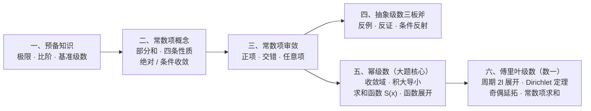

# 无穷级数 MOC

> [!info] 专题导读（考研数学一完整版）
> 本专题按**考研数学一**大纲将**常数项级数**、**幂级数**与**傅里叶级数**整合为单篇完整体系，全解与 25 道闭卷默写题见 [[01_无穷级数大观]]。
> - **选填主攻**：常数项判敛流水线、抽象级数三板斧（12 条反例 + 条件反射）、阿贝尔定理定半径、Dirichlet 定理算间断点/端点值。
> - **大题主攻**：幂级数求收敛域 + 求和函数 $S(x)$（先导后积 / 先积后导 / 微分方程法）+ 常数项级数求和、函数间接展开成幂级数、傅里叶正余弦级数展开。

## 知识结构总览

## 板块导航

| 板块 | 核心内容 | 笔记入口 |
|---|---|---|
| **总览** | 知识地图、数学一考纲要求、选填与解答题命题分布 | [[01_无穷级数大观#总览：考纲定位与知识全景]] |
| **一、预备知识** | 三个重要极限、无穷大/小比阶、四类基准级数（等比 / $p$ / 广义 $p$ / 裂项） | [[01_无穷级数大观#一、预备知识：算力与标尺]] |
| **二、常数项概念** | 收敛定义与反直觉纠偏、四条基本性质、绝对与条件收敛性质 | [[01_无穷级数大观#二、常数项级数的概念与性质]] |
| **三、常数项审敛** | 审敛流水线、正项级数（充要条件 / 比较 / 放缩工具箱 / 比值 / 根值 / 积分）、交错级数（Leibniz / 交错 $p$ / $\sin$ 提号）、任意项级数（泰勒拆分 / Dirichlet·Abel） | [[01_无穷级数大观#三、常数项级数审敛法]] |
| **四、抽象三板斧** | 反例大观（12 条）、反证法与正项转化、条件反射大观 | [[01_无穷级数大观#四、抽象级数三板斧]] |
| **五、幂级数** | 阿贝尔定理、收敛半径与收敛域（含缺项）、分析性质（积大导小）、**七大展开式**、**求和函数 $S(x)$ 四套路**、函数间接展开 | [[01_无穷级数大观#五、幂级数]] |
| **六、傅里叶级数** | 周期 $2l$ 与 $2\pi$ 系数公式、**Dirichlet 收敛定理**、奇偶函数与半幅延拓、数项级数求和 | [[01_无穷级数大观#六、傅里叶级数（数学一）]] |
| **七、速查与易混** | 全章题型选型总表、十组易混概念、考前裸背清单 | [[01_无穷级数大观#七、速查与易混]] |
| **八、默写自测** | 25 道全考点折叠默写题（常数项 12 ＋ 幂级数 9 ＋ 傅里叶 4） | [[01_无穷级数大观#八、公式默写自测（25 题）]] |
| **核心公式卡** | **12 张考前必背公式速查卡** | [[01_无穷级数大观#目录]] |

## 一、常数项级数审敛速查

> [!important] 审敛三步走
> **① 先算 $\lim u_n$**：$\ne0$ $\to$ 直接发散；$=0$ $\to$ 继续。
> **② 看符号分流**：全非负 $\to$ **正项**；正负相间 $\to$ **交错**；符号不规则 $\to$ **任意项**。
> **③ 挑工具**：含 $n!\to$ 比值；含 $n$ 次方 $\to$ 根值；幂次/等价无穷小 $\to$ 比较（极限形式）；单减含 $\ln n\to$ 积分或广义 $p$ 级数；复合交错 $\to$ **泰勒拆分到二次项**。

| 判别法 | 适用长相 | 判据 | 结论 |
|---|---|---|---|
| **必要条件** | 一切级数第一步 | $\lim u_n$ | $\ne0\Rightarrow$ 发散；$=0\Rightarrow$ 不定 |
| **正项充要条件** | $u_n\ge0$ | 部分和 $\{S_n\}$ | 有上界 $\iff$ 收敛 |
| **比较（极限形式）** | 正项，可等价抓大头 | $\lim\frac{u_n}{v_n}=l$ | $0<l<+\infty$ 同敛散；$l=0$ 大收小收；$l=+\infty$ 小散大散 |
| **比值 / 根值** | $n!$ 连乘 / $n$ 次幂 | $\rho=\lim\frac{u_{n+1}}{u_n}$ 或 $\lim\sqrt[n]{u_n}$ | $\rho<1$ 收；$\rho>1$ 发；**$\rho=1$ 失效（退回比较法）** |
| **广义 $p$ 级数** | $\sum\frac{1}{n^p\ln^q n}$ | 先看 $p$，$p=1$ 再看 $q$ | $p>1$ 或 $(p=1,q>1)$ 收敛；其余发散 |
| **Leibniz** | 交错 $\sum(-1)^{n-1}u_n$ | $u_n\downarrow$ 且 $u_n\to0$ | 收敛，余项 $\lvert R_n\rvert\le u_{n+1}$ |
| **泰勒拆分** | $\ln\left(1+\frac{(-1)^n}{n^p}\right)$ 等 | 展到二次项拆成 $v_n+w_n$ | 避免非正项级数等价替换出错 |
| **Dirichlet** | $\sum\frac{\sin nx}{n^p},\ \sum\frac{\cos nx}{n^p}$ | $\sum a_n$ 部分和有界，$b_n\downarrow0$ | $p>1$ 绝收；$0<p\le1$ 条收 |

## 二、抽象级数反例与条件反射速查

- **头号全能反例**：$u_n=\dfrac{(-1)^n}{\sqrt{n}}$（本身条件收敛，但平方 $\sum u_n^2=\sum\frac1n$ 发散，乘积 $\sum u_n v_n$ 发散）。
- **正项级数专属特权**（$u_n\ge0$ 且 $\sum u_n$ 收敛）：① $\sum u_n^2$ 必收敛；② $\sum u_{2n-1},\sum u_{2n}$ 必收敛；③ 若再加 $u_n$ 单减，则必有 $\lim n u_n=0$。
- **平方收敛触发器**：已知 $\sum u_n^2$ 收敛 $\implies$ 立即用均值不等式 $\left\lvert\frac{u_n}{n}\right\rvert\le\frac{u_n^2+1/n^2}{2}$ 推出 $\sum\frac{u_n}{n}$ 绝对收敛。

## 三、幂级数核心速查（解答题必背）

### 1. 七大麦克劳林展开式与收敛域

| 函数 | 展开式 | 收敛域 |
|---|---|---|
| $\dfrac{1}{1-x}$ | $\sum\limits_{n=0}^{\infty}x^n=1+x+x^2+\cdots$ | $(-1,\ 1)$ |
| $\dfrac{1}{1+x}$ | $\sum\limits_{n=0}^{\infty}(-1)^n x^n=1-x+x^2-\cdots$ | $(-1,\ 1)$ |
| $\ln(1+x)$ | $\sum\limits_{n=1}^{\infty}(-1)^{n-1}\dfrac{x^n}{n}=x-\dfrac{x^2}{2}+\dfrac{x^3}{3}-\cdots$ | $(-1,\ 1]$ |
| $\arctan x$ | $\sum\limits_{n=0}^{\infty}(-1)^n\dfrac{x^{2n+1}}{2n+1}=x-\dfrac{x^3}{3}+\dfrac{x^5}{5}-\cdots$ | $[-1,\ 1]$ |
| $e^x$ | $\sum\limits_{n=0}^{\infty}\dfrac{x^n}{n!}=1+x+\dfrac{x^2}{2!}+\cdots$ | $(-\infty,\ +\infty)$ |
| $\sin x$ | $\sum\limits_{n=0}^{\infty}(-1)^n\dfrac{x^{2n+1}}{(2n+1)!}=x-\dfrac{x^3}{3!}+\dfrac{x^5}{5!}-\cdots$ | $(-\infty,\ +\infty)$ |
| $\cos x$ | $\sum\limits_{n=0}^{\infty}(-1)^n\dfrac{x^{2n}}{(2n)!}=1-\dfrac{x^2}{2!}+\dfrac{x^4}{4!}-\cdots$ | $(-\infty,\ +\infty)$ |

### 2. 求和函数 $S(x)$ 四大套路

| 通项特征 | 口诀 | 关键动作与秒杀结果 |
|---|---|---|
| $\sum\dfrac{a_n}{an+b}x^n$ | **分母有 $n$，先导后积** | 配齐幂次 $x^{an+b}\to$ 求导消分母 $\to\int_0^x S'(t)\,\mathrm dt+S(0)$；$\sum_{n=1}^\infty\frac{x^n}{n}=-\ln(1-x)$ |
| $\sum(an+b)x^n$ | **分子有 $n$，先积后导** | 提 $x$ 配 $nx^{n-1}\to$ 积分得 $\frac{x}{1-x}\to$ 求导；$\sum_{n=1}^\infty nx^{n-1}=\frac{1}{(1-x)^2}$ |
| $\sum P(n)x^n$ | **多项式拆阶乘幂** | $n^2x^n=[n(n-1)+n]x^n=x^2(x^n)''+x(x^n)'$ |
| 含递推 / 阶乘跳步 | **求导列微分方程** | 建立 $S'(x),S''(x)$ 与 $S(x)$ 的方程，配合 $S(0)$ 求解 |

## 四、傅里叶级数速查（数学一专属）

- **周期 $2l$ 展开**：$f(x)\sim\dfrac{a_0}{2}+\sum\limits_{n=1}^{\infty}\left(a_n\cos\dfrac{n\pi x}{l}+b_n\sin\dfrac{n\pi x}{l}\right)$，其中 $a_n=\dfrac1l\int_{-l}^l f\cos\dfrac{n\pi x}{l}\,\mathrm dx$，$b_n=\dfrac1l\int_{-l}^l f\sin\dfrac{n\pi x}{l}\,\mathrm dx$。
- **Dirichlet 收敛定理**：连续点 $S(x)=f(x)$；内部间断点 $S(x)=\dfrac{f(x^-)+f(x^+)}{2}$；端点 $S(\pm l)=\dfrac{f(-l^+)+f(l^-)}{2}$。
- **半幅延拓**：
  - 展为**正弦级数** $\iff$ **奇延拓**（$a_n=0$，端点和必为 $S(0)=S(l)=0$）；
  - 展为**余弦级数** $\iff$ **偶延拓**（$b_n=0$，端点和必为 $S(0)=f(0^+),\ S(l)=f(l^-)$）。

## 相关链接

- [[01_无穷级数大观]]（知识点全解与 25 道默写题正文）
- [[138_🌲7.反常积分和无穷级数（待）]]（教材原始笔记）
- [[00_函数极限 MOC]]、[[00_一元积分 MOC]]、[[00_多元微分 MOC]]、[[00_微分方程 MOC]]（同库高数大观系列）
