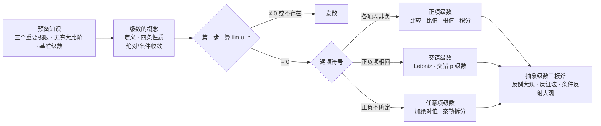
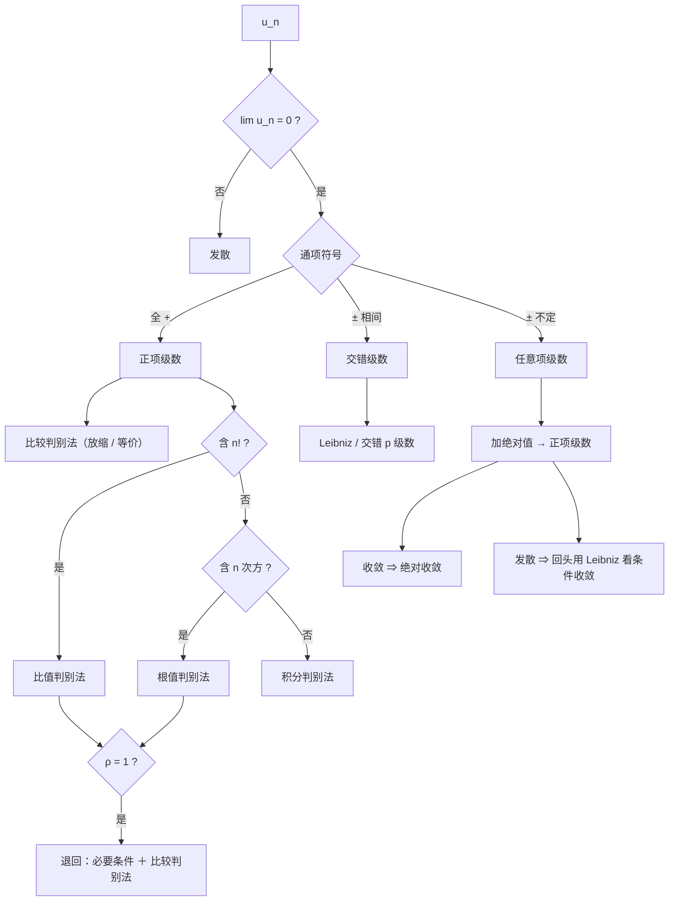
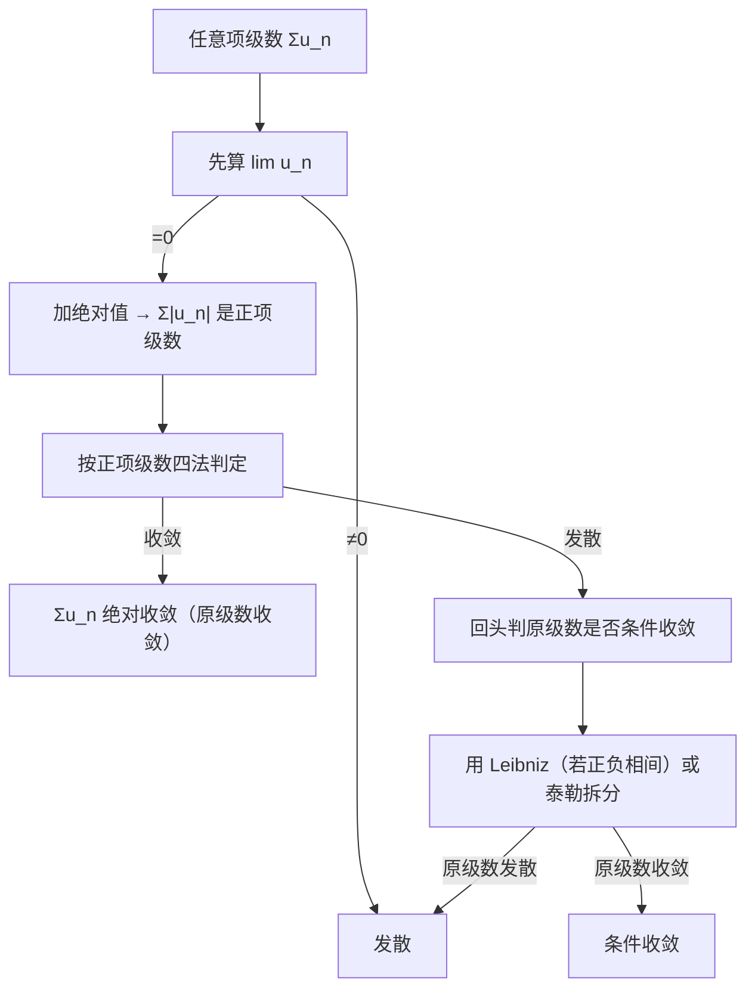

# 无穷级数大观

> [!info] 整理说明
> - 依《【分块】级数知识点（幂级数待更新）.pdf》（**思维导图 ＋ 大纲 ＋ 手写口诀**）整理；索引与速查见 [[无穷级数 MOC]]。
> - 原 PDF 是思维导图，多数节点只有**标题 ＋ 公式碎片**。本笔记按库内规范**扩写为完整全解**：每个判别法给出标准表述（条件与结论）、每条口诀给出对应的数学内容、手写反例补成完整算式。
> - 凡标 **「补充说明」** 处，是按标准考研教材补上的内容，**并非 PDF 逐字转录**。
> - PDF 标题写明「幂级数待更新」，故本文**只含常数项级数**。幂级数（收敛半径与收敛域、幂级数的运算与性质、函数展开成幂级数、求和函数）的清单见 [[#附录：来源中尚未展开的部分]]，待后续单独补齐。
> - 原 PDF 里口语化的「框框」「三个对象」「三句话」「大小关系」「条件反射」「抽象三板斧」等提法**保留为小节标题**（便于与原图对照），并在正文中给出标准数学表述。
> - **本次不配例题**：原 PDF 无题面，例题待题目 PDF 到位后再补入。
> - 公式已逐条数值验算：比值/根值判定的分界、广义 $p$ 级数的分界、反例大观里的每个反例都代回验证过。

> [!info] 阅读约定
> **编号体系**（一路从大到小，不再混用）
> - 一级板块 **一、二、三…**（`##`）；二三级 **X.Y**、**X.Y.Z**（`###` / `####`）；最深一级 **（1）（2）…**（`#####`）。
> - 交叉引用一律写编号，如「见 3.2.2」；正文里的内部链接可直接点击跳转。
>
> **提示框约定**（每类固定一种用途，扫一眼就知道该不该细读）
>
> | 提示框 | 用途 |
> |---|---|
> | `[!important]` **核心公式** | 考前直接翻的必背公式，汇总见 [[#目录]] 下的《核心公式速查》 |
> | `[!summary]` | 口诀、一句话结论 |
> | `[!info]` | 定义与**补充说明**（原 PDF 未给、后来补上的标准内容） |
> | `[!tip]` | 做题技巧、自检办法、直观解释 |
> | `[!warning]` | 易错点、前提条件、雷区 |
> | `[!question]` | 默写自测题（见 [[#六、公式默写自测]]） |
> | `[!abstract]` | 分块速查清单（如 5.3 裸背清单） |
> | `[!failure]` | 反例（见 [[#4.1 第一板斧：级数反例大观]]） |

---

## 目录

**章节速览**

| 板块 | 一句话内容 | 小节数 |
|---|---|---:|
| [[#总览]] | 知识地图 ＋ 三条岔路 | 2 |
| [[#一、预备知识]] | 三个重要极限、无穷大比阶、三组基准级数 | 3 |
| [[#二、级数的概念]] | 定义、四条性质、绝对/条件收敛的定义与性质 | 4 |
| [[#三、级数审敛]] | 审敛流水线 ＋ 正项/交错/任意项三类具体套路 | 21 |
| [[#四、抽象级数三板斧]] | 反例大观、反证法、条件反射大观 | 7 |
| [[#五、速查与易混]] | 选型速查表、易混概念、考前裸背清单 | 3 |
| [[#六、公式默写自测]] | 20 道默写题，题面与答案同页折叠 | 0 |
| [[#附录：来源中尚未展开的部分]] | 幂级数（待更新）等遗留条目 | 0 |
| [[#相关链接]] | 同库其他专题的入口 | 0 |

> [!abstract]- 点开查看全章目录（点击任意条目跳转）
> - [[#目录]]
> - [[#总览]]
>   - [[#0.1 全章知识地图]]
>   - [[#0.2 三条岔路：审敛总流程]]
> - [[#一、预备知识]]
>   - [[#1.1 三个重要极限]]
>   - [[#1.2 无穷大比阶]]
>   - [[#1.3 三组基准级数]]
> - [[#二、级数的概念]]
>   - [[#2.1 定义]]
>   - [[#2.2 四条基本性质]]
>   - [[#2.3 绝对收敛与条件收敛的定义]]
>   - [[#2.4 绝对收敛与条件收敛的性质]]
> - [[#三、级数审敛]]
>   - [[#3.1 审敛流水线（总流程）]]
>   - [[#3.2 正项级数]]
>     - [[#3.2.1 正项级数收敛的充要条件]]
>     - [[#3.2.2 比较判别法（一般形式）]]
>     - [[#3.2.3 比较判别法的极限形式]]
>     - [[#3.2.4 三个对象：放缩的落脚点]]
>     - [[#3.2.5 三句话：放缩的方向感]]
>     - [[#3.2.6 比值判别法]]
>     - [[#3.2.7 根值判别法]]
>     - [[#3.2.8 积分判别法]]
>     - [[#3.2.9 推论：奇偶项子级数]]
>   - [[#3.3 交错级数]]
>     - [[#3.3.1 Leibniz 判别法]]
>     - [[#3.3.2 交错 $p$ 级数]]
>     - [[#3.3.3 用 $\sin$ 创造交错级数]]
>     - [[#3.3.4 有理化]]
>   - [[#3.4 任意项级数]]
>     - [[#3.4.1 具体任意项级数的审敛三步]]
>     - [[#3.4.2 泰勒拆分]]
>     - [[#3.4.3 Dirichlet／Abel 判别法]]
>   - [[#3.5 本章小结与选型]]
> - [[#四、抽象级数三板斧]]
>   - [[#4.1 第一板斧：级数反例大观]]
>   - [[#4.2 第二板斧：反证法]]
>   - [[#4.3 第三板斧：条件反射大观]]
>     - [[#4.3.1 收敛的条件反射]]
>     - [[#4.3.2 发散的条件反射]]
>     - [[#4.3.3 大小关系的条件反射]]
>     - [[#4.3.4 绝对值相加]]
> - [[#五、速查与易混]]
>   - [[#5.1 判别法选型速查表]]
>   - [[#5.2 八组易混概念]]
>   - [[#5.3 考前最终背诵（裸背清单）]]
> - [[#六、公式默写自测]]
> - [[#附录：来源中尚未展开的部分]]
> - [[#相关链接]]

**核心公式速查**

| 名称 | 公式 | 结论 |
|---|---|---|
| 三个重要极限 | $\lim\limits_{n\to\infty}\left(1+\frac1n\right)^n=e$；$\lim\limits_{n\to\infty}\frac{\sqrt[n]{n!}}{n}=\frac1e$；$\lim\limits_{n\to\infty}\sqrt[n]{a}=1\,(a>0)$ | 根值/比值判定的算力来源 |
| 无穷大比阶 | $\ln^{\alpha}n\ll n^{\beta}\ll a^{n}\ll n!\ll n^{n}$ | 判阶数的"标尺" |
| 等比级数 | $\sum\limits_{n=1}^{\infty}q^{n}$ | $\lvert q\rvert<1$ 收敛；$\lvert q\rvert\ge1$ 发散 |
| $p$ 级数 | $\sum\limits_{n=1}^{\infty}\frac{1}{n^{p}}$ | $p>1$ 收敛；$p\le1$ 发散 |
| 广义 $p$ 级数 | $\sum\limits_{n=2}^{\infty}\frac{1}{n^{p}\ln^{q}n}$ | $p>1$ 收敛；$p=1$ 时看 $q>1$ 收敛／$q\le1$ 发散；$p<1$ 发散 |
| 收敛的必要条件 | $\sum u_n$ 收敛 $\Rightarrow \lim\limits_{n\to\infty}u_n=0$ | 逆不成立（$\sum\frac1n$） |
| 比较判别法 | $u_n\le v_n$ | 大收则小收，小散则大散 |
| 比较判别法（极限形式） | $\lim\frac{u_n}{v_n}=l$ | $0<l<+\infty$ 同敛散；$l=0$ 大收则小收；$l=+\infty$ 小散则大散 |
| 比值判别法 | $\rho=\lim\limits_{n\to\infty}\frac{u_{n+1}}{u_n}$ | $\rho<1$ 收；$\rho>1$ 发；$\rho=1$ 不定（含 $n!$ 用） |
| 根值判别法 | $\rho=\lim\limits_{n\to\infty}\sqrt[n]{u_n}$ | $\rho<1$ 收；$\rho>1$ 发；$\rho=1$ 不定（含 $n$ 次方用） |
| 积分判别法 | $\sum\limits_{n=1}^{\infty}f(n)$ 与 $\int_1^{+\infty}f(x)\,\mathrm dx$ | $f$ 非负、连续、单调递减时同敛散 |
| Leibniz 判别法 | $\sum(-1)^{n-1}u_n$，$u_n$ 单减且 $u_n\to0$ | 收敛；余项 $\lvert R_n\rvert\le u_{n+1}$ |
| 交错 $p$ 级数 | $\sum\limits_{n=1}^{\infty}\frac{(-1)^{n-1}}{n^{p}}$ | $p>1$ 绝对收敛；$0<p\le1$ 条件收敛；$p\le0$ 发散 |
| 绝对收敛 ⇒ 收敛 | $\sum\lvert u_n\rvert$ 收敛 $\Rightarrow\sum u_n$ 收敛 | 判"条件收敛"的唯一出口 |

---

## 总览

### 0.1 全章知识地图

三条主线的分工：**「预备知识」提供算力**（根值/比值要算的三个极限、判阶数要用的比阶表），**「级数的概念」提供定义与合法性**（什么时候能加括号、能拆项），**「级数审敛」提供动作**（三条岔路，各自有哪些判别法）。

### 0.2 三条岔路：审敛总流程

拿到一个级数，固定按下面的顺序走，**第一步几乎是免费的**，也是最能省时间的一步：

（1）**先算通项极限** $\lim\limits_{n\to\infty}u_n$。若 $\ne0$（或不存在），**直接判发散**（收敛的必要条件，见 2.2）；若 $=0$，进入下一步。

（2）**看通项的符号**，分成三条岔路：

- **各项均非负 → 正项级数**：比较判别法（一般形式/极限形式）、比值判别法、根值判别法、积分判别法，外加"收敛充要条件"与"奇偶项推论"。见 [[#3.2 正项级数]]。
- **正负项相间 → 交错级数**：Leibniz 判别法、交错 $p$ 级数；若 $\sin$ 结构或根式结构伪装成交错级数，先做恒等变形（3.3.3、3.3.4）。见 [[#3.3 交错级数]]。
- **正负不确定 → 任意项级数**：加绝对值化成正项级数（能收敛就是绝对收敛），或泰勒拆分。见 [[#3.4 任意项级数]]。

（3）**若题干给的是抽象级数**（没有具体通项，只有"设 $u_n>0$""已知 $\sum u_n$ 收敛"这类条件），就走**抽象三板斧**：找反例、反证法、条件反射大观。见 [[#四、抽象级数三板斧]]。

> [!tip] 三条岔路的口诀
> **正项放缩比大小，交错就用 Leibniz，任意项先加绝对值。**
> 加绝对值后若收敛 → 绝对收敛，题目里所有"和""乘积""拆项"的操作都可以放心做；加绝对值后发散 → 原级数最多只能是条件收敛，回头用 Leibniz 定它是收敛还是发散。

---

## 一、预备知识

> [!summary] 这一节干什么
> 三个重要极限是**根值/比值判别法的算力来源**（出现 $\sqrt[n]{\ }$ 或 $n!$ 时就要靠它们收尾）；无穷大比阶是**判阶数的标尺**（比较判别法里"谁大谁小"靠它）；三组基准级数是**放缩的落脚点**（比较判别法最终都要落到它们身上）。
> 三者都只是工具，单独不构成考点，但缺了它们，后面每一步都会卡住。

### 1.1 三个重要极限

> [!important] 三个重要极限（级数版）
> $$
> \text{①}\ \lim_{n\to\infty}\left(1+\frac1n\right)^{n}=e
> \qquad\Bigl(\text{等价形式：}\lim_{x\to0}(1+x)^{\frac1x}=e\Bigr)
> $$
> $$
> \text{②}\ \lim_{n\to\infty}\frac{\sqrt[n]{n!}}{n}=\frac1e
> $$
> $$
> \text{③}\ \lim_{n\to\infty}\sqrt[n]{a}=1\quad(a>0),
> \qquad\text{特例}\quad \lim_{n\to\infty}\sqrt[n]{n}=1
> $$

三个极限各自的来路与用法：

（1）$\lim\limits_{n\to\infty}\left(1+\frac1n\right)^n=e$。这是 $1^{\infty}$ 型的标准极限。凡是通项里出现 $\left(\frac{n+a}{n+b}\right)^{n}$ 这类结构，都是先凑成 $\left(1+\frac{a-b}{n+b}\right)^{n+b}\cdot(\cdots)$ 再用它。

（2）$\lim\limits_{n\to\infty}\dfrac{\sqrt[n]{n!}}{n}=\dfrac1e$。来自 Stirling 公式 $n!\sim\sqrt{2\pi n}\left(\dfrac ne\right)^{n}$。用根值判别法时若通项含 $n!$ 又带 $n$ 次方，收尾就是它。

（3）$\lim\limits_{n\to\infty}\sqrt[n]{a}=1\ (a>0)$。取对数即得：$\sqrt[n]{a}=e^{\frac{\ln a}{n}}\to e^{0}=1$。同理 $\sqrt[n]{n}=e^{\frac{\ln n}{n}}\to e^{0}=1$。

> [!info] 补充说明：③ 的推广（根值判别法里最常用的形式）
> 对**任何**满足 $\lim\limits_{n\to\infty}\dfrac{\ln c_n}{n}=0$ 的正数列 $\{c_n\}$，都有 $\lim\limits_{n\to\infty}\sqrt[n]{c_n}=1$。特别地：
> - $\lim\limits_{n\to\infty}\sqrt[n]{n}=1$（多项式因子不改变 $n$ 次根的极限）
> - $\lim\limits_{n\to\infty}\sqrt[n]{\ln n}=1$
> - $\lim\limits_{n\to\infty}\sqrt[n]{n^{k}}=1$（$k$ 为任意常数）
>
> 一句话：**根值判别法算到只剩"多项式和 $\ln$"时，极限就是 $1$**，此时 $\rho=1$，判别法失效，必须退回比较判别法。

> [!warning] 易错点
> ② 里的分母是 $n$ 而不是 $n$ 的其他幂。$\lim\frac{\sqrt[n]{n!}}{n}=\frac1e$，但 $\lim\sqrt[n]{n!}=+\infty$，两者别混。
> ③ 要求 $a>0$；且 $\lim\sqrt[n]{n!}\ne1$（正是因为这个，含 $n!$ 的题不能用根值判别法直接收尾，要用比值判别法——见 3.2.6）。

### 1.2 无穷大比阶

> [!important] 无穷大比阶（$n\to\infty$）
> $$
> \ln^{\alpha}n\ \ll\ n^{\beta}\ \ll\ a^{n}\ \ll\ n!\ \ll\ n^{n}
> \qquad(\alpha>0,\ \beta>0,\ a>1)
> $$
> 记号 $f\ll g$ 表示 $\lim\limits_{n\to\infty}\dfrac{f(n)}{g(n)}=0$，即"$g$ 比 $f$ 高阶地快"。

**记法**：对数 → 幂 → 指数 → 阶乘 → 双重指数，**从左到右越来越快**。

> [!tip] 取倒数就是"无穷小比阶"
> 把上式整体取倒数，得到由慢到快（趋于 $0$ 由慢到快）的序列：
> $$
> \frac{1}{n^{n}}\ \ll\ \frac{1}{n!}\ \ll\ a^{-n}\ \ll\ \frac{1}{n^{\beta}}\ \ll\ \frac{1}{\ln^{\alpha}n}
> $$
> 这条在**比较判别法**里最常用：看到 $\frac{1}{n^{\beta}}$ 与 $\frac{1}{\ln^{\alpha}n}$ 混在一起，就知道谁是"大的"、谁是"小的"。

> [!info] 补充说明：这条链怎么用
> （1）**判阶数**：比较判别法的极限形式要求"同阶"，比阶表告诉你该拿谁去比。例如 $\sum\frac{1}{n^{1.01}}$ 收敛，而 $\sum\frac{1}{n\ln n}$ 发散——虽然都"比 $\frac1n$ 小一点"，但 $\frac{1}{n\ln n}\gg\frac{1}{n^{1.01}}$ 属于不同阶。
> （2）**验证必要条件**：$\frac{n^{100}}{n!}\to0$ 就是由 $n!\gg n^\beta$（任意 $\beta$）得到的。
> （3）**注意 $\beta$ 任意**：$n^{\beta}\ll a^n$ 对任意大的 $\beta$ 都成立，所以 $\sum\frac{n^{100}}{2^{n}}$ 一定收敛。

### 1.3 三组基准级数

> [!info] 补充说明：本节内容原 PDF 未单列，是从「三个对象」（3.2.4）前移来的完整表述
> 原 PDF 把这三组级数放在「比较判别法 → 三个对象」里，作为放缩的**落脚点**。这里先给出完整表述，做比较判别法时随时回查。

（1）**等比级数**
$$
\sum_{n=1}^{\infty}q^{n}=
\begin{cases}
\text{收敛，且}\ \sum\limits_{n=1}^{\infty}q^{n}=\dfrac{q}{1-q}, & \lvert q\rvert<1,\\[8pt]
\text{发散}, & \lvert q\rvert\ge1 .
\end{cases}
$$
（从 $n=0$ 起编号时，和为 $\frac{1}{1-q}$。$q=1$ 时通项恒为 $1$，$q=-1$ 时通项为 $\pm1$，都不趋 $0$，故发散。）

（2）**$p$ 级数**
$$
\sum_{n=1}^{\infty}\frac{1}{n^{p}}=
\begin{cases}
\text{收敛}, & p>1,\\[4pt]
\text{发散}, & p\le1 .
\end{cases}
$$
特别地 $p=1$ 时是**调和级数** $\sum\limits_{n=1}^{\infty}\frac1n$，**发散**——这是"通项趋 $0$ 但级数发散"的头号反例。

（3）**广义 $p$ 级数**（含对数因子）
$$
\sum_{n=2}^{\infty}\frac{1}{n^{p}\ln^{q}n}=
\begin{cases}
\text{收敛}, & p>1,\\[4pt]
\text{收敛}, & p=1\ \text{且}\ q>1,\\[4pt]
\text{发散}, & p=1\ \text{且}\ q\le1,\\[4pt]
\text{发散}, & p<1 .
\end{cases}
$$

> [!tip] 记忆法：$p$ 级数看一次项的指数，广义 $p$ 级数"先看 $p$，$p=1$ 时再看 $q$"
> $p>1$ 时对数因子完全不起作用（$n^{p}$ 已经把 $\ln^{q}n$ 压死）；$p<1$ 时也一样（$n^{p}$ 太弱，救不回来）；**只有 $p=1$ 这个临界点上，对数因子才成为决定性的**——此时把 $\sum\frac{1}{n\ln^{q}n}$ 用积分判别法（3.2.8）一算即得。
>
> 特例：$\sum\limits_{n=2}^{\infty}\frac{1}{n\ln n}$ 发散（$p=1,q=1$），$\sum\limits_{n=2}^{\infty}\frac{1}{n\ln^{2}n}$ 收敛（$p=1,q=2$）。

> [!warning] 三组基准级数的边界都是"闭的一侧发散"
> 等比：$\lvert q\rvert=1$ 发散；$p$ 级数：$p=1$ 发散；广义 $p$ 级数：$p=1,q=1$ 发散。**临界点全部落在发散一侧**，考试里最爱考这几个临界点。

---

## 二、级数的概念

### 2.1 定义

> [!info] 级数与部分和
> 给定数列 $\{u_n\}$，形式写出
> $$
> \sum_{n=1}^{\infty}u_n=u_1+u_2+\cdots+u_n+\cdots
> $$
> 称为**无穷级数**（简称**级数**），$u_n$ 称为**通项**（一般项）。
> 作**部分和**
> $$
> S_n=u_1+u_2+\cdots+u_n=\sum_{k=1}^{n}u_k ,
> $$
> 得到**部分和数列** $\{S_n\}$。若 $\lim\limits_{n\to\infty}S_n=S$ 存在（有限），则称级数**收敛**，$S$ 称为级数的**和**，记 $\sum\limits_{n=1}^{\infty}u_n=S$；否则称级数**发散**。

> [!tip] 级数 ＝ 数列的"无穷叠加"，落脚点永远是 $\{S_n\}$
> 一切关于级数的定义、性质、判别法，本质上都在研究 $\{S_n\}$ 的极限与单调有界性。正项级数的"充要条件"（3.2.1）就是这一句话的直接产物。

### 2.2 四条基本性质

> [!important] 级数的四条基本性质
> **① 线性（加减法）**
> - 收敛 ＋ 收敛 ＝ 收敛；且 $\sum(\alpha u_n+\beta v_n)=\alpha\sum u_n+\beta\sum v_n$。
> - 收敛 ＋ 发散 ＝ **发散**。
> - 发散 ＋ 发散 ＝ **不一定**。**但若两个级数都是正项级数，则发散 ＋ 发散 ＝ 发散**。
>
> **② 增减有限项不改变敛散性**
> 改变、增加或删去级数的**有限项**，不改变级数的敛散性（但收敛时和会变）。
>
> **③ 加括号提升收敛性，加绝对值降低收敛性**
> - 收敛级数**加括号后仍收敛**，且和不变。
> - 但**加括号后收敛，原级数不一定收敛**。
> - 加绝对值（即 $\sum u_n\to\sum\lvert u_n\rvert$）方向相反：把条件变苛刻。
>
> **④ 级数收敛的必要条件**
> $$
> \sum_{n=1}^{\infty}u_n\ \text{收敛}\ \Longrightarrow\ \lim_{n\to\infty}u_n=0 .
> $$
> 逆命题**不成立**：$\sum\frac1n$ 的通项趋于 $0$，但级数发散。

> [!info] 补充说明：每条性质为什么成立、怎么用
> **① 的关键是"发散＋发散不定"。** 反例：$\sum\frac1n$ 与 $\sum\left(-\frac1n\right)$ 都发散，但逐项相加后每项为 $0$，级数收敛于 $0$。**这就是"不能用减法抵消发散"的出处**——抽象题里想把两个发散级数相减来论证什么，一定错。
>
> **① 中"正项 ＋ 正项"为什么发散＋发散＝发散？** 设 $\sum u_n,\sum v_n$ 为正项级数。若 $\sum(u_n+v_n)$ 收敛，则由 $0\le u_n\le u_n+v_n$ 与比较判别法，$\sum u_n$ 收敛，矛盾。故 $\sum(u_n+v_n)$ 必发散。
>
> **② 的作用是"只看尾巴"。** 所以比较判别法、积分判别法里都写"存在 $N$，当 $n>N$ 时……"——前面的有限项一律不管。
>
> **③ 的两个方向要分清**：
> - 加括号**不会**把一个收敛级数变成发散（收敛性只能被"提升"）。反例：$\sum(-1)^{n-1}=1-1+1-1+\cdots$ 发散，但加括号成 $(1-1)+(1-1)+\cdots=0+0+\cdots$ 收敛于 $0$。
> - 加绝对值**不会**把一个发散级数变成收敛（收敛性只能被"降低"）。反例：$\sum\frac{(-1)^{n-1}}{n}$ 收敛，但 $\sum\frac1n$ 发散。
> - 结论：**$\sum u_n$ 收敛 $\Rightarrow$ 任意加括号后收敛**；反之不然。
>
> **④ 是考场上的"第一刀"**。算 $\lim u_n$ 几乎是免费的，一旦算出来 $\ne0$，整题一步结束。配合 4.3.2 的条件反射使用。

> [!warning] 三个高频错误
> （1）"$\sum u_n$ 收敛 $\Rightarrow\sum u_n^2$ 收敛"——**错**。反例：$u_n=\frac{(-1)^{n}}{\sqrt n}$，$\sum u_n$ 收敛而 $\sum u_n^2=\sum\frac1n$ 发散。
> （2）"$\sum u_n,\sum v_n$ 都收敛 $\Rightarrow\sum u_nv_n$ 收敛"——**错**（无条件时不成立）。反例同上，取 $v_n=u_n$ 得 $\sum u_nv_n=\sum\frac1n$ 发散。
> （3）"$\lim u_n=0\Rightarrow\sum u_n$ 收敛"——**错**，调和级数。
> 若加上"$u_n$ 非负"，则（1）成立（见 [[#4.1 第一板斧：级数反例大观]] 的对照表）。

### 2.3 绝对收敛与条件收敛的定义

> [!important] 绝对收敛与条件收敛
> 设 $\sum\limits_{n=1}^{\infty}u_n$ 为任意项级数。
> - 若 $\sum\limits_{n=1}^{\infty}\lvert u_n\rvert$ **收敛**，则称 $\sum\limits_{n=1}^{\infty}u_n$ **绝对收敛**；
> - 若 $\sum\limits_{n=1}^{\infty}u_n$ **收敛**，但 $\sum\limits_{n=1}^{\infty}\lvert u_n\rvert$ **发散**，则称 $\sum\limits_{n=1}^{\infty}u_n$ **条件收敛**。

> [!summary] 两个定义的分工（原 PDF 原文）
> - **绝对收敛**：级数加绝对值后收敛。
> - **条件收敛**：级数收敛，但级数加绝对值发散。

> [!tip] 判定顺序（考场动作）
> 判"绝对 / 条件"永远只走两步：
> **第一步：加绝对值，按正项级数（第三章）判 $\sum\lvert u_n\rvert$。** 收敛 → 绝对收敛，结束。
> **第二步：$\sum\lvert u_n\rvert$ 发散时，才回头用 Leibniz（3.3.1）判原级数。** 原级数收敛 → 条件收敛；原级数发散 → 发散。
> 千万不要一上来就用 Leibniz：Leibniz 只能给出"收敛"，给不出"绝对收敛"，用它判完还得再走一遍第一步。

### 2.4 绝对收敛与条件收敛的性质

> [!important] 绝对收敛与条件收敛的性质（四条）
> 设 $\sum u_n,\sum v_n$ 均为级数。
>
> **（1）绝对收敛的级数本身一定收敛**
> $$
> \sum_{n=1}^{\infty}\lvert u_n\rvert\ \text{收敛}\ \Longrightarrow\ \sum_{n=1}^{\infty}u_n\ \text{收敛}.
> $$
>
> **（2）拆成"正部"和"负部"**
> $$
> \text{若}\ \sum_{n=1}^{\infty}\lvert u_n\rvert\ \text{收敛},\ \text{则}\
> \sum_{n=1}^{\infty}\frac{u_n+\lvert u_n\rvert}{2}
> \ \text{与}\
> \sum_{n=1}^{\infty}\frac{u_n-\lvert u_n\rvert}{2}
> \ \text{均收敛}; $$
> $$
> \text{若}\ \sum_{n=1}^{\infty}u_n\ \text{条件收敛},\ \text{则}\
> \sum_{n=1}^{\infty}\frac{u_n+\lvert u_n\rvert}{2}
> \ \text{与}\
> \sum_{n=1}^{\infty}\frac{u_n-\lvert u_n\rvert}{2}
> \ \text{均发散}.
> $$
> （$\frac{u_n+\lvert u_n\rvert}{2}$ 是"正部"，只保留 $u_n$ 的正项；$\frac{u_n-\lvert u_n\rvert}{2}$ 是"负部"，只保留负项。）
>
> **（3）加减法的三条结论**
> - 若 $\sum u_n,\sum v_n$ 都绝对收敛，则 $\sum(u_n+v_n)$ **绝对收敛**；
> - 若 $\sum u_n$ 绝对收敛、$\sum v_n$ 条件收敛，则 $\sum(u_n+v_n)$ **条件收敛**；
> - 若 $\sum u_n,\sum v_n$ 都条件收敛，则 $\sum(u_n+v_n)$ **可能绝对收敛，也可能条件收敛**。
>
> **（4）绝对 × 收敛 ＝ 绝对**
> $$
> \text{若}\ \sum_{n=1}^{\infty}u_n\ \text{绝对收敛},\
> \sum_{n=1}^{\infty}v_n\ \text{收敛},\
> \text{则}\ \sum_{n=1}^{\infty}u_nv_n\ \text{绝对收敛}.
> $$

> [!summary] 口诀（原 PDF 手写）
> - 🔺 **绝对收敛的级数所有正项或负项组成的级数均收敛**（性质 2 的前半）
> - 🔺 **条件收敛的级数所有正项或负项组成的级数均发散**（性质 2 的后半）
> - 🔺 **绝对 ± 绝对 ＝ 绝对**
> - 🔺 **绝对 ± 条件 ＝ 条件**
> - 🔺 **条件 ± 条件 ＝ 收敛**（至于是绝对还是条件，要具体看）

> [!info] 补充说明：为什么是这样
> **（1）的证明**（用 Cauchy 收敛准则最干净）：记 $T_n=\sum_{k=1}^{n}\lvert u_k\rvert$ 收敛。对任意 $p$，
> $$\Bigl\lvert\sum_{k=n+1}^{n+p}u_k\Bigr\rvert\le\sum_{k=n+1}^{n+p}\lvert u_k\rvert=\lvert T_{n+p}-T_n\rvert\to0,$$
> 故 $\sum u_n$ 满足 Cauchy 准则，收敛。**这就是"绝对收敛比收敛更强"的含义：可以无条件用三角不等式。**
>
> **（2）的证明思路**：注意 $\frac{u_n+\lvert u_n\rvert}{2}$ 与 $\frac{u_n-\lvert u_n\rvert}{2}$ 都 $\ge0$ 且都 $\le\lvert u_n\rvert$，由比较判别法在 $\sum\lvert u_n\rvert$ 收敛时均收敛。反过来，若 $\sum u_n$ 条件收敛而正部收敛，则负部 ＝ 正部 － $u_n$ 也收敛，于是 $\sum\lvert u_n\rvert$ ＝ 正部 ＋ 负部收敛，矛盾。**所以条件收敛的级数，正项和负项各自都是发散的**——这正是"条件"二字的来源：它的收敛完全依赖正负项之间的**抵消**。
>
> **（3）第三条为什么"不一定"？** 两个条件收敛级数加起来，正负抵消可能"刚好"抵得只剩绝对收敛的部分。例如 $u_n=\frac{(-1)^{n-1}}{n}$ 条件收敛，取 $v_n=-u_n$，则 $\sum(u_n+v_n)=\sum0$ 绝对收敛；而取 $v_n=\frac{(-1)^{n-1}}{\sqrt n}$（条件收敛），则 $\sum(u_n+v_n)$ 仍条件收敛（$\lvert u_n+v_n\rvert\ge\frac{1}{\sqrt n}-\frac1n$ 的量级仍是 $\frac{1}{\sqrt n}$，发散）。**具体题要具体估阶，不能套"条件＋条件＝条件"。**
>
> **（4）的证明**：$\lvert u_nv_n\rvert\le M\lvert u_n\rvert$（$M$ 为 $\{v_n\}$ 的上界，由 $\sum v_n$ 收敛得 $v_n\to0$ 故有界），再由比较判别法。

> [!warning] 性质（1）的逆用：判"发散"第二刀
> $\sum\lvert u_n\rvert$ 发散时**不能**说 $\sum u_n$ 发散（反例：$\sum\frac{(-1)^{n-1}}{n}$）。但由性质（1）取逆否命题：
> $$
> \sum u_n\ \text{发散}\ \Longrightarrow\ \sum\lvert u_n\rvert\ \text{发散}.
> $$
> 这就是原 PDF「条件反射大观 · 发散」里的第一条：**级数发散 ⇒ 绝对值也发散**（见 4.3.2）。方向别记反。

---

## 三、级数审敛

### 3.1 审敛流水线（总流程）

> [!important] 审敛流水线 ⭐⭐⭐（原 PDF 红框标注，最优先背）
> **第一步：先算 $\lim\limits_{n\to\infty}u_n$。**
> - $\ne0$ 或不存在 → **发散**，结束。
> - $=0$ → 往下走（注意：这一步**只能证发散，不能证收敛**）。
>
> **第二步：看通项符号，三条岔路。**
> - 各项均非负 → [[#3.2 正项级数|正项级数]]：比较（放缩或等价）、比值、根值、积分。
> - 正负项相间 → [[#3.3 交错级数|交错级数]]：Leibniz，或先化为交错 $p$ 级数。
> - 正负不确定 → [[#3.4 任意项级数|任意项级数]]：先加绝对值化成正项级数。
>
> **第三步：正项级数内部再分流（按通项长相挑工具）。**
> - 含 $n!$ 或连乘结构 → **比值判别法**；若算出 $\rho=1$，退回"必要条件 ＋ 比较判别法"。
> - 含 $n$ 次方（$\sqrt[n]{\ }$、$(\ \cdot\ )^{n}$）→ **根值判别法**；若算出 $\rho=1$，同样退回。
> - 通项是 $n$ 的幂／幂的倒数、或可放缩成这类 → **比较判别法**（等价替换走极限形式）。
> - 通项是 $f(n)$ 且 $f$ 非负、连续、单调递减 → **积分判别法**。

流程图（与原 PDF 手写图对应）：

> [!tip] 流水线的使用要点
> （1）**第一步不能跳**。绝大多数"看着很难"的题，通项极限一算就结束了。
> （2）**比值/根值算出 $\rho=1$ 是"没算出来"而不是"收敛"**。这是最常见的失分点，此时唯一出路是比较判别法（或退到必要条件判发散）。
> （3）**正项级数才可以用比较/比值/根值/积分**。交错级数、任意项级数必须先加绝对值化成正项，或直接上 Leibniz——**绝不能对非正项级数用比值/根值判别法**。
> （4）四个判别法的分工可以记成一句话：**比值管阶乘，根值管 $n$ 次方，比较管幂，积分管单调 $f(n)$**。

### 3.2 正项级数

> [!info] 正项级数的定义
> 若 $u_n\ge0\ (n=1,2,\cdots)$，则称 $\sum\limits_{n=1}^{\infty}u_n$ 为**正项级数**（"各项均非负"）。
> 正项级数是整个级数理论里最"好判"的一类：因为部分和数列 $\{S_n\}$ **单调不减**，所以"收敛"与"有界"是同一件事。

#### 3.2.1 正项级数收敛的充要条件

> [!important] 充要条件
> 设 $\sum\limits_{n=1}^{\infty}u_n$ 为正项级数，则
> $$
> \sum_{n=1}^{\infty}u_n\ \text{收敛}
> \ \Longleftrightarrow\
> \sum_{n=1}^{\infty}u_n\ \text{的前}\ n\ \text{项和数列}\ \{S_n\}\ \text{有界}.
> $$

> [!info] 补充说明：为什么，以及它有什么用
> **为什么**：正项级数有 $S_{n+1}=S_n+u_{n+1}\ge S_n$，即 $\{S_n\}$ **先天地单调不减**。而"单调有界数列必收敛"（单调有界准则），所以在正项级数里，"$\{S_n\}$ 有上界"与"$\lim S_n$ 存在"完全等价。
>
> **有什么用**：这是**唯一一个"不分析通项长相"的判据**，也是所有正项级数判别法的**共同源头**——比较判别法、积分判别法、比值判别法都是它的推论：
> - 要证 $\sum u_n$ 收敛，只需找一个上界 $M$ 使 $S_n\le M$；
> - 比较判别法干的正是这件事：$u_n\le v_n$ 且 $\sum v_n$ 收敛（其部分和有界）$\Rightarrow$ $\{S_n\}$ 有界；
> - 抽象题里"已知 $\{S_n\}$ 有界"就是"已知 $\sum u_n$ 收敛"的同义句。

#### 3.2.2 比较判别法（一般形式）

> [!important] 比较判别法（一般形式 ＝ 放缩）
> 设 $\sum\limits_{n=1}^{\infty}u_n$、$\sum\limits_{n=1}^{\infty}v_n$ 均为**正项**级数，且存在 $N>0$，当 $n>N$ 时恒有
> $$
> u_n\le v_n ,
> $$
> 则
> - **大收则小收**：若 $\sum\limits_{n=1}^{\infty}v_n$ 收敛，则 $\sum\limits_{n=1}^{\infty}u_n$ 收敛；
> - **小散则大散**：若 $\sum\limits_{n=1}^{\infty}u_n$ 发散，则 $\sum\limits_{n=1}^{\infty}v_n$ 发散。

> [!summary] 三条识别口诀（原 PDF 原文）
> - **只关心 $n$ 足够大的时候**（前有限项不改变敛散性，见 2.2 性质 ②）。
> - **放缩或等价**——一般形式用放缩，极限形式（3.2.3）用等价。
> - **三个对象三句话**——放缩的落脚点是"三个对象"（3.2.4），方向感靠"三句话"（3.2.5）。

放缩工具箱（原 PDF 的四张卡片）：

##### （1）函数不等式

> [!important] 常用函数不等式
> $$
> \text{①}\ x>\sin x\quad(x>0);
> \qquad
> \text{②}\ e^{x}>1+x\quad(x\ne0);
> $$
> $$
> \text{③}\ \frac{x}{1+x}<\ln(1+x)<x\quad(x>-1,\ x\ne0).
> $$

来源与用法：

- ① 是 $\sin x<x<\tan x\ \left(0<x<\frac{\pi}{2}\right)$ 的一半，由来是 $f(x)=x-\sin x$ 单调递增且 $f(0)=0$。**用在"$\sin$ 出现在分子"的题**：$\frac{\sin\frac1n}{n}<\frac{1}{n^{2}}$ 之类。
- ② 是 $e^x$ 在 $0$ 处的切线不等式（$e^x\ge1+x$，等号仅 $x=0$）。**用在"$e$ 的幂"**：$e^{1/n}-1>\frac1n$。
- ③ 左右两侧都要记：$\ln(1+x)<x$ 是常用上界，$\frac{x}{1+x}<\ln(1+x)$ 用于**估下界**（判发散时把 $\ln$ 缩小）。由 ③ 立得 $\frac{1}{\ln(1+\frac1n)}>n$ 这类结构。

##### （2）基本不等式

> [!important] 基本不等式
> $$
> \lvert ab\rvert\le\frac{a^{2}+b^{2}}{2}\qquad(a,b\in\mathbb R).
> $$
> 推广：算术—几何平均不等式 $a+b\ge2\sqrt{ab}\ (a,b>0)$，以及 $\sqrt{ab}\le\frac{a+b}{2}$。

用法：**把乘积放缩成平方和**。典型场景是通项里出现 $a_n b_n$ 而题目只给 $\sum a_n^{2}$、$\sum b_n^{2}$ 收敛的信息——由 $\lvert a_nb_n\rvert\le\frac{a_n^{2}+b_n^{2}}{2}$，两个平方和级数收敛即推出 $\sum\lvert a_nb_n\rvert$ 收敛。

##### （3）分数放缩

> [!summary] 分数放缩
> **分母越小，分数就越大；分子越小，分数就越小。**
> - 要证**收敛**（需要放大）：**放小分母**或**放大分子**；
> - 要证**发散**（需要缩小）：**放大分母**或**缩小分子**。

> [!info] 补充说明：最常用的一种分数放缩是"裂项"
> 把分母从 $n^{2}$ 缩小到 $n(n-1)$（$n\ge2$）：
> $$
> \frac{1}{n^{2}}<\frac{1}{n(n-1)}=\frac{1}{n-1}-\frac{1}{n},
> $$
> 右边可**裂项求和**，$S_n<1-\frac1n<1$ 有界，于是 $\sum\frac{1}{n^{2}}$ 收敛。这条也顺带给出了 $p$ 级数 $p=2$ 的收敛性证明。
> 反向（要证发散时）常配合：$\frac{1}{n}>\ln\left(1+\frac1n\right)=\ln\frac{n+1}{n}$，求和得 $S_n>\ln(n+1)\to+\infty$，即调和级数发散。

##### （4）$\sin$、$\cos$ 的绝对值／平方

> [!summary] $\sin$、$\cos$ 的绝对值与平方
> $$
> \lvert\sin\square\rvert\le1,\qquad \lvert\cos\square\rvert\le1,\qquad \sin^{2}\square\le1,\qquad \cos^{2}\square\le1 .
> $$
> （原 PDF 记为"**框框 $\le1$**"——方框里可以是任何式子。）

用法：**把振荡因子直接扔掉**。例如 $\sum\frac{\lvert\sin n\rvert}{n^{2}}\le\sum\frac{1}{n^{2}}$ 收敛；$\sum\frac{\sin^{2}n}{n}$ 与 $\sum\frac{1}{n}$ 同阶发散。注意 $|\sin |$ 与 $\sin^2$ 都**不趋 $0$**，所以它们不能"帮忙"收敛，只能"不添乱"（判收敛时当 $1$ 用），也不能"冒充"小量。

#### 3.2.3 比较判别法的极限形式

> [!important] 比较判别法（极限形式 ＝ 等价）
> 设 $\sum\limits_{n=1}^{\infty}u_n$、$\sum\limits_{n=1}^{\infty}v_n$ 均为正项级数（$v_n\ne0$），且
> $$
> \lim_{n\to\infty}\frac{u_n}{v_n}=l ,
> $$
> 则
> - 若 $0<l<+\infty$：$\sum u_n$ 与 $\sum v_n$ **敛散性相同**（同阶同敛散）；
> - 若 $l=0$：且 $\sum v_n$ 收敛 $\Rightarrow\sum u_n$ 收敛（$\sum u_n$ 是 $\sum v_n$ 的高阶无穷小，大收则小收）；
> - 若 $l=+\infty$：且 $\sum v_n$ 发散 $\Rightarrow\sum u_n$ 发散（小散则大散）。

> [!tip] 实际操作：用等价无穷小替换就得到 $l=1$
> 做题时不需要真去求极限，直接对通项做 $n\to\infty$ 的等价替换即可。常用替换（$n\to\infty$）：
> $$
> \sin\frac1n\sim\frac1n,\quad
> \tan\frac1n\sim\frac1n,\quad
> \ln\left(1+\frac1n\right)\sim\frac1n,\quad
> e^{\frac1n}-1\sim\frac1n,
> $$
> $$
> 1-\cos\frac1n\sim\frac{1}{2n^{2}},\quad
> \left(1+\frac1n\right)^{\!a}-1\sim\frac an,\quad
> \sqrt[n]{a}-1\sim\frac{\ln a}{n},\quad
> \arctan\frac1n\sim\frac1n .
> $$
> **替换后通项与哪个"对象"（3.2.4）同阶，就判它与那个对象同敛散。**

> [!warning] 两条铁律
> （1）**只能替换成"同阶"的基准级数通项**，替换的目的就是**认出它是 $p$ 级数还是等比级数**。替换完还剩一堆因子就说明没替换干净。
> （2）**"同阶同敛散"要求 $0<l<+\infty$**。若 $\frac{u_n}{v_n}\to0$，只能说"$\sum u_n$ 比 $\sum v_n$ 收敛得更快"，不能反过来说 $\sum v_n$ 发散时 $\sum u_n$ 也发散。方向搞错是这一节最常见的错误。

#### 3.2.4 三个对象：放缩的落脚点

> [!important] 三个对象（一切比较判别法的"靶子"）
> $$
> \text{（1）等比级数}\quad \sum_{n=1}^{\infty}q^{n}:\quad
> \begin{cases}\text{收敛}, & \lvert q\rvert<1,\\[2pt] \text{发散}, & \lvert q\rvert\ge1 ;\end{cases}
> $$
> $$
> \text{（2）}p\ \text{级数}\quad \sum_{n=1}^{\infty}\frac{1}{n^{p}}:\quad
> \begin{cases}\text{收敛}, & p>1,\\[2pt] \text{发散}, & p\le1 ;\end{cases}
> $$
> $$
> \text{（3）广义}\ p\ \text{级数}\quad \sum_{n=2}^{\infty}\frac{1}{n^{p}\ln^{q}n}:\quad
> \begin{cases}\text{收敛}, & p>1,\\[2pt] \text{收敛}, & p=1,\ q>1,\\[2pt] \text{发散}, & p=1,\ q\le1,\\[2pt] \text{发散}, & p<1 .\end{cases}
> $$

> [!summary] 记忆三句话
> **等比看 $\lvert q\rvert$ 与 $1$；$p$ 级数看 $p$ 与 $1$；广义 $p$ 级数先看 $p$ 与 $1$，$p=1$ 时再看 $q$ 与 $1$。** 三个临界值全都是 $1$，且全都是"取等号时发散"。

> [!info] 补充说明：为什么只要这三个对象
> 因为考研题里出现的通项，等价替换后几乎总会落到 $\frac{1}{n^{p}}$、$\frac{1}{n^{p}\ln^{q}n}$ 或 $q^{n}$ 三者之一。**比较判别法的全部工作就是"把通项改造成这三个对象中的一个，同时记住不等号方向"**：
> - 要证收敛 → 放大成**收敛的对象**（如 $\frac{1}{n^{1.1}}$、$\left(\frac12\right)^{n}$）；
> - 要证发散 → 缩小成**发散的对象**（如 $\frac1n$、$\frac{1}{n\ln n}$、$1$）。
> 若替换后得到的是 $\frac{1}{n}$ 与 $\frac{1}{n^{2}}$ 之间"夹住"的量（如 $\frac{1}{n^{1}}$ 乘 $\ln$ 因子），就必须用广义 $p$ 级数或积分判别法定夺。

#### 3.2.5 三句话：放缩的方向感

> [!important] 三句话
> $$
> \text{① 同阶同敛散}\qquad
> \text{② 大收则小收}\qquad
> \text{③ 小散则大散}
> $$

三句话分别对应三种动作：

（1）**同阶同敛散** —— 对应**极限形式**（3.2.3）。用等价替换把通项换成"三个对象"之一，直接得出结论。**这是首选动作**，因为它几乎不用思考不等号方向。

（2）**大收则小收** —— 目的：**证收敛**。动作：把通项**放大**（分母放小、分子放大、去掉负项）成一个已知收敛的级数，例如
$$
\frac{1}{n^{2}+n}\le\frac{1}{n^{2}},
\qquad
\frac{\lvert\sin n\rvert}{n^{2}}\le\frac{1}{n^{2}} .
$$

（3）**小散则大散** —— 目的：**证发散**。动作：把通项**缩小**（分母放大、分子放小、保留主项）成一个已知发散的级数，例如
$$
\frac{1}{n\ln(n+1)}\ge\frac{1}{(n+1)\ln(n+1)},
\qquad
\frac{1}{2n+1}\ge\frac{1}{3n}.
$$

> [!tip] 两个方向怎么选？看你想得到什么结论
> - 目标是"收敛"→ 只能**放大**，因为放大后的级数收敛才能说明原级数收敛（②）。
> - 目标是"发散"→ 只能**缩小**，因为缩小后的级数发散才能说明原级数发散（③）。
> - **方向搞反一步整题全废**，写解答时务必在放缩号旁边标一句"放大，用于判收敛"。

> [!warning] 放缩的常见失效与补救
> （1）**放缩过头**：把 $\frac{1}{n^{2}+\sqrt n}$ 放成 $\frac{1}{n}$ 就再也收不回来（本来收敛，放成了发散）。**放缩要"同阶地放"**——只动低阶项，保留主导阶。
> （2）**前有限项不能放缩**：$\frac{1}{n\ln n}$ 在 $n=1$ 处无定义，必须从 $n=2$（或某项之后）开始，写清"当 $n>N$ 时"。
> （3）**放缩不成立就别硬放**：改用极限形式（等价替换）往往一步解决。

#### 3.2.6 比值判别法

> [!important] 比值判别法（d'Alembert）
> 设 $\sum\limits_{n=1}^{\infty}u_n$ 为**正项**级数，且
> $$
> \lim_{n\to\infty}\frac{u_{n+1}}{u_n}=\rho ,
> $$
> 则
> $$
> \begin{cases}
> \text{收敛}, & \rho<1,\\[2pt]
> \text{发散}, & \rho>1\ (\text{或}\ \rho=+\infty),\\[2pt]
> \text{不一定}, & \rho=1 .
> \end{cases}
> $$

> [!summary] 适用与失效后的动作（原 PDF 原文）
> - **适用：含有 $n$ 的阶乘**（或连乘结构）。
> - **若 $\rho=1$，考虑级数收敛的必要条件或比较判别法。**

> [!info] 补充说明：$\rho=1$ 时为什么"不一定"，以及怎么办
> $\rho=1$ 的两个标准例子：$\sum\frac1n$（$\rho=1$，发散）与 $\sum\frac{1}{n^{2}}$（$\rho=1$，收敛）。可见 $\rho=1$ 时判别法**完全失效**，必须换工具：
> - 先算 $\lim u_n$：若 $\ne0$ 立即判发散；
> - 再用**比较判别法**（放缩或等价）：$\rho=1$ 说明 $u_n$ 的量级恰好在 $\frac1n$ 附近，属于"幂次临界"，比较判别法一定能处理。
>
> 例：$\sum\frac{n!}{n^{n}}$ 的 $\rho=\lim\frac{(n+1)!/(n+1)^{n+1}}{n!/n^{n}}=\lim\left(\frac{n}{n+1}\right)^{n}=\frac1e<1$，收敛。（这里 ② 号极限用不上，用的是 ①。）

> [!warning] 比值判别法的三个坑
> （1）**只能用于正项级数**。含 $(-1)^n$ 的交错级数必须先加绝对值。
> （2）**$\rho>1$ 判发散**的依据是"$u_n$ 最终单调递增 $\Rightarrow$ 不趋于 $0$"，由必要条件得发散——**不是**"部分和无界"。
> （3）**$\rho=1$ 不等于收敛**。在卷面上只写"$\rho=1$ 判别法失效"再换方法是正确的，写"$\rho=1$ 故收敛"零分。

#### 3.2.7 根值判别法

> [!important] 根值判别法（Cauchy）
> 设 $\sum\limits_{n=1}^{\infty}u_n$ 为**正项**级数，且
> $$
> \lim_{n\to\infty}\sqrt[n]{u_n}=\rho ,
> $$
> 则
> $$
> \begin{cases}
> \text{收敛}, & \rho<1,\\[2pt]
> \text{发散}, & \rho>1\ (\text{或}\ \rho=+\infty),\\[2pt]
> \text{不一定}, & \rho=1 .
> \end{cases}
> $$

> [!summary] 适用与失效后的动作（原 PDF 原文）
> - **适用：含有 $n$ 次方**。
> - **若 $\rho=1$，考虑级数收敛的必要条件或比较判别法。**

> [!info] 补充说明：两种"含 $n$ 次方"的长相与收尾方式
> （1）**显式 $\left(\ \cdot\ \right)^{n}$**：如 $\sum\left(\frac{n}{2n+1}\right)^{n}$，直接开 $n$ 次根：$\sqrt[n]{u_n}=\frac{n}{2n+1}\to\frac12<1$，收敛。
> （2）**隐式 $\sqrt[n]{\ }$**：如 $\sum\frac{1}{\left(\ln n\right)^{\ln n}}$，改写为 $\left(\frac{1}{\ln n}\right)^{\ln n}$，开 $n$ 次根得 $\frac{1}{\ln n}\to0<1$，收敛。
>
> **收尾靠三个重要极限（1.1）中的 ③**：$\lim\sqrt[n]{n}=1$、$\lim\sqrt[n]{a}=1$。凡是根号里只剩"幂、$\ln$、常数"的乘积，开 $n$ 次根后极限就是这几个因子极限的组合。若根号里出现 $n!$，就要用 ②（$\frac{\sqrt[n]{n!}}{n}\to\frac1e$），此时**不如改用比值判别法**。

> [!warning] 根值与比值的关系
> 若 $\lim\frac{u_{n+1}}{u_n}=\rho$ 存在，则 $\lim\sqrt[n]{u_n}=\rho$ 也等于同一个值（Cauchy 定理）。**所以能用比值的地方根值也能用，且结果相同。** 反过来不然：$\sum\frac{1}{2^{n-(-1)^n}}$ 这类通项比值不收敛而 $n$ 次根极限存在的题，只能用根值。**选择原则：含 $n!$ 用比值；含 $n$ 次方用根值。**

#### 3.2.8 积分判别法

> [!important] 积分判别法
> 设 $f(x)$ 在 $[1,+\infty)$ 上**非负、连续、单调递减**，则
> $$
> \sum_{n=1}^{\infty}f(n)\quad\text{与}\quad\int_{1}^{+\infty}f(x)\,\mathrm dx
> $$
> **敛散性相同**。

> [!info] 补充说明：几何直观（原 PDF 配了两张图）
> 用**矩形面积**夹住曲线下的面积。因为 $f$ 单调递减：
> - 以 $f(n)$ 为高、宽 $1$ 的**左端点矩形**面积之和 $\sum\limits_{n=1}^{\infty}f(n)$ 覆盖在曲线之上；
> - **右端点矩形**面积之和 $\sum\limits_{n=2}^{\infty}f(n)$ 被曲线盖住。
>
> 于是
> $$
> \int_{1}^{+\infty}f(x)\,\mathrm dx\ \le\ \sum_{n=1}^{\infty}f(n)\ \le\ f(1)+\int_{1}^{+\infty}f(x)\,\mathrm dx .
> $$
> 两边同敛散，中间自然同敛散。原 PDF 举的两例正是 $\sum\frac1n$ 对 $\int_1^{+\infty}\frac{\mathrm dx}{x}$（都发散）与 $\sum\frac{1}{n^{2}}$ 对 $\int_1^{+\infty}\frac{\mathrm dx}{x^{2}}$（都收敛）。

> [!tip] 积分判别法的两个标准用途
> （1）**证明 $p$ 级数（3.2.4 对象 ②）**：取 $f(x)=\frac{1}{x^{p}}$，
> $$\int_{1}^{+\infty}\frac{\mathrm dx}{x^{p}}=\begin{cases}\dfrac{1}{p-1}, & p>1,\\[4pt] +\infty, & p\le1 .\end{cases}$$
> （2）**处理广义 $p$ 级数（对象 ③，即 $p=1$ 的临界情形）**：取 $f(x)=\frac{1}{x\ln^{q}x}$，令 $t=\ln x$ 得
> $$\int_{2}^{+\infty}\frac{\mathrm dx}{x\ln^{q}x}=\int_{\ln2}^{+\infty}\frac{\mathrm dt}{t^{q}},$$
> 它在 $q>1$ 时收敛、$q\le1$ 时发散。**这两条是"三个对象"里唯一无法靠幂次看出来的部分，必须由积分判别法提供。**

> [!warning] 前提条件一个都不能少
> $f$ **非负、连续、单调递减**三条缺一不可。特别地：
> - 若 $f$ 不单调（如 $f(x)=\frac{1+\sin x}{x}$），判别法失效；
> - **通项不单调递减的题不能硬套积分判别法**，改用比较判别法；
> - $f$ 只需在 $[N,+\infty)$ 上有定义并满足条件即可（性质 ② 只看尾巴）。

#### 3.2.9 推论：奇偶项子级数

> [!important] 推论（正项级数才成立）
> $$
> \text{正项级数}\ \sum_{n=1}^{\infty}a_n\ \text{收敛}\
> \Longrightarrow\
> \text{奇数项级数}\ \sum_{n=1}^{\infty}a_{2n-1}\ \text{与偶数项级数}\ \sum_{n=1}^{\infty}a_{2n}\ \text{均收敛}.
> $$
> 反之（在正项级数前提下）也成立：若 $\sum a_{2n-1}$ 与 $\sum a_{2n}$ 都收敛，则 $\sum a_n$ 收敛（因为 $S_{2n}=S^{\text{偶}}_n+S^{\text{奇}}_n$ 收敛，而 $S_{2n+1}=S_{2n}+a_{2n+1}$ 也收敛，两者同极限）。

> [!info] 补充说明：原 PDF 的证明
> 由正项级数收敛的充要条件（3.2.1），$\sum a_n$ 收敛等价于 $\{S_n\}$ **有上界**，即存在 $M$ 使
> $$
> a_1+a_2+\cdots+a_n\le M\quad(\forall n).
> $$
> 取偶数项部分和
> $$
> a_2+a_4+\cdots+a_{2k}\ \le\ a_1+a_2+\cdots+a_{2k}\ \le\ M ,
> $$
> 故偶子级数的部分和有上界，收敛；奇子级数同理（$a_1+a_3+\cdots+a_{2k-1}\le a_1+\cdots+a_{2k-1}\le M$）。

> [!warning] 两条注意
> （1）**该推论只对正项级数成立。** 反例：$a_n=\frac{(-1)^{n-1}}{n}$，$\sum a_n$ 条件收敛，但奇数项级数 $\sum\frac{1}{2n-1}$ 与偶数项级数 $-\sum\frac{1}{2n}$ 都发散——这正是 2.4 性质（2）说的"条件收敛的级数正项、负项各自发散"。
> （2）**抽象题里这是"从整体推局部"的唯一一条免费结论**：题干给"$\sum a_n$ 收敛且 $a_n>0$"，就可以直接写"$\sum a_{2n}$ 收敛"。

### 3.3 交错级数

> [!info] 交错级数的定义
> 形如
> $$
> \sum_{n=1}^{\infty}(-1)^{n-1}u_n=u_1-u_2+u_3-u_4+\cdots\qquad(u_n>0)
> $$
> 的级数称为**交错级数**（"正负项相间"）。

#### 3.3.1 Leibniz 判别法

> [!important] Leibniz 判别法
> 设交错级数 $\sum\limits_{n=1}^{\infty}(-1)^{n-1}u_n$（$u_n>0$）满足：
> $$
> \text{①}\ u_n\ge u_{n+1}\ (n=1,2,\cdots;\ \text{或从某项起}),\qquad
> \text{②}\ \lim_{n\to\infty}u_n=0 ,
> $$
> 则 $\sum\limits_{n=1}^{\infty}(-1)^{n-1}u_n$ **收敛**，且
> $$
> \text{和}\ S\le u_1,\qquad\text{余项}\ \lvert R_n\rvert=\Bigl\lvert S-S_n\Bigr\rvert\le u_{n+1} .
> $$

> [!info] 补充说明：为什么收敛（两个直观来源）
> （1）**部分和成对地"夹"起来**：记 $S_{2n}=(u_1-u_2)+(u_3-u_4)+\cdots+(u_{2n-1}-u_{2n})$。由 ① 每个括号 $\ge0$，故 $\{S_{2n}\}$ 单调不减；又 $S_{2n}=u_1-(u_2-u_3)-\cdots-(u_{2n-2}-u_{2n-1})-u_{2n}\le u_1$，有上界。于是 $\{S_{2n}\}$ 收敛。再由 ② 得 $S_{2n+1}=S_{2n}+u_{2n+1}\to$ 同一极限，故 $\{S_n\}$ 收敛。
> （2）**余项估计**：$R_n=\pm(u_{n+1}-u_{n+2}+\cdots)$，由同样的夹逼得 $\lvert R_n\rvert\le u_{n+1}$。**这是用交错级数近似求和时的误差控制公式**。

> [!important] 单减条件下的"充要"
> **当 $\{u_n\}$ 单调递减时，Leibniz 判别法是充要的**：
> $$
> u_n\ \text{单减}\ \Longrightarrow\ \Bigl(\sum(-1)^{n-1}u_n\ \text{收敛}\iff\lim_{n\to\infty}u_n=0\Bigr).
> $$
> 换句话说：**在 $u_n$ 单减的前提下，交错级数只会因为通项不趋 $0$ 而发散。**

> [!warning] Leibniz 的三个前提坑
> （1）**$u_n$ 单调递减不能省。** 反例：$u_n=\begin{cases}\frac1n, & n\ \text{为奇数},\\[2pt]\frac{1}{n^{2}}, & n\ \text{为偶数},\end{cases}$ 有 $u_n\to0$ 但不单调，此时 $\sum(-1)^{n-1}u_n=\sum\limits_{n\ \text{奇}}\frac1n-\sum\limits_{n\ \text{偶}}\frac{1}{n^{2}}$ 发散。
> （2）**$\lim u_n=0$ 不能省**：$\sum(-1)^{n-1}\left(1+\frac1n\right)$ 通项不趋 $0$，发散。
> （3）**Leibniz 只说明"收敛"，不说明"绝对收敛"。** 得到"收敛"后若题目问敛散性的类型，还必须回头判 $\sum u_n$ 的敛散。典型：$\sum\frac{(-1)^{n-1}}{n}$ 由 Leibniz 收敛，而 $\sum\frac1n$ 发散 → **条件收敛**。

#### 3.3.2 交错 $p$ 级数

> [!important] 交错 $p$ 级数
> $$
> \sum_{n=1}^{\infty}\frac{(-1)^{n-1}}{n^{p}}=
> \begin{cases}
> \text{绝对收敛}, & p>1,\\[2pt]
> \text{条件收敛}, & 0<p\le1,\\[2pt]
> \text{发散}, & p\le0 .
> \end{cases}
> $$

> [!info] 补充说明：分类依据
> - $p>1$：$\sum\frac{1}{n^{p}}$ 收敛（$p$ 级数，3.2.4），故加绝对值仍收敛 → 绝对收敛。
> - $0<p\le1$：$\sum\frac{1}{n^{p}}$ 发散；但 $\{u_n\}=\left\{\frac{1}{n^{p}}\right\}$ 单减且趋于 $0$，由 Leibniz 原级数收敛 → 条件收敛。
> - $p\le0$：$u_n=\frac{1}{n^{p}}\not\to0$（$p=0$ 时恒为 $1$；$p<0$ 时 $\to+\infty$），通项不趋 $0$，发散。
>
> **它是"绝对收敛 / 条件收敛 / 发散"三分法的标准样本**，$p=\frac12,1,\frac32$ 三个值分别对应三种情况。

#### 3.3.3 用 $\sin$ 创造交错级数

> [!important] 核心恒等式
> $$
> \sin(n\pi+\theta)=(-1)^{n}\sin\theta\qquad(n\in\mathbb Z).
> $$
> 由此，把 $\sin(\pi\sqrt{n^{2}+a})$ 里的 $\sqrt{n^{2}+a}$ 拆成 $n+(\sqrt{n^{2}+a}-n)$，得
> $$
> \sin\!\left(\pi\sqrt{n^{2}+a}\right)=(-1)^{n}\sin\!\left(\pi\left(\sqrt{n^{2}+a}-n\right)\right)
> =(-1)^{n}\sin\!\left(\frac{a\pi}{\sqrt{n^{2}+a}+n}\right).
> $$

> [!info] 补充说明：为什么要这么拆
> 通项里出现 $\sin(\pi\sqrt{n^{2}+a})$ 时，**它自己不是交错级数**（$\sin$ 的符号由 $\sqrt{n^{2}+a}$ 的小数部分决定，不规则），但把它改写成 $(-1)^{n}\times$（一个正的小量）之后，就**变成了标准的交错级数**，可以直接上 Leibniz 判敛。
> 关键一步是**有理化**（见 3.3.4）：$\sqrt{n^{2}+a}-n=\frac{a}{\sqrt{n^{2}+a}+n}$，从而
> $$
> \sin\!\left(\frac{a\pi}{\sqrt{n^{2}+a}+n}\right)\sim\frac{a\pi}{2n}\to0,
> $$
> 且当 $n$ 足够大时 $\frac{a\pi}{\sqrt{n^{2}+a}+n}<\frac{\pi}{2}$，$\sin$ 单调递增，所以 $\{u_n\}$ 单调递减。**两个条件齐备，Leibniz 可用。**

> [!tip] 同族的另外三种长相
> $$
> \cos\!\left(\pi\sqrt{n^{2}+a}\right)=(-1)^{n}\cos\!\left(\pi\left(\sqrt{n^{2}+a}-n\right)\right),
> $$
> $$
> \sin\!\left(\pi\sqrt{n^{2}+n}\right)=(-1)^{n}\sin\!\left(\frac{n\pi}{\sqrt{n^{2}+n}+n}\right)\to(-1)^{n}\sin\frac{\pi}{2}=(-1)^{n},
> $$
> $$
> \sin(n\pi+\theta)\ \text{一般形式代入}\ \theta=\frac{\pi}{\sqrt{n^{2}+a}+n}.
> $$
> 处理套路完全一致：**先提 $(-1)^n$，再把剩下的角有理化，估阶（通常是 $\frac1n$ 的量级），最后上 Leibniz。**

#### 3.3.4 有理化

> [!important] 有理化的两个方向
> $$
> \frac{1}{\sqrt{n+1}+\sqrt n}=\sqrt{n+1}-\sqrt n
> \qquad\bigl(\text{分母是}\ \sqrt{\ }+\sqrt{\ }\ \Rightarrow\ \text{结果}\ \sqrt{\ }-\sqrt{\ }\bigr),
> $$
> $$
> \frac{1}{\sqrt{n+1}-\sqrt n}=\sqrt{n+1}+\sqrt n
> \qquad\bigl(\text{分母是}\ \sqrt{\ }-\sqrt{\ }\ \Rightarrow\ \text{结果}\ \sqrt{\ }+\sqrt{\ }\bigr).
> $$
> 一般形式（$a\ne b$）：
> $$
> \frac{1}{\sqrt a+\sqrt b}=\frac{\sqrt a-\sqrt b}{a-b},
> \qquad
> \frac{1}{\sqrt a-\sqrt b}=\frac{\sqrt a+\sqrt b}{a-b}.
> $$

> [!tip] 有理化的三个用途
> （1）**估阶**：$\frac{1}{\sqrt{n+1}+\sqrt n}=\sqrt{n+1}-\sqrt n\sim\frac{1}{2\sqrt n}$，于是 $\sum\frac{1}{\sqrt{n+1}+\sqrt n}$ 与 $\sum\frac{1}{\sqrt n}$（$p=\frac12\le1$）同发散。
> （2）**化成交错级数**：$\sum(-1)^{n}\left(\sqrt{n+1}-\sqrt n\right)$ 是交错级数，且 $u_n=\sqrt{n+1}-\sqrt n=\frac{1}{\sqrt{n+1}+\sqrt n}$ 单减趋于 $0$，Leibniz 可用 → 收敛。
> （3）**造出"裂项"**：$\sqrt{n+1}-\sqrt n$ 不能直接裂项，但 $\frac{1}{n(n+1)}=\frac1n-\frac1{n+1}$ 可以；两者常配合使用。
>
> **注意**：有理化处理的是"分子是常数、分母含根式差"的结构；若分子也含根式（如 $\sqrt{n+1}-\sqrt n$ 出现在分子），则反过来"有理化分子"。

### 3.4 任意项级数

> [!info] 任意项级数的定义
> 通项 $u_n$ **符号不确定**（既有正项又有负项，但不一定交替）的级数，称为**任意项级数**（也常叫**一般项级数**）。交错级数是它的特例。

#### 3.4.1 具体任意项级数的审敛三步

> [!important] 三步（原 PDF 原文）
> **① 盯住目标**：题干的**绝对条件**／级数为**任意项**（正负不确定）。
> **② 直接加绝对值**，转化为正项级数。
> **③ 比较 ／ 定义，若收敛 $\Rightarrow$ 原级数绝对收敛。**

补全后的完整流程（"加绝对值"这一步之后的分支）：

> [!warning] 三个动作要点
> （1）**"加绝对值"不是可选项，是默认动作**。因为绝对收敛比收敛强，而且一旦得到绝对收敛，题目后续的"拆项""求和""换序"全都合法（见 2.4）。
> （2）**"绝对条件"这个词要认出来**：题干写"已知 $\sum u_n$ **绝对**收敛"，往往是为了让你放心用 $\sum u_n^{2}$、$\sum u_nv_n$ 这类结论（2.4 性质 4）。
> （3）**判到"$\sum\lvert u_n\rvert$ 发散"时千万不要停手**——它只是排除了绝对收敛，级数本身可能是条件收敛的，必须再走一步（Leibniz 或泰勒拆分）。

#### 3.4.2 泰勒拆分

> [!important] 泰勒拆分（把通项"劈成两半"）
> 当通项是"两个量之差"且都能在 $n\to\infty$ 时泰勒展开时，把主项留下、把差拆成高阶项：
> $$
> \frac1n-\ln\!\left(1+\frac1n\right)=\frac{1}{2n^{2}}+o\!\left(\frac{1}{n^{2}}\right),
> $$
> $$
> \ln\frac{n+1}{n}=\ln\!\left(1+\frac1n\right)=\frac1n-\frac{1}{2n^{2}}+\frac{1}{3n^{3}}-\cdots,
> $$
> $$
> \frac{1}{2n+1}-\frac{1}{2n-1}=-\frac{2}{4n^{2}-1}\sim-\frac{1}{2n^{2}} ,
> $$
> $$
> e^{\frac1n}-1-\frac1n=\frac{1}{2n^{2}}+o\!\left(\frac{1}{n^{2}}\right).
> $$

> [!tip] 什么时候该想到泰勒拆分
> **信号：通项里出现"相减"的结构，且单独看每一项都不趋 $0$（或都发散）**，例如
> $$
> \sum_{n=1}^{\infty}(-1)^{n}\left(\frac{1}{\sqrt n}-\frac{1}{\sqrt{n+1}}\right),\qquad
> \sum_{n=1}^{\infty}\left[\frac1n-\ln\!\left(1+\frac1n\right)\right].
> $$
> 处理动作：**把差做泰勒展开，只留最高阶（主项），于是通项化成一个幂次明确的量**，接下来就纯粹是比较判别法的问题了。
>
> 上例第一个：$\frac{1}{\sqrt n}-\frac{1}{\sqrt{n+1}}=\frac{1}{\sqrt n}\left(1-\sqrt{\frac{n}{n+1}}\right)\sim\frac{1}{2n^{3/2}}$，而 $\sum\frac{1}{n^{3/2}}$ 收敛 → **绝对收敛**（交错号可以直接扔掉）。
> 第二个：$\frac1n-\ln\left(1+\frac1n\right)\sim\frac{1}{2n^{2}}$，$\sum\frac{1}{n^{2}}$ 收敛 → 收敛。

> [!warning] 拆分的常见错误
> （1）**阶数估错**：只保留到会相消的那一阶，结果得 $0$，说明展得不够深，要继续往下一阶展开。
> （2）**不能对发散的部分单独求和**：$\sum\left(\frac1n-\ln(1+\frac1n)\right)$ 里若把 $\sum\frac1n$ 与 $\sum\ln(1+\frac1n)$ 分开看，两个都发散，**不能相减**（2.2 性质 ①：发散－发散不定）。**必须整体泰勒展开后再判。**
> （3）**只在 $n$ 足够大时展开**：把主项外的余项记为 $o\!\left(\frac{1}{n^{k}}\right)$，判敛只靠主项的阶。

#### 3.4.3 Dirichlet／Abel 判别法

> [!info] 补充说明：超出大纲边缘，但抽象题与 $\sum\frac{\sin n}{n^{p}}$ 型题里是标准工具
> 两者都是"**通项 ＝ 有界振荡因子 × 单调小量**"型级数的判敛工具。
>
> **Dirichlet 判别法**：若
> - 级数 $\sum a_n$ 的**部分和数列** $\left\{\sum_{k=1}^{n}a_k\right\}$ **有界**，
> - 数列 $\{b_n\}$ **单调**且 $\lim\limits_{n\to\infty}b_n=0$，
>
> 则 $\sum a_nb_n$ **收敛**。
>
> **Abel 判别法**：若 $\sum a_n$ 收敛，$\{b_n\}$ **单调有界**，则 $\sum a_nb_n$ 收敛。
>
> **两个标准用法**：
> （1）$\sum\limits_{n=1}^{\infty}\frac{\sin n}{n^{p}}$（$p>0$）收敛。取 $a_n=\sin n$，$\left\lvert\sum_{k=1}^{n}\sin k\right\rvert=\left\lvert\frac{\cos\frac12-\cos\left(n+\frac12\right)}{2\sin\frac12}\right\rvert\le\frac{1}{\sin\frac12}$ 有界，$b_n=\frac{1}{n^{p}}$ 单调趋于 $0$，Dirichlet 给出收敛。
> （2）$\sum\limits_{n=1}^{\infty}\frac{(-1)^{n}}{n}\cdot\frac{n}{n+1}$ 收敛。取 $a_n=\frac{(-1)^n}{n}$（收敛），$b_n=\frac{n}{n+1}$ 单调有界，Abel 给出收敛。

> [!warning] 用之前先确认
> （1）**这两个判别法都只给"收敛"，不给"绝对收敛"**，也不能判发散。
> （2）考研卷面上若大纲未列，建议**先尝试比较/Leibniz**；只有在前述判别法完全无从下手（如 $\sum\frac{\sin n}{n^{p}}$）时才用它，并写清两个前提。

### 3.5 本章小结与选型

收尾时按通项长相查这张表（详细版见 [[#5.1 判别法选型速查表]]）：

| 通项长相 | 首选工具 |
|---|---|
| 幂的倒数、可等价替换成 $\frac{1}{n^{p}}$ | 比较判别法（极限形式） |
| 含 $n!$、连乘 | 比值判别法 |
| 含 $n$ 次方、$\sqrt[n]{\ }$ | 根值判别法 |
| $f(n)$ 非负连续单调递减 | 积分判别法 |
| 正负相间 | Leibniz 判别法 |
| 正负不定 | 先加绝对值 |
| 含 $\sin(\pi\sqrt{n^{2}+a})$ | 提 $(-1)^n$ → 有理化 → Leibniz |
| 两个量之差 | 泰勒拆分 |

---

## 四、抽象级数三板斧

> [!info] 什么是"抽象级数题"
> 题干里**没有具体通项**，只给"设 $u_n>0$""已知 $\sum u_n$ 收敛"这类条件，让你判断某个新级数的敛散性，或判断某个命题的真假。原 PDF 把处理这类题的三件武器叫作**抽象三板斧**：
> **① 级数反例大观（找反例推翻命题）→ ② 反证法（找不到反例就证它）→ ③ 条件反射大观（把已知条件翻译成可用的动作）。**

### 4.1 第一板斧：级数反例大观

> [!summary] 使用顺序（原 PDF 口诀）
> **先找反例，再考虑证明。** 判断"命题是否成立"的题，只要找到**一个**反例，整题结束；找不到反例，才走第二板斧（反证法）。
> 找反例的固定动作：**先试三个"最简型"——$\frac{1}{n^{p}}$、$(-1)^{n}$、$q^{n}$；再用比阶表（1.2）调整阶数。**

> [!important] 反例大观（按"想推翻什么"分类）
>
> | 想推翻的命题 | 反例 | 验证 |
> |---|---|---|
> | 通项趋 $0$ ⇒ 收敛 | $\sum\dfrac1n$（调和级数） | 通项 $\to0$，但 $S_n\sim\ln n\to+\infty$，发散 |
> | 收敛 ⇒ 绝对收敛 | $\sum\dfrac{(-1)^{n-1}}{n}$ | 原级数由 Leibniz 收敛；$\sum\frac1n$ 发散 → 条件收敛 |
> | 收敛 ⇒ 平方收敛 | $u_n=\dfrac{(-1)^{n}}{\sqrt n}$ | $\sum u_n$ 收敛（Leibniz）；$\sum u_n^{2}=\sum\frac1n$ 发散。**但若 $u_n\ge0$，则"收敛 ⇒ 平方收敛"是真命题**（$u_n\to0$ 故最终 $u_n\le1$，$u_n^{2}\le u_n$） |
> | 收敛 ⇒ 逐项相乘仍收敛 | $u_n=v_n=\dfrac{(-1)^{n}}{\sqrt n}$ | $\sum u_n,\sum v_n$ 均收敛；$\sum u_nv_n=\sum\frac1n$ 发散 |
> | 发散 ＋ 发散 ⇒ 发散 | $\sum\dfrac1n$ 与 $\sum\left(-\dfrac1n\right)$ | 两者都发散，逐项相加后恒为 $0$，收敛 |
> | 发散 ＋ 发散 ⇒ 发散（第二例） | $\sum(-1)^{n}$ 与 $\sum(-1)^{n-1}$ | 两者都发散，相加恒为 $0$，收敛 |
> | 加括号后收敛 ⇒ 原级数收敛 | $\sum(-1)^{n-1}=1-1+1-\cdots$ | 加括号为 $(1-1)+(1-1)+\cdots=0$ 收敛；原级数发散 |
> | $\sum(a_{2n-1}+a_{2n})$ 收敛 ⇒ $\sum a_n$ 收敛 | $a_{2n-1}=-1,\ a_{2n}=1$ | 每两项之和为 $0$，故配对级数收敛；但 $S_{2n}=0,\ S_{2n+1}=-1$，$\sum a_n$ 发散 |
> | Leibniz 可省去"$u_n$ 单减" | $u_n=\begin{cases}\frac1n, & n\ \text{奇}\\[2pt]\frac{1}{n^{2}}, & n\ \text{偶}\end{cases}$ | $u_n\to0$ 但不单调；$\sum(-1)^{n-1}u_n=\sum\limits_{n\ \text{奇}}\frac1n-\sum\limits_{n\ \text{偶}}\frac{1}{n^{2}}$，前者发散 → 发散 |
> | $\sum\lvert u_n\rvert$ 发散 ⇒ $\sum u_n$ 发散 | $\sum\dfrac{(-1)^{n-1}}{n}$ | $\sum\frac1n$ 发散，而原级数收敛 |
> | 比值判别法 $\rho=1$ ⇒ 收敛 | $\sum\dfrac1n$（$\rho=1$，发散） | 与 $\sum\frac{1}{n^{2}}$（$\rho=1$，收敛）配对说明"不定" |
> | $a_n\to0$ ⇒ $\sum a_n^{2}$ 收敛 | $a_n=\dfrac{1}{\sqrt n}$ | $a_n\to0$；$\sum a_n^{2}=\sum\frac1n$ 发散 |

> [!info] 补充说明：原 PDF 手写「反例大观」的三个层次
> 原图把手写反例按**已知结论**分成三组，整理如下（这三组正是上表的"素材库"）：
>
> **（1）已知"（绝对）收敛"时能举的例子**：$\frac{1}{n^{p}}\ (p>1)$、$q^{n}\ (\lvert q\rvert<1)$；以及一切满足 $a_n\to0$ 且阶数足够的通项。**共同点：通项必须趋于 $0$。**
>
> **（2）已知"条件收敛"时的例子**：$\dfrac{(-1)^{n-1}}{n}$（奇偶相关：正部、负部各自发散）、$\dfrac{(-1)^{n-1}}{\sqrt n}$（**本身收敛、平方发散**——这是"收敛不能推平方收敛"的来源）、$\dfrac{(-1)^{n-1}}{n\ln n}$（对数因子把 $p$ 级数压到发散一侧）。
>
> **（3）已知"发散"时的例子**：$c\ne0$（常数项，通项不趋 $0$）、$(-1)^{n}$（通项不趋 $0$）、$\dfrac1n$（调和）、$\dfrac{1}{n\ln n}$（广义 $p$ 级数 $p=q=1$）。
>
> **（4）专用于"配对方差"的反例**：$\sum(a_{2n-1}+a_{2n})$ 收敛但 $\sum a_n$ 发散，取 $a_{2n-1}=-1,\ a_{2n}=1$，则配对后每项为 $0$，而 $\sum a_n=1-1+1-1+\cdots$ 发散。**这是"加括号"与"配对求和"两个方向的公共反例。**

> [!warning] 用反例的三条纪律
> （1）**反例必须真的验证到底**：写出通项极限、写清部分和或说明它与哪个基准级数同阶，别只写"取 $u_n=\frac1n$"就算完。
> （2）**反例里的级数要满足题干的所有条件**：题干说"$u_n>0$"，反例就不能取带负号的项。
> （3）**注意象限**：题干说"正项级数"，上表里所有带 $(-1)^n$ 的反例全部失效——**正项级数世界里，很多"成对相反的命题"会变成真命题**（如"收敛 ⇒ 平方收敛"）。

### 4.2 第二板斧：反证法

> [!summary] 反证法（原 PDF 原文）
> **反驳型人格：假设结论相反，若推出与已知条件／大自然基本规律矛盾，则假设错误，即原命题成立。**

> [!tip] 抽象题里反证法的标准流程
> （1）**把"结论不成立"写成具体的否定形式**：
> - "$\sum a_n$ 收敛" 的否定是"$\sum a_n$ **发散**"（不是"$\lim S_n$ 不存在且……"）；
> - "$\{S_n\}$ 有界" 的否定是"$\{S_n\}$ **无界**"；
> - "$\lim a_n=0$" 的否定是"$\lim a_n\ne0$ **或极限不存在**"。
> （2）**把否定形式翻译成可用的动作**：由 3.2.1，$\sum a_n$ 发散 ⇔ $\{S_n\}$ 无界；由 2.2 性质 ④，通项不趋 $0$ ⇒ 发散。
> （3）**推出与已知矛盾**：常用的三条已知量是"$\sum a_n$ 收敛（$\{S_n\}$ 有界）""$a_n\ge0$""$a_n$ 单减"。
> （4）**下结论**：假设不成立，原命题成立。

> [!info] 两个典型目标（什么时候该用反证法）
> （1）**要证的结论是"发散"**：直接证发散的工具少（只有必要条件与比较判别法的下界方向），反证法往往更快。
> **标准范例（调和级数发散）**：设 $\sum\frac1n$ 收敛于 $S$。则 $S_{2n}\to S$、$S_n\to S$，故 $S_{2n}-S_n\to0$。但
> $$
> S_{2n}-S_n=\frac{1}{n+1}+\frac{1}{n+2}+\cdots+\frac{1}{2n}\ \ge\ n\cdot\frac{1}{2n}=\frac12 ,
> $$
> 与"$\to0$"矛盾，故 $\sum\frac1n$ **发散**。同一个 $S_{2n}-S_n$ 的技巧还可用来证明 $\sum\frac{1}{n}$ 的部分和 $\sim\ln n$。
>
> （2）**要证"$\sum a_n^{2}$ 收敛"而题目只给"$a_n>0$、$\sum a_n$ 收敛"**：反设 $\sum a_n^{2}$ 发散，则由 $a_n\to0$ 得 $\frac{a_n^{2}}{a_n}=a_n\to0$，在比较判别法的极限形式（3.2.3）里取 $l=0$、$\sum a_n$ 收敛，立刻推出 $\sum a_n^{2}$ 收敛，与假设矛盾。
>
> **要证"某个数列无界／不趋 $0$"**：由 4.3.2 的条件反射，$\sum(-1)^{n-1}a_n$ 在 $a_n$ 单减时的发散必然意味着 $\lim a_n\ne0$——这是反证法"顺带得出的强结论"。
>
> **两个高层工具**（超出大纲边缘，仅供理解）：证明"正项级数收敛 ⇔ 部分和有界"用的是单调有界准则；而 $\sum\frac{\sin n}{n^{p}}$ 这类题用的是 Dirichlet 判别法（3.4.3）。

### 4.3 第三板斧：条件反射大观

> [!info] 这一节是什么
> 原 PDF 用一张"反射图"列出**看到某个条件就该条件反射地说出什么**。三组反射分别对应：**由收敛能推出什么、由发散能推出什么、被要求比较两个级数时该干什么**。

#### 4.3.1 收敛的条件反射

> [!important] 由"收敛"能条件反射出什么
> $$
> \sum_{n=1}^{\infty}u_n\ \text{收敛}
> \ \Longrightarrow\
> \lim_{n\to\infty}u_n=0
> \ \Longrightarrow\
> \{u_n\}\ \text{有界}.
> $$

> [!info] 补充说明：三步的强度递减，用途各不相同
> - **第一步（通项趋 $0$）**：只用来**判发散**（逆否）。写解答时是"由收敛的必要条件得 $\lim u_n=0$"。
> - **第二步（有界）**：这是**真正有用的那一步**。原 PDF 的原文是：
>   > 当 $n$ 趋于 $\infty$，数列离 $0$ 要多近有多近，**必小于 $1$**，可将数列放缩为 $1$。
>
>   展开就是：存在 $N$，当 $n>N$ 时 $\lvert u_n\rvert\le1$，于是
>   $$
>   \lvert u_n\rvert\le1,\qquad \lvert u_n\rvert^{2}\le\lvert u_n\rvert,\qquad \lvert u_n v_n\rvert\le\lvert v_n\rvert\ (\lvert v_n\rvert\le1),
>   $$
>   **这就是"$\sum u_n$ 收敛 ⇒ $\sum u_n^{2}$ 收敛（在 $u_n$ 有界意义下）"与"绝对收敛 × 收敛 ＝ 绝对收敛"（2.4 性质 4）的全部依据。**
> - **第三步（整体有界 $M$）**：由 $\sum u_n$ 收敛得 $\lvert S_n\rvert\le M$，用于各种"部分和放大"的论证。

#### 4.3.2 发散的条件反射

> [!important] 由"发散"能条件反射出什么
> $$
> \text{①}\ \sum u_n\ \text{发散}\ \Longrightarrow\ \sum\lvert u_n\rvert\ \text{发散}; $$
> $$
> \text{②}\ a_n\ \text{单减},\ \ \sum(-1)^{n-1}a_n\ \text{发散}\ \Longrightarrow\ \lim_{n\to\infty}a_n\ne0 .
> $$

> [!info] 补充说明：两条各自的来历
> **① 是 2.4 性质（1）的逆否命题**：$\sum\lvert u_n\rvert$ 收敛 ⇒ $\sum u_n$ 收敛，取逆否即得。**用途**：题干给"$\sum u_n$ 发散"，等价于知道了"$\sum\lvert u_n\rvert$ 发散"这个信息（反过来用错就完蛋，见 4.1 的倒数第二行）。
>
> **② 是 3.3.1 那条"单减时 Leibniz 是充要的"的逆否命题**。展开说：
> $$
> a_n\ \text{单减}\ \Longrightarrow\ \Bigl(\sum(-1)^{n-1}a_n\ \text{收敛}\iff\lim_{n\to\infty}a_n=0\Bigr),
> $$
> 取逆否：**若 $a_n$ 单减而交错级数发散，则只能是通项不趋 $0$。** 抽象题里这是**由"发散"倒推出"$\lim a_n\ne0$"的唯一免费通道**，非常有力——一旦得到 $\lim a_n\ne0$，就能反过来用必要条件判别的级数发散。

> [!warning] ② 的使用前提
> 必须**先确认 $a_n$ 单调递减**（题干给了"$a_n$ 单减"或能从通项看出）。若 $a_n$ 不单调，交错级数发散可能是别的原因，推不出通项不趋 $0$（反例见 4.1 的 Leibniz 那一行）。

#### 4.3.3 大小关系的条件反射

> [!important] 要比较两个级数的大小时（原 PDF 反射图原文）
> **① 已知正项级数** → 直接上 **比较审敛法一般形式**（3.2.2）。
> **② 若无正项级数** → **"大—小构造正项级数"** → 再用比较审敛法：
> - **正项加绝对值仍为本身**，所以对正项级数而言"收敛"与"绝对收敛"是一回事；
> - **若正项级数收敛，则原级数绝对收敛**；
> - 落实到动作：**用"加减法构造所需级数"**（把已知收敛的级数加减出一个新级数）。

> [!info] 补充说明：为什么"构造"要用加减法
> 设已知 $\sum a_n$ 收敛（$a_n\ge0$），想判定 $\sum b_n$（$b_n$ 符号未知）的敛散性。常用两条路：
> （1）**凑出 $b_n$ 与 $a_n$ 的大小关系**：若能证明 $\lvert b_n\rvert\le Ca_n$，则由比较判别法 $\sum b_n$ 绝对收敛。
> （2）**把 $b_n$ 写成已知级数的加减**：$b_n=(a_n+b_n)-a_n$，其中 $\sum(a_n+b_n)$ 若已知收敛，则由 2.2 性质 ①（收敛 － 收敛 ＝ 收敛）得 $\sum b_n$ 收敛。**注意这里用到的是"收敛级数可以逐项相减"，而"发散级数不能相减"（2.2 性质 ① 反例）。**
>
> **一句话总结"大—小构造"**：想证收敛就构造一个**比它大的、已知收敛的**正项级数；想证发散就构造一个**比它小的、已知发散的**正项级数。**构造出来的级数必须是正项的，否则比较判别法不能用。**

#### 4.3.4 绝对值相加

> [!important] 绝对值相加（原 PDF 反射图原文）
> $$
> \boxed{\ \text{放缩：}\ \lvert a_n+b_n\rvert\ \le\ \lvert a_n\rvert+\lvert b_n\rvert\ \ge\ \text{每一项}\ }
> $$
> **取绝对值再相加，得到的量"$\ge$ 每一项"，也 $\ge$ 每一项的绝对值。**

> [!info] 补充说明：这就是三角不等式，两种用法
> **（1）往大处用（证收敛）**：
> $$
> \lvert a_n+b_n\rvert\le\lvert a_n\rvert+\lvert b_n\rvert,\qquad
> \sum_{n=1}^{\infty}\left\lvert a_n+b_n\right\rvert\ \le\ \sum_{n=1}^{\infty}\lvert a_n\rvert+\sum_{n=1}^{\infty}\lvert b_n\rvert ,
> $$
> 右边两个级数收敛即得左边收敛（**注意：这一步用的是"正项级数的部分和有界"（3.2.1）**）。
> **（2）往小处用（证发散）**：三角不等式的下界形式
> $$
> \lvert a_n+b_n\rvert\ \ge\ \bigl\lvert\lvert a_n\rvert-\lvert b_n\rvert\bigr\rvert .
> $$
> 常用于"从一个已知发散的量推出另一个发散"。
>
> **记忆点**：$\lvert a_n\rvert+\lvert b_n\rvert$ 是"能一次抓住的最大上界"，所以当题干给的已知条件都是"某个和收敛"时，第一步几乎总是**先取绝对值，把每一项换成绝对值相加**。

> [!tip] 三板斧的使用顺序（考场版）
> 1. 题目问"命题是否成立" → 先按 4.1 找反例（最多 30 秒，试 $\frac{1}{n^{p}}$、$(-1)^{n}$、$q^{n}$ 三种）；
> 2. 找不到反例 → 按 4.2 写反证法的假设；
> 3. 无论证还是驳，中间都靠 4.3 的条件反射把题干条件翻译成动作。

---

## 五、速查与易混

### 5.1 判别法选型速查表

**按通项长相选工具**

| 通项长相 | 首选 | 动作要点 |
|---|---|---|
| $\frac{1}{n^{p}}$ 或可等价替换成它 | 比较判别法（极限形式） | 等价替换后用"三个对象"定位 |
| 含 $n!$、连乘结构 | 比值判别法 | 算 $\rho=\lim\frac{u_{n+1}}{u_n}$；$\rho=1$ 换比较 |
| 含 $n$ 次方、$\sqrt[n]{\ }$ | 根值判别法 | 算 $\rho=\lim\sqrt[n]{u_n}$；$\rho=1$ 换比较 |
| $f(n)$，$f$ 非负连续单减 | 积分判别法 | 算 $\int_1^{+\infty}f(x)\mathrm dx$ |
| 正负相间 | Leibniz 判别法 | 验 $u_n$ 单减 ＋ $u_n\to0$ |
| 正负不定 | 加绝对值 → 正项级数 | 收敛 ⇒ 绝对收敛；发散 ⇒ 再判条件收敛 |
| $\sin(\pi\sqrt{n^{2}+a})$ | 提 $(-1)^n$ ＋ 有理化 | 化为 $\frac{a\pi}{2n}$ 量级后用 Leibniz |
| 两个量之差 | 泰勒拆分 | 展到相消后剩主项 |
| 振荡因子 × 单调小量 | Dirichlet／Abel（3.4.3） | 验"部分和有界 ＋ 单减趋 $0$" |

**按颜色信号选工具**（原 PDF 的视觉提示）

- 🔴 **红色框**＝最高优先级：审敛流水线（3.1）。
- ⭐⭐⭐ 三星以上＝必背：审敛流水线、大小关系（4.3.3）。
- **手写蓝色**＝老师补充的口诀与图（放缩工具箱、条件反射）。

### 5.2 八组易混概念

> [!warning] ① 收敛 vs 绝对收敛
> 收敛是"$\sum u_n$ 收敛"，绝对收敛是"$\sum\lvert u_n\rvert$ 收敛"。**绝对收敛 ⇒ 收敛，反之不然。** 由 Leibniz 得到的收敛**只是收敛**，要判是否绝对收敛，必须另算 $\sum\lvert u_n\rvert$。

> [!warning] ② "条件收敛"的两个条件缺一不可
> 必须同时满足：**级数本身收敛** ＋ **加绝对值后发散**。只满足前半是"绝对收敛"，只满足后半是"发散"（如 $\sum(-1)^{n}$）。

> [!warning] ③ 比值/根值 $\rho=1$ ≠ 收敛
> $\rho=1$ 表示**判别法失效**，必须换工具。$\sum\frac1n$ 与 $\sum\frac{1}{n^{2}}$ 的 $\rho$ 都是 $1$，一个发散一个收敛。

> [!warning] ④ 比较判别法的方向不能记反
> 是"**大收则小收，小散则大散**"：
> - $u_n\le v_n$ 且 $\sum v_n$ 收敛 ⇒ $\sum u_n$ 收敛；
> - $u_n\le v_n$ 且 $\sum u_n$ 发散 ⇒ $\sum v_n$ 发散。
> **没有"大散则小散""小收则大收"**。放缩方向与目标结论必须匹配（3.2.5）。

> [!warning] ⑤ "发散 ＋ 发散 ＝ 不定"只在非正项级数里成立
> 若两个级数**都是正项级数**，则发散 ＋ 发散 ＝ **发散**（证明见 2.2 补充说明）。抽象题里"$u_n\ge0$"这个条件是关键信息。

> [!warning] ⑥ 两个方向的逆否关系别搞反
> - ✅ $\sum u_n$ **发散** ⇒ $\sum\lvert u_n\rvert$ **发散**（2.4 性质 1 的逆否）
> - ❌ $\sum\lvert u_n\rvert$ **发散** ⇏ $\sum u_n$ **发散**（反例 $\sum\frac{(-1)^{n-1}}{n}$）

> [!warning] ⑦ $p$ 级数 vs 广义 $p$ 级数
> $\sum\frac{1}{n^{p}}$ 只看 $p$；$\sum\frac{1}{n^{p}\ln^{q}n}$ **先看 $p$，只有 $p=1$ 时才轮到 $q$**。别把 $\sum\frac{1}{n\ln n}$ 当成收敛（它是 $p=q=1$，发散）。

> [!warning] ⑧ "加括号"与"加绝对值"的方向相反
> - **加括号**：$S$ 的收敛性只能被**提升**（收敛 → 一定还能收敛），不能把发散的变收敛的"反例"被打掉；**加括号后收敛 ⇏ 原级数收敛**。
> - **加绝对值**：收敛性只能被**降低**（绝对收敛 → 一定收敛）；**加绝对值后发散 ⇏ 原级数发散**。
> 一句话：**加括号更宽松，加绝对值更苛刻。**

### 5.3 考前最终背诵（裸背清单）

> [!abstract] 预备（三个极限 ＋ 比阶）
> - $\lim\left(1+\frac1n\right)^{n}=e$；$\lim\frac{\sqrt[n]{n!}}{n}=\frac1e$；$\lim\sqrt[n]{a}=1$，$\lim\sqrt[n]{n}=1$。
> - $\ln^{\alpha}n\ll n^{\beta}\ll a^{n}\ll n!\ll n^{n}$；取倒数即无穷小比阶。

> [!abstract] 概念（定义 ＋ 四条性质）
> - $S_n=\sum_{k=1}^{n}u_k$，$\sum u_n$ 收敛 ⇔ $\{S_n\}$ 收敛。
> - 收敛＋收敛＝收敛；收敛＋发散＝发散；发散＋发散＝不定（正项时＝发散）。
> - 增减有限项不改敛散；加括号不改变收敛的和；加绝对值把条件变苛刻。
> - **收敛的必要条件**：$\sum u_n$ 收敛 ⇒ $u_n\to0$（只能判发散）。
> - 绝对收敛 ⇒ 收敛；条件收敛 ⇒ 正部、负部各自发散。

> [!abstract] 审敛（三条岔路 ＋ 四个判别法）
> - **第一步永远先算 $\lim u_n$**。
> - 正项：比较（放缩／等价）、比值（管 $n!$）、根值（管 $n$ 次方）、积分（管单减 $f(n)$）。
> - 交错：Leibniz（单减 ＋ 趋 $0$）；交错 $p$ 级数三分法。
> - 任意项：先加绝对值；$\lvert u_n\rvert$ 发散时用 Leibniz 或泰勒拆分。
> - 三个对象：等比（$\lvert q\rvert$ vs $1$）、$p$ 级数（$p$ vs $1$）、广义 $p$ 级数（先 $p$ 后 $q$）。
> - 三句话：**同阶同敛散、大收则小收、小散则大散**。

> [!abstract] 抽象三板斧
> - 先找反例（$\frac{1}{n^{p}}$、$(-1)^{n}$、$q^{n}$ 三件套），找不到再反证。
> - 收敛 ⇒ $u_n\to0$ ⇒ **有界（可放缩为 $1$）**。
> - 发散 ⇒ 绝对值也发散；$a_n$ 单减且交错级数发散 ⇒ $\lim a_n\ne0$。
> - 比较大小：有正项级数直接比较；没有就用加减法构造正项级数。
> - 绝对值相加 ⇒ 三角不等式，是"最大上界"。

> [!tip] 使用方式
> 这一节是**不看表的裸背清单**——每行只有触发词与动作。若某一行背不顺，回到对应的正文小节补细节。

---

## 六、公式默写自测

> [!info] 用法
> 每题先自己默写，再点开答案核对。题目全部来自前面各节的核心结论。

> [!question] 1. 级数收敛的定义
> 请写出 $\sum\limits_{n=1}^{\infty}u_n$ 收敛的定义（用部分和数列表述）：$\underline{\hspace{6cm}}$
>
> > [!success]- 点开看答案
> > 记 $S_n=\sum\limits_{k=1}^{n}u_k$，若 $\lim\limits_{n\to\infty}S_n=S$ 存在（有限），则称级数收敛，$S$ 为级数的和。见 [[#2.1 定义]]

> [!question] 2. 收敛的必要条件及其逆是否成立
> 请默写收敛的必要条件：$\underline{\hspace{5cm}}$；并说明逆命题是否成立：$\underline{\hspace{3cm}}$
>
> > [!success]- 点开看答案
> > $$
> > \sum_{n=1}^{\infty}u_n\ \text{收敛}\ \Longrightarrow\ \lim_{n\to\infty}u_n=0
> > $$
> > 逆**不成立**，反例为调和级数 $\sum\frac1n$（通项趋 $0$ 而级数发散）。见 [[#2.2 四条基本性质]]

> [!question] 3. 三条线性性质
> 请默写"收敛＋收敛""收敛＋发散""发散＋发散"的结论：$\underline{\hspace{6cm}}$
>
> > [!success]- 点开看答案
> > 收敛＋收敛＝收敛；收敛＋发散＝发散；发散＋发散＝**不一定**（两个都是正项级数时＝发散）。见 [[#2.2 四条基本性质]]

> [!question] 4. 绝对收敛与条件收敛的定义
> 请默写二者的定义：$\underline{\hspace{7cm}}$
>
> > [!success]- 点开看答案
> > 若 $\sum\lvert u_n\rvert$ 收敛，则称 $\sum u_n$ **绝对收敛**；若 $\sum u_n$ 收敛而 $\sum\lvert u_n\rvert$ 发散，则称 $\sum u_n$ **条件收敛**。见 [[#2.3 绝对收敛与条件收敛的定义]]

> [!question] 5. 绝对收敛的四个性质（口诀版）
> 请默写"绝对 ± 绝对""绝对 ± 条件""条件 ± 条件"的结论：$\underline{\hspace{6cm}}$
>
> > [!success]- 点开看答案
> > 绝对 ± 绝对 ＝ 绝对；绝对 ± 条件 ＝ 条件；条件 ± 条件 ＝ 收敛（绝对或条件需另判）。另：绝对收敛 × 收敛 ＝ 绝对收敛。见 [[#2.4 绝对收敛与条件收敛的性质]]

> [!question] 6. 条件收敛级数的正部、负部
> 若 $\sum u_n$ 条件收敛，则 $\sum\dfrac{u_n+\lvert u_n\rvert}{2}$ 与 $\sum\dfrac{u_n-\lvert u_n\rvert}{2}$ 各自：$\underline{\hspace{4cm}}$
>
> > [!success]- 点开看答案
> > **均发散**。反之若 $\sum\lvert u_n\rvert$ 收敛，则二者均收敛。见 [[#2.4 绝对收敛与条件收敛的性质]]

> [!question] 7. 三个重要极限
> 请默写：$\lim\limits_{n\to\infty}\left(1+\frac1n\right)^n=\underline{\hspace{2cm}}$，$\lim\limits_{n\to\infty}\frac{\sqrt[n]{n!}}{n}=\underline{\hspace{2cm}}$，$\lim\limits_{n\to\infty}\sqrt[n]{n}=\underline{\hspace{2cm}}$
>
> > [!success]- 点开看答案
> > $$
> > e,\qquad \frac1e,\qquad 1
> > $$
> > 见 [[#1.1 三个重要极限]]

> [!question] 8. 无穷大比阶
> 请按从小到大补全：$\ln^{\alpha}n\ \ll\ \underline{\hspace{1.5cm}}\ \ll\ \underline{\hspace{1.5cm}}\ \ll\ \underline{\hspace{1.5cm}}\ \ll\ n^{n}$
>
> > [!success]- 点开看答案
> > $$
> > \ln^{\alpha}n\ \ll\ n^{\beta}\ \ll\ a^{n}\ \ll\ n!\ \ll\ n^{n}\qquad(\alpha>0,\beta>0,a>1)
> > $$
> > 见 [[#1.2 无穷大比阶]]

> [!question] 9. 三个对象
> 请默写等比级数、$p$ 级数、广义 $p$ 级数的敛散性判据。
>
> > [!success]- 点开看答案
> > $\sum q^{n}$：$\lvert q\rvert<1$ 收敛，$\lvert q\rvert\ge1$ 发散；
> > $\sum\frac{1}{n^{p}}$：$p>1$ 收敛，$p\le1$ 发散；
> > $\sum\frac{1}{n^{p}\ln^{q}n}$：$p>1$ 收敛；$p=1$ 且 $q>1$ 收敛；$p=1$ 且 $q\le1$ 发散；$p<1$ 发散。见 [[#3.2.4 三个对象：放缩的落脚点]]

> [!question] 10. 正项级数收敛的充要条件
> 请默写：$\sum u_n$（$u_n\ge0$）收敛 $\iff\ \underline{\hspace{5cm}}$
>
> > [!success]- 点开看答案
> > $$
> > \sum_{n=1}^{\infty}u_n\ \text{收敛}\iff\{S_n\}\ \text{有界}
> > $$
> > 依据是"正项级数的 $S_n$ 单调不减 ＋ 单调有界准则"。见 [[#3.2.1 正项级数收敛的充要条件]]

> [!question] 11. 比较判别法（一般形式）
> 设 $u_n\le v_n\ (n>N)$，请默写两条结论：$\underline{\hspace{6cm}}$
>
> > [!success]- 点开看答案
> > 大收则小收：$\sum v_n$ 收敛 ⇒ $\sum u_n$ 收敛；小散则大散：$\sum u_n$ 发散 ⇒ $\sum v_n$ 发散。见 [[#3.2.2 比较判别法（一般形式）]]

> [!question] 12. 比较判别法的极限形式
> 设 $\lim\limits_{n\to\infty}\frac{u_n}{v_n}=l$，请分三种情况默写结论：$\underline{\hspace{7cm}}$
>
> > [!success]- 点开看答案
> > $0<l<+\infty$：同敛散；$l=0$ 且 $\sum v_n$ 收敛：$\sum u_n$ 收敛；$l=+\infty$ 且 $\sum v_n$ 发散：$\sum u_n$ 发散。见 [[#3.2.3 比较判别法的极限形式]]

> [!question] 13. 放缩工具箱
> 请默写：$x>0$ 时 $x$ 与 $\sin x$ 的大小；$e^x$ 与 $1+x$；$\ln(1+x)$ 的上下界；基本不等式。
>
> > [!success]- 点开看答案
> > $$
> > x>\sin x\ (x>0);\qquad e^{x}>1+x\ (x\ne0);
> > $$
> > $$
> > \frac{x}{1+x}<\ln(1+x)<x\ (x>-1,\ x\ne0);\qquad \lvert ab\rvert\le\frac{a^{2}+b^{2}}{2}
> > $$
> > 见 [[#3.2.2 比较判别法（一般形式）]]

> [!question] 14. 三句话
> 请默写比较判别法的三句口诀：$\underline{\hspace{6cm}}$
>
> > [!success]- 点开看答案
> > 同阶同敛散、大收则小收、小散则大散。见 [[#3.2.5 三句话：放缩的方向感]]

> [!question] 15. 比值判别法与根值判别法
> 请默写两个 $\rho$ 的定义式与三种结论，并写出各自的适用长相。
>
> > [!success]- 点开看答案
> > $$
> > \rho=\lim_{n\to\infty}\frac{u_{n+1}}{u_n}\ (\text{含}\ n!),\qquad
> > \rho=\lim_{n\to\infty}\sqrt[n]{u_n}\ (\text{含}\ n\ \text{次方});
> > $$
> > $\rho<1$ 收敛，$\rho>1$ 发散，$\rho=1$ 不一定（改用必要条件或比较判别法）。见 [[#3.2.6 比值判别法]]、[[#3.2.7 根值判别法]]

> [!question] 16. 积分判别法
> 请默写条件与结论，并说明它用来证明哪两条基准结论。
>
> > [!success]- 点开看答案
> > $f$ 在 $[1,+\infty)$ 非负、连续、单调递减时，$\sum f(n)$ 与 $\int_1^{+\infty}f(x)\mathrm dx$ 同敛散。
> > 用来证明 $p$ 级数（$f=\frac{1}{x^{p}}$）与广义 $p$ 级数 $p=1$ 的情形（$f=\frac{1}{x\ln^{q}x}$）。见 [[#3.2.8 积分判别法]]

> [!question] 17. 奇偶项推论
> 正项级数 $\sum a_n$ 收敛可以推出关于 $\sum a_{2n}$、$\sum a_{2n-1}$ 的什么结论？逆命题成立吗？
>
> > [!success]- 点开看答案
> > $\sum a_{2n}$ 与 $\sum a_{2n-1}$ 均收敛（逆命题在正项前提下也成立）。注意：**对非正项级数不成立**（$\sum\frac{(-1)^{n-1}}{n}$ 是反例）。见 [[#3.2.9 推论：奇偶项子级数]]

> [!question] 18. Leibniz 判别法
> 请默写两个条件、结论，以及余项估计式。
>
> > [!success]- 点开看答案
> > 条件：$u_n\ge u_{n+1}$（或从某项起）且 $\lim\limits_{n\to\infty}u_n=0$；结论：$\sum(-1)^{n-1}u_n$ 收敛，且 $S\le u_1$，$\lvert R_n\rvert\le u_{n+1}$。见 [[#3.3.1 Leibniz 判别法]]

> [!question] 19. 交错 $p$ 级数的三分法
> 请默写 $\sum\frac{(-1)^{n-1}}{n^{p}}$ 在 $p>1$、$0<p\le1$、$p\le0$ 时的敛散性类型。
>
> > [!success]- 点开看答案
> > $p>1$ 绝对收敛；$0<p\le1$ 条件收敛；$p\le0$ 发散（通项不趋 $0$）。见 [[#3.3.2 交错 $p$ 级数|3.3.2 交错 p 级数]]

> [!question] 20. 抽象级数的条件反射
> 请默写：由"$\sum u_n$ 收敛"能推出哪两步？由"$\sum u_n$ 发散"能推出什么？$a_n$ 单减时交错级数发散又意味着什么？
>
> > [!success]- 点开看答案
> > 收敛 ⇒ $u_n\to0$ ⇒ $\{u_n\}$ **有界**（可取 $\lvert u_n\rvert\le1$，用于比较放缩）；
> > 发散 ⇒ $\sum\lvert u_n\rvert$ **发散**；
> > $a_n$ 单减且 $\sum(-1)^{n-1}a_n$ 发散 ⇒ $\lim\limits_{n\to\infty}a_n\ne0$。见 [[#4.3 第三板斧：条件反射大观]]

---

## 附录：来源中尚未展开的部分

原 PDF 标题写明「幂级数待更新」，故以下内容**本次未整理**，留作后续单独补齐：

- **幂级数的收敛半径与收敛域**：$\lim\left\lvert\frac{a_{n+1}}{a_n}\right\rvert=\rho$ 求收敛半径 $R=\frac1\rho$；端点单独判定；缺项幂级数的处理。
- **幂级数的运算与性质**：和函数的连续性、逐项求导、逐项积分及其应用（求收敛区间内和函数）。
- **函数展开成幂级数**：直接法（Taylor 展开）、间接法（利用 $\frac{1}{1-x}$、$e^{x}$、$\sin x$、$\cos x$、$\ln(1+x)$ 五个常用展开式）；收敛区间与余项。
- **求和函数（幂级数求和）**：先导后积、先积后导、逐项求导凑已知展开。
- **常用展开式表**：五个基本展开式及其收敛域。
- **幂级数和函数的微分方程法**。

> [!info] 已补齐的条目（原 PDF 只列标题）
> 下列条目在原 PDF 中只有节点名或公式碎片，本次已按标准考研套路补全，不再列为"待补充"：
> - 比较判别法的四张放缩卡片 → [[#3.2.2 比较判别法（一般形式）]]
> - 三个对象中的**广义 $p$ 级数**完整分界（原图只有手写标签） → [[#3.2.4 三个对象：放缩的落脚点]]
> - 交错级数中 $\sin$ 创造交错级数的**恒等式与估阶** → [[#3.3.3 用 $\sin$ 创造交错级数|3.3.3 用 sin 创造交错级数]]
> - 任意项级数的**泰勒拆分**完整套路 → [[#3.4.2 泰勒拆分]]
> - 手写「级数反例大观」补成可验证的**反例表** → [[#4.1 第一板斧：级数反例大观]]
> - 超出大纲边缘但抽象题常用的 **Dirichlet／Abel 判别法** → [[#3.4.3 Dirichlet／Abel 判别法]]
>
> 补齐的原则：只放**经过数值验算、且在考研范围内有明确出处**的标准公式，每条都标注了适用范围与易错点。

> [!warning] 本笔记没有例题
> 原 PDF 是思维导图，**不含题面**。本次按约定只做知识点与公式。待「级数题目提炼」类的题目 PDF 到位后，可仿照 [[微分方程大观#八、题目提炼（36 题）]] 的做法加一节「题目提炼」并在 [[无穷级数 MOC]] 里挂上例题索引。

---

## 相关链接

- [[无穷级数 MOC]]（知识结构、专题导航与速查）
- [[一元积分 MOC]]、[[函数极限 MOC]]、[[多元微分 MOC]]、[[微分方程 MOC]]（同库其他专题）

