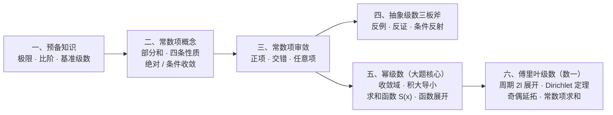
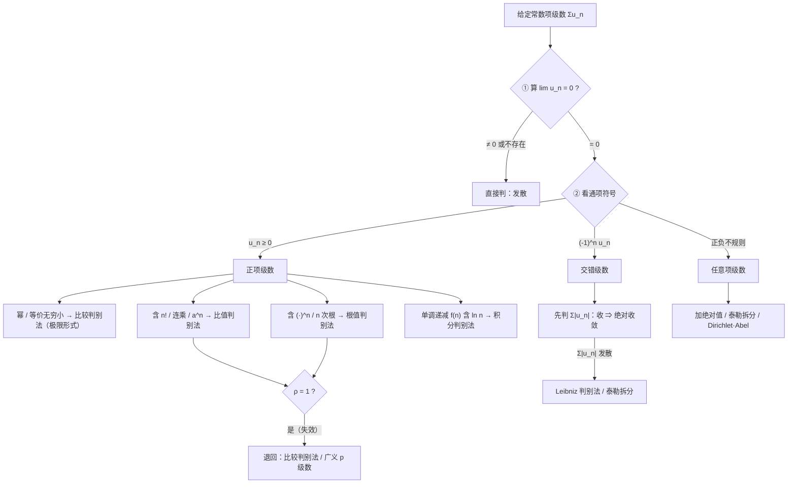

# 无穷级数大观

> [!info] 整理说明与阅读约定
> - **适用范围**：按**考研数学一**大纲完整构建，涵盖**常数项级数**、**幂级数**与**傅里叶级数**三大模块；索引与速查见 [[无穷级数 MOC]]。
> - **极简排版**：全篇按「考纲定位 → 常数项审敛 → 抽象级数 → 幂级数 → 傅里叶级数 → 速查与自测」单线推进，剔除重复叙述与冗余推导，保留考场直接调用的**判据、公式、口诀与反例**。
> - **提示框约定**：
>   - `[!important]` **核心公式 / 定理**：考前必背结论，汇总见 [[#目录]] 下的《核心公式速查》
>   - `[!summary]` **口诀 / 结论**：一句话秒杀规律
>   - `[!tip]` **做题动作**：考场实操步骤与破题信号
>   - `[!warning]` **易错雷区**：前提条件、端点陷阱与高频失分点
>   - `[!failure]` **经典反例**：推翻伪命题的头号样本
>   - `[!question]` **默写自测**：题面在外、答案折叠（见 [[#八、公式默写自测（25 题）]]）

---

## 目录

**章节速览**

| 板块 | 核心内容 | 题型定位 |
|---|---|---|
| [[#总览：考纲定位与知识全景]] | 知识地图、数学一考纲要求、选填与大题命题分布 | 全局导航 |
| [[#一、预备知识：算力与标尺]] | 三个重要极限、无穷大/小比阶、四类基准级数 | 审敛算力基础 |
| [[#二、常数项级数的概念与性质]] | 收敛定义、四条基本性质、绝对收敛与条件收敛 | 选填概念辨析 |
| [[#三、常数项级数审敛法]] | 审敛总流水线、正项五法 + 放缩工具箱、交错级数、任意项级数 | 选填具体级数判敛 |
| [[#四、抽象级数三板斧]] | 反例大观（12 条）、反证法、条件反射大观 | 选填压轴推理 |
| [[#五、幂级数]] | 阿贝尔定理、收敛域、分析性质（积大导小）、七大展开式、求和函数 $S(x)$、函数展开 | **解答题核心** ＋ 选填 |
| [[#六、傅里叶级数（数学一）]] | 周期 $2l$ 展开、狄利克雷定理、奇偶延拓、利用展开求数项级数和 | **数学一专属**（选填/大题） |
| [[#七、速查与易混]] | 全章题型选型总表、十组易混概念、考前裸背清单 | 考前十分钟冲刺 |
| [[#八、公式默写自测（25 题）]] | 常数项（12 题）＋ 幂级数（9 题）＋ 傅里叶（4 题）折叠自测 | 闭卷检核 |

> [!abstract]- 点开查看全章详细目录（点击跳转）
> - [[#总览：考纲定位与知识全景]]
>   - [[#0.1 全章知识地图]]
>   - [[#0.2 考研数学一命题定位]]
> - [[#一、预备知识：算力与标尺]]
>   - [[#1.1 三个重要极限（级数版）]]
>   - [[#1.2 无穷大与无穷小比阶]]
>   - [[#1.3 四类基准级数（放缩与比较的靶子）]]
> - [[#二、常数项级数的概念与性质]]
>   - [[#2.1 收敛定义与反直觉纠偏]]
>   - [[#2.2 四条基本性质]]
>   - [[#2.3 绝对收敛与条件收敛]]
> - [[#三、常数项级数审敛法]]
>   - [[#3.1 审敛总流水线]]
>   - [[#3.2 正项级数审敛]]
>     - [[#3.2.1 充要条件与奇偶项推论]]
>     - [[#3.2.2 比较判别法（放缩与等价）]]
>     - [[#3.2.3 放缩工具箱与三句口诀]]
>     - [[#3.2.4 比值判别法与根值判别法]]
>     - [[#3.2.5 积分判别法]]
>   - [[#3.3 交错级数审敛]]
>     - [[#3.3.1 Leibniz 判别法与余项估计]]
>     - [[#3.3.2 交错 p 级数三分法]]
>     - [[#3.3.3 伪装交错级数：sin 提号与根式有理化]]
>   - [[#3.4 任意项级数审敛]]
>     - [[#3.4.1 审敛三步走]]
>     - [[#3.4.2 泰勒拆分法]]
>     - [[#3.4.3 Dirichlet 与 Abel 判别法]]
> - [[#四、抽象级数三板斧]]
>   - [[#4.1 第一板斧：级数反例大观]]
>   - [[#4.2 第二板斧：反证法与正项转化]]
>   - [[#4.3 第三板斧：条件反射大观]]
> - [[#五、幂级数]]
>   - [[#5.1 阿贝尔定理与收敛域]]
>     - [[#5.1.1 阿贝尔（Abel）定理与收敛结构]]
>     - [[#5.1.2 收敛半径与收敛域求法]]
>   - [[#5.2 幂级数的运算与分析性质]]
>   - [[#5.3 七大必背麦克劳林展开式]]
>   - [[#5.4 幂级数求和函数 S(x)（大题核心）]]
>     - [[#5.4.1 求和函数四步标准流程]]
>     - [[#5.4.2 四大核心套路]]
>     - [[#5.4.3 常数项级数求和（大题第二问）]]
>   - [[#5.5 函数展开成幂级数]]
> - [[#六、傅里叶级数（数学一）]]
>   - [[#6.1 傅里叶级数与系数公式]]
>   - [[#6.2 狄利克雷（Dirichlet）收敛定理]]
>   - [[#6.3 奇偶函数展开与半幅延拓]]
>   - [[#6.4 利用傅里叶展开求数项级数和]]
> - [[#七、速查与易混]]
>   - [[#7.1 全章题型—工具选型总表]]
>   - [[#7.2 十组高频易混概念]]
>   - [[#7.3 考前最终背诵（裸背清单）]]
> - [[#八、公式默写自测（25 题）]]

> [!important]- 核心公式速查（12 张考前必看卡片）
> | # | 核心考点 | 关键公式 / 判据 | 跳转 |
> |:--:|---|---|---|
> | ① | 级数版重要极限与比阶 | $\lim\frac{\sqrt[n]{n!}}{n}=\frac1e$；$\ln^\alpha n\ll n^\beta\ll a^n\ll n!\ll n^n$ | [[#1.1 三个重要极限（级数版）\|1.1]] |
> | ② | 广义 $p$ 级数判据 | $\sum\frac{1}{n^p\ln^q n}$：$p>1$ 收；$p<1$ 发；$p=1$ 时 $q>1$ 收、$q\le1$ 发 | [[#1.3 四类基准级数（放缩与比较的靶子）\|1.3]] |
> | ③ | 绝对与条件收敛性质 | 绝对 $\pm$ 绝对 $=$ 绝对；绝对 $\pm$ 条件 $=$ 条件；绝对 $\times$ 收敛 $=$ 绝对 | [[#2.3 绝对收敛与条件收敛\|2.3]] |
> | ④ | 比较、比值与根值法 | $\lim\frac{u_n}{v_n}=l\in(0,+\infty)$ 同敛散；$\rho=\lim\frac{u_{n+1}}{u_n}$ 或 $\lim\sqrt[n]{u_n}$：$<1$ 收、$>1$ 发、$=1$ 失效 | [[#3.2 正项级数审敛\|3.2]] |
> | ⑤ | Leibniz 与交错 $p$ 级数 | $u_n\downarrow0\Rightarrow\sum(-1)^{n-1}u_n$ 收；$\sum\frac{(-1)^{n-1}}{n^p}$：$p>1$ 绝收、$0<p\le1$ 条收 | [[#3.3 交错级数审敛\|3.3]] |
> | ⑥ | 头号全能反例 | $u_n=\frac{(-1)^n}{\sqrt{n}}$（本身条件收敛，平方 $\sum u_n^2=\sum\frac1n$ 发散） | [[#4.1 第一板斧：级数反例大观\|4.1]] |
> | ⑦ | 阿贝尔定理与收敛半径 | 在 $x_1$ 条件收敛 $\Rightarrow R=\lvert x_1-x_0\rvert$；不缺项 $R=\frac{1}{\rho}$，缺项直接令 $\lim\left\lvert\frac{u_{n+1}(x)}{u_n(x)}\right\rvert<1$ | [[#5.1 阿贝尔定理与收敛域\|5.1]] |
> | ⑧ | 逐项求导与逐项积分 | 半径 $R$ 不变，收敛域**积大导小**（积分端点只增不减，求导端点只减不增） | [[#5.2 幂级数的运算与分析性质\|5.2]] |
> | ⑨ | 七大麦克劳林展开式 | $\frac{1}{1-x},\ \frac{1}{1+x},\ \ln(1+x),\ e^x,\ \sin x,\ \cos x,\ (1+x)^\alpha$（含收敛域） | [[#5.3 七大必背麦克劳林展开式\|5.3]] |
> | ⑩ | 求和函数 $S(x)$ 四套路 | 分母带 $n$ 先导后积；分子带 $n$ 先积后导；多项式系数拆 $n(n-1)$；递推列微分方程 | [[#5.4 幂级数求和函数 S(x)（大题核心）\|5.4]] |
> | ⑪ | 傅里叶系数与 Dirichlet 定理 | $a_n=\frac1l\int_{-l}^l f\cos\frac{n\pi x}{l}\mathrm dx$；收敛于 $S(x)=\frac{f(x^-)+f(x^+)}{2}$，端点 $\frac{f(-l^+)+f(l^-)}{2}$ | [[#6.1 傅里叶级数与系数公式\|6.1]] |
> | ⑫ | 半幅奇偶延拓 | 正弦级数 $\Leftrightarrow$ 奇延拓（$a_n=0$）；余弦级数 $\Leftrightarrow$ 偶延拓（$b_n=0$） | [[#6.3 奇偶函数展开与半幅延拓\|6.3]] |

---

## 总览：考纲定位与知识全景

### 0.1 全章知识地图

- **常数项级数（一～四章）**：一切级数问题的地基，解决**定性判敛**（收敛/发散、绝对/条件收敛），也是幂级数**端点敛散性判定**的工具。
- **幂级数（第五章）**：把常数项升级为函数项 $\sum a_n(x-x_0)^n$，依靠**逐项求导与逐项积分**在「级数」与「初等函数/微分方程」之间双向转换，是考研**解答题**的绝对核心。
- **傅里叶级数（第六章，仅数一）**：用正交三角函数系逼近周期/分段函数，以**狄利克雷收敛定理**和**奇偶延拓**为主要落脚点。

### 0.2 考研数学一命题定位

| 题型 | 常考模块 | 典型考法与核心武器 |
|---|---|---|
| **选择题**（5 分） | 抽象常数项级数判敛、阿贝尔定理、傅里叶收敛点 | 先用[[#4.1 第一板斧：级数反例大观\|反例大观]]排除伪命题，再用[[#4.3 第三板斧：条件反射大观\|条件反射]]或阿贝尔定理定半径 |
| **填空题**（5 分） | 具体级数收敛域、简单数项级数求和、傅里叶系数与和函数值 | 缺项幂级数直接比值法求域；利用[[#6.2 狄利克雷（Dirichlet）收敛定理\|Dirichlet 定理]]算间断点/端点和函数值 |
| **解答题**（10～12 分） | **幂级数求和函数 $S(x)$**、函数展开成幂级数、递推数列转幂级数 | 第一问求收敛域并先导后积/先积后导/列微分方程求 $S(x)$；第二问代入特殊值 $x_0$ 求数项级数和 |

> [!info] 数学一考纲核心要求
> 1. **理解**常数项级数收敛、发散以及收敛级数的和的概念，**掌握**级数的基本性质及收敛的必要条件。
> 2. **掌握**几何级数与 $p$ 级数的收敛与发散的条件，**掌握**正项级数收敛性的比较判别法、比值判别法、根值判别法，**会用**积分判别法。
> 3. **掌握**交错级数的莱布尼茨判别法；**了解**任意项级数绝对收敛与条件收敛的概念及关系。
> 4. **理解**幂级数收敛半径的概念，**掌握**幂级数的收敛半径、收敛区间及收敛域的求法。
> 5. **了解**幂级数在其收敛区间内的基本性质（和函数的连续性、逐项求导和逐项积分），**会求**一些幂级数在收敛区间内的和函数，并会由此求某些数项级数的和。
> 6. **掌握** $e^x,\ \sin x,\ \cos x,\ \ln(1+x),\ (1+x)^\alpha$ 的麦克劳林展开式，**会用**它们将一些简单函数间接展开成幂级数。
> 7. **（仅数学一）了解**傅里叶级数的概念和狄利克雷收敛定理，**会将**定义在 $[-l,l]$ 上的函数展开为傅里叶级数，会将定义在 $[0,l]$ 上的函数展开为正弦或余弦级数，会写出傅里叶级数的和函数的表达式。

---

## 一、预备知识：算力与标尺

### 1.1 三个重要极限（级数版）

> [!important] 三个重要极限（根值法与比值法的收尾工具）
> $$
> \text{①}\ \lim_{n\to\infty}\left(1+\frac1n\right)^{n}=e
> \qquad\quad
> \text{②}\ \lim_{n\to\infty}\frac{\sqrt[n]{n!}}{n}=\frac1e
> \qquad\quad
> \text{③}\ \lim_{n\to\infty}\sqrt[n]{a}=1\ (a>0),\quad \lim_{n\to\infty}\sqrt[n]{n}=1
> $$

- **① 的用法**：比值判别法化简 $\left(\frac{n+a}{n+b}\right)^n$ 时凑 $1^\infty$ 极限。
- **② 的来源与用法**：源于 Stirling 公式 $n!\sim\sqrt{2\pi n}\left(\frac{n}{e}\right)^n$。当通项同时含 $n!$ 与 $n^n$ 时，开 $n$ 次根直接得 $\frac1e$。
- **③ 的通则（开 $n$ 次根消幂律）**：对任意常数 $k$，均有 $\lim\limits_{n\to\infty}\sqrt[n]{n^k}=1$、$\lim\limits_{n\to\infty}\sqrt[n]{\ln^k n}=1$。**开 $n$ 次根后若只剩 $n$ 或 $\ln n$ 的有限次幂，极限必为 $1$**（此时根值法 $\rho=1$ 失效）。

> [!warning] 易错点
> - 分清 $\lim\frac{\sqrt[n]{n!}}{n}=\frac1e$ 与 $\lim\sqrt[n]{n!}=+\infty$。
> - 指数不为 $n$ 时切勿乱约：如 $u_n=\frac{1}{(\ln n)^{\ln n}}=e^{-\ln n\ln\ln n}$，开 $n$ 次根得 $e^{-\frac{\ln n\ln\ln n}{n}}\to e^0=1$（而非 $\frac{1}{\ln n}$）。

### 1.2 无穷大与无穷小比阶

> [!important] 阶数标尺（$n\to\infty$，参数 $\alpha>0,\ \beta>0,\ a>1$）
> - **无穷大比阶（由慢到快）**：
>   $$
>   \ln^{\alpha}n\ \ll\ n^{\beta}\ \ll\ a^{n}\ \ll\ n!\ \ll\ n^{n}
>   $$
> - **无穷小比阶（趋于 $0$ 由快到慢）**：
>   $$
>   \frac{1}{n^{n}}\ \ll\ \frac{1}{n!}\ \ll\ a^{-n}\ \ll\ \frac{1}{n^{\beta}}\ \ll\ \frac{1}{\ln^{\alpha}n}
>   $$

> [!summary] 考场记法
> **对数 $\ll$ 幂 $\ll$ 指数 $\ll$ 阶乘 $\ll$ 幂指**。任意正幂 $n^\beta$ 在指数 $a^n$ 面前都是低阶量（故 $\sum\frac{n^{100}}{2^n}$ 必收敛）；对数 $\ln^\alpha n$ 在任意小正幂 $n^\varepsilon$ 面前都是低阶量。

### 1.3 四类基准级数（放缩与比较的靶子）

> [!important] 四类基准级数敛散性总表
> | 基准级数 | 标准形式 | 收敛条件（及和） | 发散条件 | 核心备注 |
> |---|---|---|---|---|
> | **等比级数**（几何级数） | $\sum\limits_{n=1}^{\infty}aq^{n-1}\ (a\ne0)$ | $\lvert q\rvert<1$，和 $S=\dfrac{a}{1-q}$ | $\lvert q\rvert\ge1$ | 比值/根值法的理论标尺；首项为 $aq^0$ 时分子即首项 |
> | **$p$ 级数** | $\sum\limits_{n=1}^{\infty}\dfrac{1}{n^p}$ | $p>1$ | $p\le1$ | $p=1$ 为**调和级数** $\sum\frac1n$（发散）；比较判别法主力靶子 |
> | **广义 $p$ 级数**（$p$-$\ln$ 级数） | $\sum\limits_{n=2}^{\infty}\dfrac{1}{n^p\ln^q n}$ | $p>1$（$q$ 任意）； 或 $p=1$ 且 $q>1$ | $p<1$（$q$ 任意）； 或 $p=1$ 且 $q\le1$ | 口诀：**先看 $p$，$p$ 定胜负；$p=1$ 时再看 $q$** |
> | **裂项级数**（望远镜级数） | $\sum\limits_{n=1}^{\infty}(b_{n+1}-b_n)$ | $\lim\limits_{n\to\infty}b_n=B$ 存在， 和 $S=B-b_1$ | $\lim\limits_{n\to\infty}b_n$ 不存在 | 典型：$\sum\frac{1}{n(n+1)}=1$（收）；$\sum\ln\left(1+\frac1n\right)$（发） |

> [!tip] 顺手秒答的四个临界点（全落在发散侧）
> - $\sum\frac{1}{n}$ **发散**，$\sum\frac{1}{n^2}$ **收敛**（和为 $\frac{\pi^2}{6}$）；
> - $\sum\frac{1}{n\ln n}$ **发散**（$p=1,q=1$），$\sum\frac{1}{n\ln^2 n}$ **收敛**（$p=1,q=2$）。

---

## 二、常数项级数的概念与性质

### 2.1 收敛定义与反直觉纠偏

> [!info] 级数收敛的定义
> 设级数 $\sum\limits_{n=1}^{\infty}u_n$ 的**前 $n$ 项部分和**为 $S_n=\sum\limits_{k=1}^{n}u_k$。
> - 若 $\lim\limits_{n\to\infty}S_n=S$ **存在且有限**，则称级数**收敛**，$S$ 称为级数的**和**；
> - 若 $\lim\limits_{n\to\infty}S_n$ 不存在（趋于 $\infty$ 或振荡无极限），则称级数**发散**。
> - **数列与级数的等价转换**：数列 $\{a_n\}$ 收敛 $\Longleftrightarrow$ 裂项级数 $\sum(a_{n+1}-a_n)$ 收敛（因为 $S_n=a_{n+1}-a_1$）。

> [!warning] 两条反直觉概念纠偏
> 1. **级数发散 $\ne$ 部分和无界**：「级数发散 $\iff \lim S_n$ 不存在」包含两种情形——**无界发散**（如 $\sum\frac1n$）与**有界振荡发散**（如 $\sum(-1)^n$，其 $S_n\in\{-1,0\}$ 有界但发散）。只有**正项级数**才满足「发散 $\iff$ 部分和无界」。
> 2. **级数收敛 $\not\Rightarrow$ 奇偶项子级数收敛**：将 $\sum u_n$ 拆为奇数项 $\sum u_{2n-1}$ 与偶数项 $\sum u_{2n}$ 属于无穷项**重排**，仅对**正项级数**或**绝对收敛级数**合法；条件收敛级数（如 $\sum\frac{(-1)^{n-1}}{n}$）拆开后奇偶子级数均发散。

### 2.2 四条基本性质

> [!important] 级数的四条基本性质
> 1. **线性运算（加减法）**：
>    - 收敛 $\pm$ 收敛 $=$ **收敛**，且 $\sum(\alpha u_n\pm\beta v_n)=\alpha\sum u_n\pm\beta\sum v_n$；
>    - 收敛 $\pm$ 发散 $=$ **发散**；
>    - 发散 $\pm$ 发散 $=$ **不一定**（反例：$\sum\frac1n$ 与 $\sum(-\frac1n)$ 相加为 $0$）。**但若两级数均为正项级数，则正项发散 $+$ 正项发散 $=$ 发散**。
> 2. **有限项无关性**：增加、删去或改变级数的**有限项**，不改变级数的敛散性（收敛时和会改变）。
> 3. **加括号性质（结合律单向成立）**：
>    - 原级数收敛 $\Longrightarrow$ 任意加括号后所得新级数**必收敛**，且和不变；
>    - **逆否命题（判发散利器）**：加括号后发散 $\Longrightarrow$ 原级数**必发散**；
>    - **逆命题不成立**：加括号后收敛 $\not\Rightarrow$ 原级数收敛（反例：$(1-1)+(1-1)+\cdots=0$ 收敛，但 $\sum(-1)^{n-1}$ 发散）。
> 4. **收敛的必要条件（考场第一刀）**：
>    $$
>    \sum_{n=1}^{\infty}u_n\ \text{收敛}\ \Longrightarrow\ \lim_{n\to\infty}u_n=0\qquad(\text{因}\ u_n=S_n-S_{n-1}\to S-S=0).
>    $$
>    - **逆否命题**：若 $\lim\limits_{n\to\infty}u_n\ne0$ 或极限不存在，则 $\sum u_n$ **必发散**；
>    - **逆命题不成立**：$\lim u_n=0\not\Rightarrow\sum u_n$ 收敛（反例：$\sum\frac1n$）。

### 2.3 绝对收敛与条件收敛

> [!important] 定义与四大运算性质
> **1. 定义**
> - **绝对收敛**：$\sum\limits_{n=1}^{\infty}\lvert u_n\rvert$ 收敛；
> - **条件收敛**：$\sum\limits_{n=1}^{\infty}u_n$ 收敛，但 $\sum\limits_{n=1}^{\infty}\lvert u_n\rvert$ 发散。
>
> **2. 核心性质**
> - **性质 ①（绝对收敛必收敛）**：$\sum\lvert u_n\rvert$ 收敛 $\Longrightarrow \sum u_n$ 收敛。
>   - **逆否命题**：$\sum u_n$ 发散 $\Longrightarrow \sum\lvert u_n\rvert$ **必发散**（但 $\sum\lvert u_n\rvert$ 发散 $\not\Rightarrow\sum u_n$ 发散）。
> - **性质 ②（正负部拆解）**：记正部 $u_n^+=\dfrac{\lvert u_n\rvert+u_n}{2}$，负部 $u_n^-=\dfrac{\lvert u_n\rvert-u_n}{2}$，则：
>   - $\sum u_n$ **绝对收敛** $\Longleftrightarrow \sum u_n^+$ 与 $\sum u_n^-$ **均收敛**（且重排后仍绝对收敛、和不变）；
>   - $\sum u_n$ **条件收敛** $\Longrightarrow \sum u_n^+$ 与 $\sum u_n^-$ **均发散**（条件收敛全靠正负项抵消）。
> - **性质 ③（加减法则）**：
>   - **绝对 $\pm$ 绝对 $=$ 绝对收敛**；
>   - **绝对 $\pm$ 条件 $=$ 条件收敛**；
>   - **条件 $\pm$ 条件 $=$ 收敛**（可能绝对收敛，也可能条件收敛，需具体估阶）。
> - **性质 ④（乘积法则）**：若 $\sum u_n$ **绝对收敛**，$\sum v_n$ **收敛**（或仅需 $\{v_n\}$ 有界），则 $\sum u_n v_n$ **绝对收敛**（且柯西乘积收敛）。

---

## 三、常数项级数审敛法

### 3.1 审敛总流水线

> [!summary] 审敛四句总纲
> **第一步永远先看 $\lim u_n$；正项放缩比大小，交错就上 Leibniz，任意项先加绝对值。**
> 比值法管阶乘，根值法管 $n$ 次方，比较法管幂次，积分法管单减 $f(n)$；算出 $\rho=1$ 是判别法失效，立刻退回比较判别法。

### 3.2 正项级数审敛

#### 3.2.1 充要条件与奇偶项推论

> [!important] 正项级数基本定理（设 $u_n\ge0$）
> 1. **收敛充要条件**：
>    $$
>    \sum_{n=1}^{\infty}u_n\ \text{收敛}\ \Longleftrightarrow\ \text{部分和数列}\ \{S_n\}\ \text{有上界}.
>    $$
>    （依据：$u_n\ge0\Rightarrow\{S_n\}$ 单调不减，由单调有界准则即得。）
> 2. **奇偶项子级数推论（仅正项级数成立）**：
>    $$
>    \text{正项级数}\ \sum_{n=1}^{\infty}u_n\ \text{收敛}\ \Longleftrightarrow\ \sum_{n=1}^{\infty}u_{2n-1}\ \text{与}\ \sum_{n=1}^{\infty}u_{2n}\ \text{均收敛}.
>    $$

#### 3.2.2 比较判别法（放缩与等价）

> [!important] 比较判别法（设 $u_n\ge0,\ v_n>0$）
> **1. 一般形式（放缩法）**：若当 $n>N$ 时恒有 $u_n\le v_n$，则：
> - **大收则小收**：$\sum v_n$ 收敛 $\Longrightarrow \sum u_n$ 收敛；
> - **小散则大散**：$\sum u_n$ 发散 $\Longrightarrow \sum v_n$ 发散。
>
> **2. 极限形式（等价抓大头，考场首选）**：设 $\lim\limits_{n\to\infty}\dfrac{u_n}{v_n}=l$，则：
> - **$0<l<+\infty$（同阶）**：$\sum u_n$ 与 $\sum v_n$ **同敛散**（即：**正项级数通项可做等价无穷小替换**）；
> - **$l=0$（$u_n$ 更高阶）**：若 $\sum v_n$ 收敛，则 $\sum u_n$ **收敛**（大收则小收）；
> - **$l=+\infty$（$u_n$ 更低阶）**：若 $\sum v_n$ 发散，则 $\sum u_n$ **发散**（小散则大散）。

> [!tip] 常用等价替换表（$n\to\infty$，仅限正项级数乘除因子直接替换）
> $$
> \sin\frac1n\sim\tan\frac1n\sim\arcsin\frac1n\sim\arctan\frac1n\sim\ln\left(1+\frac1n\right)\sim e^{\frac1n}-1\sim\frac1n,
> $$
> $$
> 1-\cos\frac1n\sim\frac{1}{2n^2},\qquad \left(1+\frac1n\right)^\alpha-1\sim\frac{\alpha}{n},\qquad a^{\frac1n}-1\sim\frac{\ln a}{n}\ (a>0).
> $$

#### 3.2.3 放缩工具箱与三句口诀

> [!summary] 比较法三句话：**同阶同敛散，大收则小收，小散则大散**
> - 目标证**收敛** $\to$ 往**大**放（缩小分母、放大分子），落到收敛的基准级数（如 $\frac{1}{n^2}$）；
> - 目标证**发散** $\to$ 往**小**放（放大分母、缩小分子），落到发散的基准级数（如 $\frac{1}{n}$）。

| 工具类别 | 核心不等式 / 变形 | 典型适用场景 |
|---|---|---|
| **① 函数切线不等式** | $\sin x < x < \tan x\ (0<x<\frac\pi2)$；$e^x\ge 1+x$； $\dfrac{x}{1+x} < \ln(1+x) < x\ (x>-1,x\ne0)$ | 通项含 $\sin,\ \ln,\ e^x$ 时的上下界双向放缩（尤其 $\ln(1+\frac1n)>\frac{1}{n+1}$ 证发散） |
| **② 均值不等式** | $\lvert ab\rvert\le\dfrac{a^2+b^2}{2}$；$\sqrt{a_n b_n}\le\dfrac{a_n+b_n}{2}\ (a_n,b_n\ge0)$ | 抽象题已知 $\sum a_n^2,\sum b_n^2$ 收敛，证乘积 $\sum a_n b_n$ 或 $\sum\frac{\sqrt{a_n}}{n}$ 收敛 |
| **③ 分数与裂项放缩** | $\dfrac{1}{n^2}<\dfrac{1}{n(n-1)}=\dfrac{1}{n-1}-\dfrac1n$； $\dfrac1n>\ln\left(1+\dfrac1n\right)=\ln(n+1)-\ln n$ | 证明部分和 $S_n$ 有界（收敛）或无界（发散） |
| **④ 三角有界与降次** | $\lvert\sin\square\rvert\le1,\ \lvert\cos\square\rvert\le1$（**仅能放大证收敛**）； $\sin^2 n=\dfrac{1-\cos 2n}{2},\ \cos^2 n=\dfrac{1+\cos 2n}{2}$ | $\sum\frac{\lvert\sin n\rvert}{n^2}\le\sum\frac{1}{n^2}$ 收敛；而 $\sum\frac{\sin^2 n}{n}$ **必须先倍角降次**，拆为 $\frac12\sum\frac1n$（发）$-\frac12\sum\frac{\cos 2n}{n}$（Dirichlet 收）$\Rightarrow$ 发散 |

#### 3.2.4 比值判别法与根值判别法

> [!important] 比值判别法（d'Alembert）与根值判别法（Cauchy）对比
> | 维度 | 比值判别法（d'Alembert） | 根值判别法（Cauchy） |
> |---|---|---|
> | **判据定义** | $\rho=\lim\limits_{n\to\infty}\dfrac{u_{n+1}}{u_n}$ | $\rho=\lim\limits_{n\to\infty}\sqrt[n]{u_n}$ |
> | **共同结论** | $\rho<1\Rightarrow$ **收敛**；$\rho>1$（含 $+\infty$）$\Rightarrow$ **发散**（此时 $u_n\not\to0$）；$\rho=1\Rightarrow$ **失效（不一定）** | 同左 |
> | **适用长相** | 通项含**阶乘 $n!$**、**连乘 $(2n-1)!!$**、递推比值 $\frac{u_{n+1}}{u_n}$ | 通项含 **$n$ 次幂 $(\cdot)^n$**、**$(\cdot)^{n^2}$** |
> | **理论强弱** | 较弱（比值极限存在则根值极限必存在且相等） | **更强**（如 $u_n=2^{-n+(-1)^n}$ 比值振荡不存在，但根值 $\rho=\frac12<1$ 可判收敛） |
> | **$\rho=1$ 对策** | 退回**必要条件**（查 $u_n\to0$）或**比较判别法 / 广义 $p$ 级数 / 积分判别法** | 同左 |

#### 3.2.5 积分判别法

> [!important] 积分判别法（Cauchy）
> 设 $f(x)$ 在 $[1,+\infty)$（或 $[N,+\infty)$）上**非负、连续、单调递减**，且 $u_n=f(n)$，则：
> $$
> \sum_{n=1}^{\infty}f(n)\quad\text{与反常积分}\quad\int_{1}^{+\infty}f(x)\,\mathrm dx\quad\text{同敛散},
> $$
> 且有部分和夹逼不等式：$\displaystyle\int_1^{n+1}f(x)\,\mathrm dx\le\sum_{k=1}^n f(k)\le f(1)+\int_1^n f(x)\,\mathrm dx$。

- **核心用途**：专治含 $\ln n$ 的单调递减级数（如推导广义 $p$ 级数 $\sum\frac{1}{n\ln^q n}$ 与 $\int_2^{+\infty}\frac{\mathrm dx}{x\ln^q x}$ 同敛散），以及利用不等式估计部分和 $\sum_{k=1}^n f(k)$ 的阶。
- **前提铁律**：**非负、连续、单减**三条缺一不可。

### 3.3 交错级数审敛

#### 3.3.1 Leibniz 判别法与余项估计

> [!important] 莱布尼茨（Leibniz）判别法
> 对交错级数 $\sum\limits_{n=1}^{\infty}(-1)^{n-1}u_n\ (u_n>0)$，若同时满足：
> $$
> \text{① 单调递减：}\ u_n\ge u_{n+1}\ (n\ge N),\qquad\quad \text{② 趋于零：}\ \lim_{n\to\infty}u_n=0,
> $$
> 则级数**收敛**，且其和 $S\le u_1$，余项估计满足 $\lvert R_n\rvert=\lvert S-S_n\rvert\le u_{n+1}$。

> [!warning] Leibniz 判别法的三条核心纪律
> 1. **单减条件下的充要性**：若已知 $\{u_n\}$ **单调递减**，则「交错级数 $\sum(-1)^{n-1}u_n$ 收敛 $\Longleftrightarrow \lim u_n=0$」。反之，若 $u_n$ 单减但交错级数发散，则必有 $\lim u_n\ne0$。
> 2. **“$u_n$ 单减”不可省**：若 $u_n\to0$ 但不单调（如奇偶项分母分别为 $n$ 和 $n^2$），Leibniz 失效，需改用**泰勒拆分法**或**奇偶拆项法**。
> 3. **Leibniz 只证收敛，不证绝对收敛**：判定“绝对 vs 条件”时，永远**先加绝对值判 $\sum u_n$**；仅当 $\sum u_n$ 发散时，才用 Leibniz 判其是否为条件收敛。

#### 3.3.2 交错 p 级数三分法

> [!important] 交错 $p$ 级数（条件收敛与绝对收敛的标尺）
> $$
> \sum_{n=1}^{\infty}\frac{(-1)^{n-1}}{n^{p}}=
> \begin{cases}
> \text{绝对收敛}, & p>1,\\[2pt]
> \text{条件收敛}, & 0<p\le1\quad\bigl(p=1\ \text{为交错调和级数，和为}\ \ln 2\bigr),\\[2pt]
> \text{发散}, & p\le0\quad\bigl(\text{通项}\ u_n\not\to0\bigr).
> \end{cases}
> $$

#### 3.3.3 伪装交错级数：sin 提号与根式有理化

通项形如 $\sin\left(\pi\sqrt{n^2+a}\right)$ 或 $\cos\left(\pi\sqrt{n^2+a}\right)$ 时，利用诱导公式 $\sin(n\pi+\theta)=(-1)^n\sin\theta$ 提取交错因子并有理化：

$$
\sin\!\left(\pi\sqrt{n^2+a}\right)
=\sin\!\Bigl(n\pi+\pi\bigl(\sqrt{n^2+a}-n\bigr)\Bigr)
=(-1)^n\sin\!\left(\frac{a\pi}{\sqrt{n^2+a}+n}\right).
$$

- 当 $a$ 为常数时，内层角 $\theta_n=\frac{a\pi}{\sqrt{n^2+a}+n}\sim\frac{a\pi}{2n}$ 单调递减趋于 $0$，由 Leibniz 法知原级数**条件收敛**；
- 若根号内为 $\sqrt{n^2+n}$，则 $\theta_n=\frac{n\pi}{\sqrt{n^2+n}+n}\to\frac{\pi}{2}$，通项极限为 $(-1)^n\sin\frac\pi2=(-1)^n\not\to0$，原级数**发散**。

### 3.4 任意项级数审敛

#### 3.4.1 审敛三步走

1. **查必要条件**：若 $\lim u_n\ne0$，直接发散；
2. **先加绝对值**：考察正项级数 $\sum\lvert u_n\rvert$。若收敛 $\Rightarrow$ 原级数**绝对收敛**（结束）；
3. **若 $\sum\lvert u_n\rvert$ 发散**：回到原级数 $\sum u_n$，使用 **Leibniz 法**、**泰勒拆分法**或 **Dirichlet/Abel 判别法**判定是条件收敛还是发散。

#### 3.4.2 泰勒拆分法

> [!important] 泰勒拆分法（专治 $u_n$ 不单调或含复合函数的交错/任意项级数）
> 当通项含 $\ln\bigl(1+a_n\bigr),\ \sin a_n,\ e^{a_n}-1,\ (1+a_n)^\alpha-1\ (a_n\to0)$，特别是 $a_n=\frac{(-1)^n}{n^p}$ 时，**不可直接等价无穷小替换**（非恒正级数等价替换会改变敛散性！），必须展开到**能判出绝对收敛阶数**的那一项：
> $$
> u_n = \underbrace{v_n}_{\text{主项（交错级数）}} + \underbrace{w_n}_{\text{余项（绝对收敛级数）}}.
> $$

- **经典范例**：判别 $\sum\limits_{n=2}^{\infty}\ln\left(1+\frac{(-1)^n}{\sqrt{n}}\right)$ 的敛散性。
  - **错误做法**：直接等价替换为 $\sum\frac{(-1)^n}{\sqrt{n}}$ 判收敛（错！）。
  - **正确拆分**：由 $\ln(1+x)=x-\frac{x^2}{2}+O(x^3)$，展到二次项得：
    $$
    \ln\left(1+\frac{(-1)^n}{\sqrt{n}}\right)=\underbrace{\frac{(-1)^n}{\sqrt{n}}}_{\sum v_n\ \text{条件收敛}}\ -\ \underbrace{\left[\frac{1}{2n}+O\!\left(\frac{1}{n^{3/2}}\right)\right]}_{\sum w_n\ \text{与}\ \sum\frac{1}{2n}\ \text{同发散}}.
    $$
    由「收敛 $-$ 发散 $=$ 发散」，原级数**发散**。

> [!warning] 等价无穷小替换的铁律
> $\sum u_n$ 与 $\sum v_n$（当 $u_n\sim v_n$ 时）同敛散的前提是 **$u_n,v_n$ 同号（正项级数）**！对交错级数或任意项级数，一旦用等价替换丢掉高阶项（如丢掉 $-\frac{1}{2n}$），就会把发散级数误判为收敛。

#### 3.4.3 Dirichlet 与 Abel 判别法

> [!info] 狄利克雷（Dirichlet）与阿贝尔（Abel）判别法（专治 $\sum\frac{\sin nx}{n^p}$ 型级数）
> - **Dirichlet 判别法**：若 $\sum a_n$ 的**部分和数列有界**（如 $a_n=\sin nx,\ \cos nx,\ (-1)^n$），且 $\{b_n\}$ **单调递减趋于 $0$**（如 $b_n=\frac{1}{n^p},\ p>0$），则 $\sum a_n b_n$ **收敛**。
> - **Abel 判别法**：若 $\sum a_n$ **收敛**，且 $\{b_n\}$ **单调有界**，则 $\sum a_n b_n$ **收敛**。
> - **考场常备结论**：对任意 $\alpha\ne 2k\pi$，当 $p>1$ 时 $\sum\frac{\sin n\alpha}{n^p},\ \sum\frac{\cos n\alpha}{n^p}$ **绝对收敛**；当 $0<p\le1$ 时**条件收敛**。

---

## 四、抽象级数三板斧

选择题中不给具体通项、只给抽象条件（如“已知 $\sum a_n$ 收敛”）时，严格按**「一找反例 → 二用反证 → 三做条件反射」**三步走。

### 4.1 第一板斧：级数反例大观

> [!failure] 头号全能反例（考场第一顺位尝试）
> $$
> u_n=\frac{(-1)^n}{\sqrt{n}}:\qquad \sum_{n=1}^{\infty}u_n\ \text{条件收敛},\qquad \sum_{n=1}^{\infty}u_n^2=\sum_{n=1}^{\infty}\frac1n\ \text{发散}.
> $$
> 一个反例同时推翻：**收敛 $\Rightarrow$ 绝对收敛**、**收敛 $\Rightarrow$ 平方收敛**、**收敛 $\Rightarrow$ 乘积 $\sum u_n v_n$ 收敛**、**绝对值发散 $\Rightarrow$ 原级数发散**。

| 序号 | 常见伪命题（全错 ❌） | 秒杀反例 | 附加什么条件会变成真命题（✅） |
|:--:|---|---|---|
| 1 | $\lim u_n=0\Rightarrow\sum u_n$ 收敛 | $u_n=\dfrac1n$ | 加上「交错级数且 $u_n$ 单减」（Leibniz） |
| 2 | 正项级数 $\sum u_n$ 收敛 $\Rightarrow \lim(n u_n)=0$ | $u_n=\begin{cases}\frac1n,&n=k^2\\\frac{1}{n^2},&\text{其余}\end{cases}$ | 加上「$\{u_n\}$ **单调递减**」（Abel 定理：正项单减收敛必有 $nu_n\to0$） |
| 3 | $\sum u_n$ 收敛 $\Rightarrow\sum u_n^2$ 收敛 | $u_n=\dfrac{(-1)^n}{\sqrt{n}}$ | 加上「**$u_n\ge0$（正项）**」或「**$\sum u_n$ 绝对收敛**」 |
| 4 | $\sum u_n^2$ 收敛 $\Rightarrow\sum u_n$ 收敛 | $u_n=\dfrac1n$ | 若问 $\sum\frac{u_n}{n}$，则由 $\lvert\frac{u_n}{n}\rvert\le\frac{u_n^2+1/n^2}{2}$ 知绝对收敛 |
| 5 | $\sum u_n,\sum v_n$ 收敛 $\Rightarrow\sum u_n v_n$ 收敛 | $u_n=v_n=\dfrac{(-1)^n}{\sqrt{n}}$ | 加上「$u_n,v_n\ge0$」或「其中一个**绝对收敛**」 |
| 6 | $\sum u_n$ 收敛 $\Rightarrow\sum u_{2n},\sum u_{2n-1}$ 收敛 | $u_n=\dfrac{(-1)^{n-1}}{n}$ | 加上「**$u_n\ge0$**」或「**$\sum u_n$ 绝对收敛**」 |
| 7 | $\sum(u_{2n-1}+u_{2n})$ 收敛 $\Rightarrow\sum u_n$ 收敛 | $u_n=(-1)^{n-1}$ | 加上「**$\lim u_n=0$**」（因 $S_{2n+1}=S_{2n}+u_{2n+1}$）或「$u_n\ge0$」 |
| 8 | $\sum(u_n+u_{n+1})$ 收敛 $\Rightarrow\sum u_n$ 收敛 | $u_n=(-1)^n$ | 加上「$\lim u_n=0$」也**推不出**！（反例 $u_{2k-1}=\frac1k,u_{2k}=-\frac1k$） |
| 9 | $u_n>0,\ \frac{u_{n+1}}{u_n}<1\Rightarrow\sum u_n$ 收敛 | $u_n=\dfrac1n\ \left(\frac{n}{n+1}<1\right)$ | 加上「$\lim\frac{u_{n+1}}{u_n}=\rho<1$」（严格小于 $1$ 的极限，而非逐项 $<1$） |
| 10 | 交错级数 $u_n\to0\Rightarrow\sum(-1)^{n-1}u_n$ 收敛 | $u_n=\begin{cases}\frac1n,&n\text{奇}\\\frac{1}{n^2},&n\text{偶}\end{cases}$ | 加上「$\{u_n\}$ **单调递减**」 |
| 11 | $\sum\lvert u_n\rvert$ 发散 $\Rightarrow\sum u_n$ 发散 | $u_n=\dfrac{(-1)^{n-1}}{n}$ | 加上「$u_n\ge0$」 |
| 12 | 发散 $+$ 发散 $=$ 发散 | $\sum\frac1n$ 与 $\sum(-\frac1n)$ | 加上「两个均为**正项级数**」 |

### 4.2 第二板斧：反证法与正项转化

找不到反例时，立即检查题干是否有 **$u_n>0$（正项）** 或 **绝对收敛**：
- **策略 1（反证法）**：要证「发散」或「某极限不存在」，先假设收敛，利用收敛级数的线性运算、必要条件 $u_n\to0$ 或 Cauchy 准则推出与已知发散级数矛盾。
- **策略 2（正项化构造）**：若通项含符号未知的 $a_n$，通过平方 $a_n^2$、绝对值 $\lvert a_n\rvert$ 或配方法 $(a_n\pm\frac1n)^2\ge0$ 转化为正项级数，再用比较判别法。

### 4.3 第三板斧：条件反射大观

> [!important] 考场条件反射映射表（看到左栏已知，立即写出右栏结论）
> | 题干已知条件 | 第一时间条件反射出的结论与动作 |
> |---|---|
> | **$\sum u_n$ 收敛** | ① $u_n\to0\implies\{u_n\}$ **有界**（当 $n>N$ 时 $\lvert u_n\rvert<1$）； ② 部分和 $\{S_n\}$ **有界**（$\lvert S_n\rvert\le M$） |
> | **正项级数 $\sum u_n$ 收敛**（$u_n\ge0$） | ① $u_n^2\le u_n\implies\sum u_n^2$ **必收敛**；$\ln(1+u_n)\sim u_n\implies\sum\ln(1+u_n)$ **必收敛**； ② 奇偶子级数 $\sum u_{2n-1},\sum u_{2n}$ **均收敛** |
> | **正项且单减 $\sum u_n$ 收敛** | 除上述外，还必有 **$\lim\limits_{n\to\infty}n u_n=0$**（比 $u_n\to0$ 更强！） |
> | **$\sum u_n^2$ 收敛** | 立即联想均值不等式：$\left\lvert\dfrac{u_n}{n}\right\rvert\le\dfrac{u_n^2+1/n^2}{2}\implies\sum\dfrac{u_n}{n}$ **绝对收敛** |
> | **$\sum u_n$ 发散** | $\sum\lvert u_n\rvert$ **必发散**（绝对收敛必收敛的逆否命题） |
> | **$a_n$ 单减，且 $\sum(-1)^{n-1}a_n$ 发散** | 必有 $\lim\limits_{n\to\infty}a_n\ne0$（从而 $\sum a_n$ 等同阶正项级数必发散） |
> | **给 $S_n$ 与 $u_n$ 的关系式** | 立即利用 **$u_n=S_n-S_{n-1}\ (n\ge2)$** 消去 $u_n$ 或 $S_n$，转化为数列递推极限 |
> | **含 $\lvert a_n\pm b_n\rvert$ 的收敛性** | 三角不等式双向夹逼：$\bigl\lvert\lvert a_n\rvert-\lvert b_n\rvert\bigr\rvert\le\lvert a_n\pm b_n\rvert\le\lvert a_n\rvert+\lvert b_n\rvert$ |

---

## 五、幂级数

幂级数的标准形式为 $\sum\limits_{n=0}^{\infty}a_n x^n$（中心在原点）或平移型 $\sum\limits_{n=0}^{\infty}a_n(x-x_0)^n$（令 $t=x-x_0$ 即化为标准型）。

### 5.1 阿贝尔定理与收敛域

#### 5.1.1 阿贝尔（Abel）定理与收敛结构

> [!important] 核心公式 ⑦｜阿贝尔（Abel）定理与收敛半径 $R$
> **1. Abel 定理**：
> - 若幂级数 $\sum a_n x^n$ 在 $x=x_1\ (x_1\ne0)$ 处**收敛**，则对一切满足 $\lvert x\rvert<\lvert x_1\rvert$ 的 $x$，级数**绝对收敛**；
> - 若幂级数 $\sum a_n x^n$ 在 $x=x_2$ 处**发散**，则对一切满足 $\lvert x\rvert>\lvert x_2\rvert$ 的 $x$，级数**发散**。
>
> **2. 推论（选填高频秒杀）**：
> - 若 $\sum a_n(x-x_0)^n$ 在 $x=x_1$ 处**条件收敛**，则 $x_1$ 必为收敛区间的**端点**，收敛半径直接定出：
>   $$
>   R=\lvert x_1-x_0\rvert,
>   $$
>   且在开区间 $(x_0-R,\ x_0+R)$ 内**绝对收敛**，在 $\lvert x-x_0\rvert>R$ 处**发散**。

> [!warning] 阿贝尔定理的边界盲区
> - 已知在 $x=x_1$ 处「收敛」（未指明是条件收敛），只能推出 $R\ge\lvert x_1-x_0\rvert$，不能断定 $R=\lvert x_1-x_0\rvert$；
> - 两个端点 $x=x_0\pm R$ 处的敛散性**阿贝尔定理无法判定**，可能都收敛、都发散或一收一发，必须代回原级数作为常数项级数单独检验。

#### 5.1.2 收敛半径与收敛域求法

| 幂级数类型 | 求收敛半径 $R$ 与收敛区间的方法 | 端点检验与收敛域 |
|---|---|---|
| **① 标准不缺项型** $\sum a_n(x-x_0)^n$ | 先算系数极限 $\rho=\lim\limits_{n\to\infty}\left\lvert\dfrac{a_{n+1}}{a_n}\right\rvert$ 或 $\rho=\lim\limits_{n\to\infty}\sqrt[n]{\lvert a_n\rvert}$， 则 $R=\begin{cases}\dfrac1\rho,&0<\rho<+\infty\\+\infty,&\rho=0\\0,&\rho=+\infty\end{cases}$，收敛区间为 $(x_0-R,x_0+R)$ | 将 $x=x_0-R$ 与 $x=x_0+R$ 分别代入原级数，按第三章常数项级数判敛，把收敛端点并入开区间即得**收敛域** |
| **② 缺项 / 复合型** 如 $\sum a_n x^{2n}$、$\sum a_n\left(\frac{x-1}{2}\right)^n$ | **切勿直接套 $\frac{a_{n+1}}{a_n}$ 公式！** 把含 $x$ 的整个通项记为 $u_n(x)$，直接用比值法或根值法解不等式： $$\lim_{n\to\infty}\left\lvert\frac{u_{n+1}(x)}{u_n(x)}\right\rvert<1\quad\text{或}\quad\lim_{n\to\infty}\sqrt[n]{\lvert u_n(x)\rvert}<1$$ 直接解出 $x$ 的开区间 $(a,b)$，收敛半径 $R=\frac{b-a}{2}$ | 单独代入 $x=a$ 与 $x=b$ 检验开闭。（注：若问 $\sum a_n x^{2n}$，系数比极限为 $\rho$ 时，由 $\rho x^2<1$ 得 $R=\frac{1}{\sqrt{\rho}}$ 而非 $\frac1\rho$！） |

### 5.2 幂级数的运算与分析性质

> [!important] 核心公式 ⑧｜幂级数的三大分析性质（设收敛半径 $R>0$，和函数 $S(x)=\sum\limits_{n=0}^{\infty}a_n x^n$）
> 1. **连续性**：和函数 $S(x)$ 在 $(-R,R)$ 内连续；若在端点 $x=\pm R$ 处也收敛，则在闭端点处**单侧连续**（**Abel 边界连续性定理**：$\lim\limits_{x\to R^-}S(x)=S(R)=\sum a_n R^n$，这是用和函数求常数项级数和的理论依据）。
> 2. **逐项积分**：在 $(-R,R)$ 内可逐项积分，**收敛半径仍为 $R$**：
>    $$
>    \int_0^x S(t)\,\mathrm dt=\sum_{n=0}^{\infty}\int_0^x a_n t^n\,\mathrm dt=\sum_{n=0}^{\infty}\frac{a_n}{n+1}x^{n+1},\qquad x\in(-R,R).
>    $$
> 3. **逐项求导**：在 $(-R,R)$ 内无限次可导，**收敛半径仍为 $R$**：
>    $$
>    S'(x)=\sum_{n=1}^{\infty}n a_n x^{n-1},\qquad S^{(k)}(x)=\sum_{n=k}^{\infty}n(n-1)\cdots(n-k+1)a_n x^{n-k},\qquad x\in(-R,R).
>    $$

> [!summary] 考场必背口诀：**逐项积导半径不变，收敛域“积大导小”**
> - **逐项积分**相当于给通项除以 $n+1$，收敛性变好，端点可能由**发散变收敛**（收敛域只扩不缩）；
> - **逐项求导**相当于给通项乘以 $n$，收敛性变差，端点可能由**收敛变发散**（收敛域只缩不扩）。
> - **首项下标注意**：若原级数从 $n=0$ 开始（常数项 $a_0$），逐项求导一次后常数项导为 $0$，**下标必须从 $n=1$ 开始**（若原级数 $a_0=0$ 本就从 $n=1$ 开始，则求导后仍从 $n=1$ 开始）。

### 5.3 七大必背麦克劳林展开式

> [!important] 核心公式 ⑨｜考研必背七大展开式及导出式（公式、通项与收敛域必须一字不差）
> | 序号 | 初等函数 $f(x)$ | 麦克劳林级数展开式 | 精确收敛域 | 推导关联与记忆要点 |
> |:--:|---|---|---|---|
> | **①** | $\dfrac{1}{1-x}$ | $\displaystyle\sum_{n=0}^{\infty}x^n=1+x+x^2+\cdots+x^n+\cdots$ | $(-1,\ 1)$ | 万物之源（公比为 $x$ 的等比级数），两端点均开 |
> | **②** | $\dfrac{1}{1+x}$ | $\displaystyle\sum_{n=0}^{\infty}(-1)^n x^n=1-x+x^2-x^3+\cdots$ | $(-1,\ 1)$ | 将 ① 中的 $x$ 换为 $-x$ |
> | **③** | $\ln(1+x)$ | $\displaystyle\sum_{n=1}^{\infty}(-1)^{n-1}\frac{x^n}{n}=x-\frac{x^2}{2}+\frac{x^3}{3}-\cdots$ | $(-1,\ 1]$ | 对 ② **逐项积分**（积大：$x=1$ 变收敛）； 同理 $\ln(1-x)=-\sum_{n=1}^{\infty}\frac{x^n}{n},\ x\in[-1,1)$ |
> | **④** | $\arctan x$ | $\displaystyle\sum_{n=0}^{\infty}(-1)^n\frac{x^{2n+1}}{2n+1}=x-\frac{x^3}{3}+\frac{x^5}{5}-\cdots$ | $[-1,\ 1]$ | 将 ② 中 $x\to x^2$ 得 $\frac{1}{1+x^2}$，再**逐项积分**（$x=1$ 得 $\sum\frac{(-1)^n}{2n+1}=\frac{\pi}{4}$） |
> | **⑤** | $e^x$ | $\displaystyle\sum_{n=0}^{\infty}\frac{x^n}{n!}=1+x+\frac{x^2}{2!}+\cdots+\frac{x^n}{n!}+\cdots$ | $(-\infty,\ +\infty)$ | 求导不变，分母带阶乘 $n!$ |
> | **⑥** | $\sin x$ | $\displaystyle\sum_{n=0}^{\infty}(-1)^n\frac{x^{2n+1}}{(2n+1)!}=x-\frac{x^3}{3!}+\frac{x^5}{5!}-\cdots$ | $(-\infty,\ +\infty)$ | 奇函数，只含**奇次幂 + 奇阶乘**，正负交错 |
> | **⑦** | $\cos x$ | $\displaystyle\sum_{n=0}^{\infty}(-1)^n\frac{x^{2n}}{(2n)!}=1-\frac{x^2}{2!}+\frac{x^4}{4!}-\cdots$ | $(-\infty,\ +\infty)$ | 对 ⑥ **逐项求导**，偶函数，只含**偶次幂 + 偶阶乘** |
> | **⑧** | $(1+x)^\alpha$ | $\displaystyle 1+\alpha x+\frac{\alpha(\alpha-1)}{2!}x^2+\cdots+\frac{\alpha(\alpha-1)\cdots(\alpha-n+1)}{n!}x^n+\cdots$ | $(-1,\ 1)$ （端点视 $\alpha$ 定） | 常用特例：$\frac{1}{\sqrt{1-x}}=\sum_{n=0}^{\infty}\frac{(2n-1)!!}{(2n)!!}x^n$； $\frac{1}{(1-x)^2}=\sum_{n=1}^{\infty}nx^{n-1}$（对 ① 求导） |

### 5.4 幂级数求和函数 S(x)（大题核心）

#### 5.4.1 求和函数四步标准流程

> [!tip] 解答题满分书写四步模板
> 1. **定域**：先求出收敛半径 $R$ 并检验端点 $x=\pm R$，明确写出**收敛域 $I$**（漏求收敛域直接扣 2～3 分）；
> 2. **变形**：在开区间 $(-R,R)$ 内设 $S(x)=\sum u_n(x)$，根据系数结构执行「先导后积」「先积后导」或「拆项」，化归为七大基本展开式（最常化归为 $\sum x^n=\frac{1}{1-x}$ 或 $\sum\frac{x^n}{n!}=e^x$）；
> 3. **还原**：积分或求导还原出 $S(x)$（若用了先导后积，务必用初值 $S(x_0)$ 定出积分下限常数：$S(x)=S(0)+\int_0^x S'(t)\,\mathrm dt$）；
> 4. **补点**：检查两类特殊点——① 变形过程中除以 $x$ 导致的 **$x=0$ 处分母为零**（需写成分段函数）；② 若收敛域包含闭端点 $x=\pm R$，由 Abel 连续性定理声明该表达式在闭端点同样成立。

#### 5.4.2 四大核心套路

> [!important] 核心公式 ⑩｜求和函数 $S(x)$ 四大套路速查表
> | 系数特征 | 核心口诀 | 标准动作与常用恒等式 |
> |---|---|---|
> | **① 分母带一次因子** $\sum\dfrac{a_n}{an+b}x^n$ | **分母有 $n$，先导后积** （指数先配成 $an+b$） | 先通过提/乘 $x^k$ 把幂指数配成与分母一致的 $x^{an+b}$，再**求导**消去分母化为等比级数 $\frac{1}{1-x^a}$，最后 $\int_0^x S'(t)\,\mathrm dt+S(0)$ 还原。 **秒杀公式**：$\displaystyle\sum_{n=1}^{\infty}\frac{x^n}{n}=-\ln(1-x)\ \bigl(x\in[-1,1)\bigr)$ |
> | **② 分子带一次因子** $\sum(an+b)x^n$ | **分子有 $n$，先积后导** （幂先配成 $x^{n-1}$） | 把 $n x^n$ 改写为 $x\cdot(n x^{n-1})=x\cdot(x^n)'$，先逐项积分得 $\sum x^n=\frac{x}{1-x}$，再求导还原。 **秒杀公式**：$\displaystyle\sum_{n=1}^{\infty}n x^{n-1}=\frac{1}{(1-x)^2}$，$\displaystyle\sum_{n=1}^{\infty}n x^n=\frac{x}{(1-x)^2}\ (\lvert x\rvert<1)$ |
> | **③ 分子是多项式 / 分母是连乘** $\sum P(n)x^n$ 或 $\sum\frac{x^n}{n(n+1)}$ | **多项式拆阶乘幂，** **分母连乘先裂项** | - 分子 $n^2x^n$：拆成 $[n(n-1)+n]x^n=x^2\sum n(n-1)x^{n-2}+x\sum nx^{n-1}=\frac{2x^2}{(1-x)^3}+\frac{x}{(1-x)^2}$； - 分母 $\frac{1}{n(n+1)}$：先裂项为 $\left(\frac1n-\frac{1}{n+1}\right)x^n$，再分别按套路 ① 求和（注意拆项前先提 $\frac{1}{x}$ 配齐指数） |
> | **④ 含阶乘跳步或递推关系** $\sum\frac{x^{2n}}{(2n)!}$ 或给出 $a_{n+1}$ 与 $a_n$ 关系 | **递推 / 阶乘建立微分方程** | - 对 $S(x)=\sum a_n x^n$ 求导一次或两次，利用递推式把 $S'(x),S''(x)$ 表为 $S(x)$ 的线性微分方程，结合初值 $S(0)=a_0,\ S'(0)=a_1$ 解微分方程得 $S(x)$； - 双曲公式：$\displaystyle\sum_{n=0}^{\infty}\frac{x^{2n}}{(2n)!}=\cosh x=\frac{e^x+e^{-x}}{2}$，$\displaystyle\sum_{n=0}^{\infty}\frac{x^{2n+1}}{(2n+1)!}=\sinh x=\frac{e^x-e^{-x}}{2}$ |

#### 5.4.3 常数项级数求和（大题第二问）

当题目要求计算常数项级数 $\sum\limits_{n=1}^{\infty}c_n$ 的具体和时，绝大部分（除纯等比与纯裂项外）都走**「借幂级数和函数」**路线：
1. **找底数**：从通项 $c_n=a_n\cdot x_0^n$ 中分离出指数因子 $x_0^n$（如 $\sum\frac{n+1}{n!\,2^n}$ 中取 $x_0=\frac12$；若无明显指数因子则取 $x_0=1$ 或 $x_0=-1$）；
2. **求 $S(x)$**：按 5.4.2 求出幂级数 $S(x)=\sum a_n x^n$ 的和函数；
3. **代值**：将 $x=x_0$ 代入 $S(x)$，即得 $\sum c_n=S(x_0)$。

### 5.5 函数展开成幂级数

> [!important] 直接展开 vs 间接展开（考场 99% 用间接法）
> **1. 泰勒级数定理（直接法理论依据）**：
> $f(x)$ 在 $x_0$ 的某邻域内能展开成幂级数 $\sum\limits_{n=0}^{\infty}a_n(x-x_0)^n$ 的充要条件是 $f(x)$ 具有任意阶导数且余项 $\lim\limits_{n\to\infty}R_n(x)=0$，此时系数**唯一**且必为：
> $$
> a_n=\frac{f^{(n)}(x_0)}{n!}\qquad\Longleftrightarrow\qquad f^{(n)}(x_0)=n!\,a_n .
> $$
> > [!tip] 选填题求高阶导数 $f^{(n)}(x_0)$ 的神技
> > 将 $f(x)$ 展开为 $(x-x_0)$ 的幂级数，直接读取 $(x-x_0)^n$ 的系数 $a_n$，乘上 $n!$ 即得 $f^{(n)}(x_0)$（若该次幂缺项，则 $f^{(n)}(x_0)=0$）。
>
> **2. 间接展开三法（考场标准动作）**：
> - **① 平移换元**：若要求展开为 $(x-x_0)$ 的幂级数，**第一步永远令 $t=x-x_0$**（即 $x=t+x_0$），化为关于 $t$ 的麦克劳林展开，最后把 $t=x-x_0$ 代回。
> - **② 四则运算与部分分式**：
>   - 有理分式 $\frac{P(x)}{(x-a)(x-b)}$ $\to$ **先裂项（部分分式分解）**成 $\frac{A}{x-a}+\frac{B}{x-b}$，再各自提常数凑成 $\frac{1}{1-u}$ 型展开；
>   - 对数乘除 $\ln\frac{1+x}{1-x}$ 或 $\ln(1-x+x^2)=\ln\frac{1+x^3}{1+x}$ $\to$ 先拆成 $\ln(1+u)-\ln(1+v)$ 再展开；
>   - 三角平方 $\sin^2 x,\ \cos^2 x$ $\to$ **先用倍角公式降次**为 $\frac{1\mp\cos 2x}{2}$ 再套 $\cos 2x$ 展开。
> - **③ 先求导后积分**：遇到反三角函数（如 $\arcsin x,\ \arctan\frac{1+x}{1-x}$）或复杂对数函数，**先求导**化为简单分式展开，再 $\int_0^x f'(t)\,\mathrm dt+f(0)$ 逐项积分还原。

---

## 六、傅里叶级数（数学一）

### 6.1 傅里叶级数与系数公式

> [!important] 核心公式 ⑪｜周期为 $2l$ 与周期为 $2\pi$ 的傅里叶级数公式对照
> | 维度 | 一般周期 $T=2l$（区间 $[-l,l]$） | 标准周期 $T=2\pi$（区间 $[-\pi,\pi]$，令 $l=\pi$） |
> |---|---|---|
> | **傅里叶级数形式** | $f(x)\sim\dfrac{a_0}{2}+\sum\limits_{n=1}^{\infty}\left(a_n\cos\dfrac{n\pi x}{l}+b_n\sin\dfrac{n\pi x}{l}\right)$ | $f(x)\sim\dfrac{a_0}{2}+\sum\limits_{n=1}^{\infty}\bigl(a_n\cos nx+b_n\sin nx\bigr)$ |
> | **常数项系数 $a_0$** | $a_0=\dfrac{1}{l}\displaystyle\int_{-l}^{l}f(x)\,\mathrm dx$ | $a_0=\dfrac{1}{\pi}\displaystyle\int_{-\pi}^{\pi}f(x)\,\mathrm dx$ |
> | **余弦项系数 $a_n$** | $a_n=\dfrac{1}{l}\displaystyle\int_{-l}^{l}f(x)\cos\frac{n\pi x}{l}\,\mathrm dx\ (n=1,2,\cdots)$ | $a_n=\dfrac{1}{\pi}\displaystyle\int_{-\pi}^{\pi}f(x)\cos nx\,\mathrm dx\ (n=1,2,\cdots)$ |
> | **正弦项系数 $b_n$** | $b_n=\dfrac{1}{l}\displaystyle\int_{-l}^{l}f(x)\sin\frac{n\pi x}{l}\,\mathrm dx\ (n=1,2,\cdots)$ | $b_n=\dfrac{1}{\pi}\displaystyle\int_{-\pi}^{\pi}f(x)\sin nx\,\mathrm dx\ (n=1,2,\cdots)$ |

> [!warning] 两个高频计算细节
> 1. 级数首项是 **$\dfrac{a_0}{2}$**（带二分之一），而积分公式算出来的是 $a_0$，写展开式时千万别漏除以 $2$！
> 2. 分部积分算 $a_n,b_n$ 时，牢记三角特殊值：$\sin(n\pi)=0$，$\cos(n\pi)=(-1)^n$，$\cos\frac{n\pi}{2}$ 在奇偶时交替为 $0$ 与 $\pm1$。

### 6.2 狄利克雷（Dirichlet）收敛定理

> [!important] 狄利克雷（Dirichlet）收敛定理（数学一选填必考）
> 设周期为 $2l$ 的函数 $f(x)$ 在 $[-l,l]$ 上满足狄利克雷条件（分段光滑，或分段连续且有界变差/分段单调且至多有限个第一类间断点），则其傅里叶级数在 $\mathbb R$ 上处处收敛，且**和函数 $S(x)$** 的取值为：
> $$
> S(x)=
> \begin{cases}
> f(x), & x\in(-l,l)\ \text{为}\ f(x)\ \text{的**连续点**},\\[6pt]
> \dfrac{f(x^-)+f(x^+)}{2}, & x\in(-l,l)\ \text{为}\ f(x)\ \text{的**间断点**（左右极限均值）},\\[8pt]
> \dfrac{f(-l^+)+f(l^-)}{2}, & x=\pm l\ \text{为**区间端点**（两端点内侧极限均值）}.
> \end{cases}
> $$
> 对区间 $[-l,l]$ 之外的任意点 $x$，先按**周期 $2l$ 平移**回 $[-l,l]$ 内（即 $S(x+2kl)=S(x)$），再按上式求值。

### 6.3 奇偶函数展开与半幅延拓

> [!important] 核心公式 ⑫｜奇偶函数简化与 $[0,l]$ 上的半幅奇偶延拓
> | 展开目标 | 适用条件 / 延拓动作 | 系数化简公式（积分区间减半，前乘 $2$） | 展开级数形式与端点 $S(0),S(l)$ 特性 |
> |---|---|---|---|
> | **正弦级数** （只含 $\sin$） | ① $f(x)$ 在 $[-l,l]$ 上为**奇函数**； ② 或 $f(x)$ 定义在 $[0,l]$ 上，作**奇延拓**到 $[-l,0)$（令 $f(-x)=-f(x)$） | $$a_n=0\ (n=0,1,2,\cdots)$$ $$b_n=\frac{2}{l}\int_0^l f(x)\sin\frac{n\pi x}{l}\,\mathrm dx$$ | $$f(x)\sim\sum_{n=1}^{\infty}b_n\sin\frac{n\pi x}{l}$$ 在 $x=0$ 与 $x=\pm l$ 处，正弦级数每一项均为 $0$，故**和函数恒有 $S(0)=S(\pm l)=0$** |
> | **余弦级数** （只含 $1,\cos$） | ① $f(x)$ 在 $[-l,l]$ 上为**偶函数**； ② 或 $f(x)$ 定义在 $[0,l]$ 上，作**偶延拓**到 $[-l,0)$（令 $f(-x)=f(x)$） | $$b_n=0\ (n=1,2,\cdots)$$ $$a_n=\frac{2}{l}\int_0^l f(x)\cos\frac{n\pi x}{l}\,\mathrm dx$$ | $$f(x)\sim\frac{a_0}{2}+\sum_{n=1}^{\infty}a_n\cos\frac{n\pi x}{l}$$ 偶延拓在 $x=0$ 与 $x=\pm l$ 处左右极限相等，故**端点处不产生跳跃：$S(0)=f(0^+),\ S(\pm l)=f(l^-)$** |

### 6.4 利用傅里叶展开求数项级数和

当题目在第一问要求写出傅里叶展开式，第二问要求计算形如 $\sum\frac{1}{n^2},\ \sum\frac{(-1)^{n-1}}{n^2},\ \sum\frac{1}{(2n-1)^2},\ \sum\frac{(-1)^{n-1}}{2n-1}$ 的数项级数和时：
1. **代入特殊点法（主路）**：观察目标数项级数可由傅里叶级数在哪个特殊点 $x_0$（通常取 **$x_0=0,\ \pi,\ \frac{\pi}{2}$**）代入得到，由 Dirichlet 定理算出左端 $S(x_0)=\frac{f(x_0^-)+f(x_0^+)}{2}$，即可解出目标级数和。
2. **帕塞瓦尔（Parseval）等式（求平方和 $\sum(a_n^2+b_n^2)$ 捷径）**：
   $$
   \frac{1}{l}\int_{-l}^{l}f^2(x)\,\mathrm dx=\frac{a_0^2}{2}+\sum_{n=1}^{\infty}\bigl(a_n^2+b_n^2\bigr).
   $$
   （当已求出 $a_n\sim\frac{1}{n^2}$，却要求 $\sum\frac{1}{n^4}$ 时，直接用 Parseval 等式一步秒杀。）

---

## 七、速查与易混

### 7.1 全章题型—工具选型总表

| 所属模块 | 题目特征 / 通项长相 | 首选工具 / 核心动作 | 对应章节 |
|---|---|---|---|
| **常数项审敛** | 通项极限易算且怀疑 $\ne0$ | 先算 $\lim u_n\ne0\Rightarrow$ 直接发散 | [[#2.2 四条基本性质\|2.2]] |
| | 正项，含幂、根式、$\sin\frac1n,\ln(1+\frac1n)$ | 比较判别法极限形式（等价无穷小抓大头对标 $p$ 级数） | [[#3.2.2 比较判别法（放缩与等价）\|3.2.2]] |
| | 正项，含 $n!$、$(2n-1)!!$、$a^n$ | 比值判别法（$\rho=1$ 退回比较法） | [[#3.2.4 比值判别法与根值判别法\|3.2.4]] |
| | 正项，含 $(\cdot)^n$、$\left(1+\frac1n\right)^{n^2}$ | 根值判别法 | [[#3.2.4 比值判别法与根值判别法\|3.2.4]] |
| | 正项，含 $\frac{1}{n\ln^q n}$ 或单减 $f(n)$ | 广义 $p$ 级数结论 / 积分判别法 | [[#3.2.5 积分判别法\|3.2.5]] |
| | 交错，$(-1)^{n-1}u_n$ 且 $u_n$ 单减趋 $0$ | 先判 $\sum u_n$ 定是否绝收；发散再用 Leibniz 定条收 | [[#3.3.1 Leibniz 判别法与余项估计\|3.3.1]] |
| | 含 $\sin(\pi\sqrt{n^2+a})$ | 诱导公式提 $(-1)^n$ ＋ 分子有理化 $\to$ Leibniz | [[#3.3.3 伪装交错级数：sin 提号与根式有理化\|3.3.3]] |
| | 含 $\ln\left(1+\frac{(-1)^n}{n^p}\right)$ 或两项相减 | 泰勒展开到二次/高阶项，拆成「交错主项 $+$ 绝对收敛余项」 | [[#3.4.2 泰勒拆分法\|3.4.2]] |
| | 含 $\frac{\sin nx}{n^p},\ \frac{\cos nx}{n^p}$ 或 $\frac{\sin^2 n}{n}$ | 倍角公式降次 ＋ Dirichlet 判别法 | [[#3.4.3 Dirichlet 与 Abel 判别法\|3.4.3]] |
| **抽象级数** | 选填判断命题真假 | 第一时间试 $u_n=\frac{(-1)^n}{\sqrt{n}}$、$\frac1n$、$(-1)^n$；正项试均值不等式与 $u_n^2\le u_n$ | [[#四、抽象级数三板斧\|四]] |
| **幂级数** | 已知一点条件收敛求半径 / 判他点敛散 | 阿贝尔定理：$R=\lvert x_1-x_0\rvert$，内绝收、外发散 | [[#5.1.1 阿贝尔（Abel）定理与收敛结构\|5.1.1]] |
| | 缺项幂级数 $\sum a_n x^{2n}$ 求收敛域 | 设全通项 $u_n(x)$，解 $\lim\left\lvert\frac{u_{n+1}(x)}{u_n(x)}\right\rvert<1$，再验两端点 | [[#5.1.2 收敛半径与收敛域求法\|5.1.2]] |
| | 求和函数 $S(x)$：分母带 $n$ vs 分子带 $n$ | 分母带 $n$ **先导后积**；分子带 $n$ **先积后导**；递推列**微分方程** | [[#5.4.2 四大核心套路\|5.4.2]] |
| | 求高阶导数 $f^{(n)}(x_0)$ | 展开为 $(x-x_0)^n$ 幂级数，套 $f^{(n)}(x_0)=n!\,a_n$ | [[#5.5 函数展开成幂级数\|5.5]] |
| **傅里叶级数** | 求傅里叶级数在某点 $x_0$ 的和 $S(x_0)$ | 周期平移回 $[-l,l]$ $\to$ 查连续点 / 间断点均值 / 端点均值 | [[#6.2 狄利克雷（Dirichlet）收敛定理\|6.2]] |
| | $[0,l]$ 上展开为正弦 / 余弦级数 | 正弦 $\iff$ 奇延拓（$a_n=0$）；余弦 $\iff$ 偶延拓（$b_n=0$） | [[#6.3 奇偶函数展开与半幅延拓\|6.3]] |

### 7.2 十组高频易混概念

> [!warning] 十组考场最易踩坑辨析
> 1. **收敛区间 vs 收敛域**：收敛区间一律指开区间 $(x_0-R,x_0+R)$（不看端点）；**收敛域**必须检验 $x=x_0\pm R$ 两端点后写成开/闭/半开半闭区间。
> 2. **等价无穷小替换的禁区**：仅**正项级数**（或保号级数）可用等价无穷小替换判敛；交错级数和任意项级数直接做等价替换必错，必须用**泰勒拆分法**保留余项阶数。
> 3. **比值/根值法 $\rho=1$ $\ne$ 收敛**：$\rho=1$ 代表判别法完全失效（如 $\sum\frac1n$ 与 $\sum\frac{1}{n^2}$ 均有 $\rho=1$），必须改用比较判别法。
> 4. **比较判别法的方向**：只有「大收则小收，小散则大散」，绝无“大散则小散”或“小收则大收”。
> 5. **加括号 vs 加绝对值**：加括号使级数**更容易收敛**（原收 $\Rightarrow$ 括收）；加绝对值使级数**更难收敛**（绝收 $\Rightarrow$ 原收）。
> 6. **正项级数 vs 一般级数的平方与奇偶拆项**：正项级数 $\sum u_n$ 收敛 $\Rightarrow\sum u_n^2$ 收敛且奇偶子级数收敛；但一般级数 $\sum u_n$ 收敛（如 $\sum\frac{(-1)^n}{\sqrt{n}}$）这两条全不成立！
> 7. **缺项幂级数的半径陷阱**：对 $\sum a_n x^{2n}$，若 $\lim\left\lvert\frac{a_{n+1}}{a_n}\right\rvert=\rho$，则由 $\rho x^2<1$ 知收敛半径为 **$R=\dfrac{1}{\sqrt{\rho}}$**，而非 $\frac1\rho$。
> 8. **逐项求导与积分的端点变化（积大导小）**：逐项求导/积分后收敛半径 $R$ 不变，但逐项积分后收敛域可能**扩大**（如 $\frac{1}{1+x}$ 在 $x=1$ 发散，积分得 $\ln(1+x)$ 在 $x=1$ 收敛），逐项求导后收敛域可能**缩小**。
> 9. **先导后积还原时的初值 $S(x_0)$**：由 $S'(x)$ 积分求 $S(x)$ 时，必须写 $S(x)=S(x_0)+\int_{x_0}^x S'(t)\,\mathrm dt$，切勿漏加 $S(x_0)$；且若推导中除以了 $x$，最后必须单独写出 $x=0$ 处的取值 $S(0)$。
> 10. **傅里叶级数端点值 vs 奇偶延拓端点值**：在 $[-l,l]$ 上直接展开时，$S(\pm l)=\frac{f(-l^+)+f(l^-)}{2}$；但在 $[0,l]$ 上作**正弦级数（奇延拓）**展开时，由于奇延拓在 $0$ 和 $l$ 处正负抵消，$S(0)=S(l)=0$ 恒成立；作**余弦级数（偶延拓）**展开时，$S(0)=f(0^+),\ S(l)=f(l^-)$。

### 7.3 考前最终背诵（裸背清单）

> [!abstract] 四大模块极简触发词
> - **常数项基础**：$\lim\frac{\sqrt[n]{n!}}{n}=\frac1e$；$\ln^\alpha n\ll n^\beta\ll a^n\ll n!\ll n^n$；广义 $p$ 级数先看 $p$ 后看 $q$；必要条件 $\lim u_n=0$ 只判发散；正项发散 $+$ 正项发散 $=$ 发散；绝对 $\pm$ 条件 $=$ 条件，绝对 $\times$ 收敛 $=$ 绝对。
> - **常数项审敛**：正项比阶用等价，含 $n!$ 用比值，含 $n$ 次方用根值，$\rho=1$ 退回比较；交错先查绝对值，再用 Leibniz（单减 $+$ 趋 $0$）；复合交错用泰勒展到二次项；$\frac{\sin nx}{n^p}$ 用 Dirichlet；抽象题首推反例 $u_n=\frac{(-1)^n}{\sqrt{n}}$。
> - **幂级数**：在 $x_1$ 条件收敛 $\Rightarrow R=\lvert x_1-x_0\rvert$；缺项直接解 $\lim\left\lvert\frac{u_{n+1}(x)}{u_n(x)}\right\rvert<1$；半径不变、积大导小；七大展开式熟记收敛域；分母带 $n$ 先导后积，分子带 $n$ 先积后导，递推列微分方程；高阶导数 $f^{(n)}(x_0)=n!\,a_n$。
> - **傅里叶级数（数一）**：首项是 $\frac{a_0}{2}$；间断点收敛于 $\frac{f(x^-)+f(x^+)}{2}$，端点收敛于 $\frac{f(-l^+)+f(l^-)}{2}$；正弦级数对应奇延拓（$a_n=0,\ S(0)=S(l)=0$），余弦级数对应偶延拓（$b_n=0,\ S(0)=f(0^+),\ S(l)=f(l^-)$）。

---

## 八、公式默写自测（25 题）

> [!info] 自测说明
> 涵盖常数项级数（1～12 题）、幂级数（13～21 题）与傅里叶级数（22～25 题）。先独立默写，再点开核对。

> [!question] 1. 三个重要极限与无穷大比阶
> 请默写：$\lim\limits_{n\to\infty}\frac{\sqrt[n]{n!}}{n}=\underline{\hspace{2cm}}$；无穷大比阶（5 项）：$\underline{\hspace{6cm}}$
> > [!success]- 点开看答案
> > $\dfrac1e$；$\ln^{\alpha}n\ll n^{\beta}\ll a^{n}\ll n!\ll n^{n}\ (\alpha>0,\beta>0,a>1)$。见 [[#1.1 三个重要极限（级数版）]]、[[#1.2 无穷大与无穷小比阶]]

> [!question] 2. 广义 $p$ 级数的敛散判据
> $\sum\limits_{n=2}^{\infty}\frac{1}{n^p\ln^q n}$ 何时收敛？何时发散？
> > [!success]- 点开看答案
> > $p>1$（$q$ 任意）或 $p=1,q>1$ 时**收敛**；$p<1$（$q$ 任意）或 $p=1,q\le1$ 时**发散**。见 [[#1.3 四类基准级数（放缩与比较的靶子）]]

> [!question] 3. 收敛的必要条件与加括号性质
> $\sum u_n$ 收敛的必要条件是什么？加括号后收敛能否推出原级数收敛？
> > [!success]- 点开看答案
> > 必要条件：$\lim\limits_{n\to\infty}u_n=0$（逆不成立，反例 $\sum\frac1n$）。加括号后收敛**不能**推出原级数收敛（反例 $\sum(-1)^{n-1}$），但加括号后发散必推原级数发散。见 [[#2.2 四条基本性质]]

> [!question] 4. 绝对收敛与条件收敛的运算律
> 请写出「绝对 $\pm$ 绝对」「绝对 $\pm$ 条件」「条件 $\pm$ 条件」「绝对 $\times$ 收敛」的结果，以及条件收敛级数正部与负部的敛散性。
> > [!success]- 点开看答案
> > 绝对 $\pm$ 绝对 $=$ 绝对；绝对 $\pm$ 条件 $=$ 条件；条件 $\pm$ 条件 $=$ 收敛（绝收或条收不定）；绝对 $\times$ 收敛 $=$ 绝对收敛。条件收敛级数的正部级数与负部级数**均发散**。见 [[#2.3 绝对收敛与条件收敛]]

> [!question] 5. 正项级数收敛的充要条件与奇偶推论
> 正项级数 $\sum u_n$ 收敛的充要条件是什么？它与奇偶子级数 $\sum u_{2n-1},\sum u_{2n}$ 的关系是什么？
> > [!success]- 点开看答案
> > 充要条件是部分和数列 $\{S_n\}$ **有上界**。在正项前提下，$\sum u_n$ 收敛 $\iff \sum u_{2n-1}$ 与 $\sum u_{2n}$ 均收敛（一般级数不成立）。见 [[#3.2.1 充要条件与奇偶项推论]]

> [!question] 6. 比较判别法的极限形式
> 设正项级数满足 $\lim\limits_{n\to\infty}\frac{u_n}{v_n}=l$，分 $0<l<+\infty$、$l=0$、$l=+\infty$ 三种情况写出结论。
> > [!success]- 点开看答案
> > $0<l<+\infty$ 时 $\sum u_n$ 与 $\sum v_n$ 同敛散；$l=0$ 时若 $\sum v_n$ 收敛则 $\sum u_n$ 收敛；$l=+\infty$ 时若 $\sum v_n$ 发散则 $\sum u_n$ 发散。见 [[#3.2.2 比较判别法（放缩与等价）]]

> [!question] 7. 放缩工具箱核心不等式
> 请写出 $\ln(1+x)\ (x>0)$ 的上下界不等式，以及判别 $\sum\frac{\sin^2 n}{n}$ 敛散性的关键变形。
> > [!success]- 点开看答案
> > $\dfrac{x}{1+x}<\ln(1+x)<x\ (x>0)$；$\sin^2 n=\dfrac{1-\cos 2n}{2}$，拆为 $\frac12\sum\frac1n$（发散）$-\frac12\sum\frac{\cos 2n}{n}$（Dirichlet 收敛），故发散。见 [[#3.2.3 放缩工具箱与三句口诀]]

> [!question] 8. 比值判别法与根值判别法
> 写出两个判别法的 $\rho$ 定义、收敛/发散/失效的临界值，以及各自的适用长相。
> > [!success]- 点开看答案
> > $\rho=\lim\frac{u_{n+1}}{u_n}$（适用于含 $n!$、连乘、$a^n$），$\rho=\lim\sqrt[n]{u_n}$（适用于含 $n$ 次方）；均为 $\rho<1$ 收敛、$\rho>1$ 发散、$\rho=1$ 失效（退回比较法）。见 [[#3.2.4 比值判别法与根值判别法]]

> [!question] 9. Leibniz 判别法与交错 $p$ 级数
> 写出 Leibniz 判别法的两个条件与余项估计，以及 $\sum\frac{(-1)^{n-1}}{n^p}$ 的三分结论。
> > [!success]- 点开看答案
> > Leibniz 条件：$u_n\ge u_{n+1}\ (n\ge N)$ 且 $\lim u_n=0$，余项 $\lvert R_n\rvert\le u_{n+1}$。交错 $p$ 级数：$p>1$ 绝对收敛，$0<p\le1$ 条件收敛，$p\le0$ 发散。见 [[#3.3 交错级数审敛]]

> [!question] 10. 泰勒拆分法处理复合交错级数
> 为什么 $\sum\ln\left(1+\frac{(-1)^n}{\sqrt{n}}\right)$ 不能直接等价替换为 $\sum\frac{(-1)^n}{\sqrt{n}}$？正确做法是什么？
> > [!success]- 点开看答案
> > 非保号级数不能直接用等价无穷小替换。应泰勒展开到二次项：$\ln\left(1+\frac{(-1)^n}{\sqrt{n}}\right)=\frac{(-1)^n}{\sqrt{n}}-\frac{1}{2n}+O(n^{-3/2})$，前项条件收敛，后项发散，故原级数发散。见 [[#3.4.2 泰勒拆分法]]

> [!question] 11. 抽象级数头号反例
> 请写出能同时推翻「收敛 $\Rightarrow$ 平方收敛」「收敛 $\Rightarrow$ 绝对收敛」「收敛 $\Rightarrow$ 乘积收敛」的反例。
> > [!success]- 点开看答案
> > $u_n=v_n=\dfrac{(-1)^n}{\sqrt{n}}$（$\sum u_n$ 条件收敛，而 $\sum u_n^2=\sum u_n v_n=\sum\frac1n$ 发散）。见 [[#4.1 第一板斧：级数反例大观]]

> [!question] 12. 正项单减级数收敛的隐藏结论
> 若正项级数 $\sum u_n$ 收敛且 $\{u_n\}$ 单调递减，除了 $\lim u_n=0$ 和 $\sum u_n^2$ 收敛外，还有什么更强的极限结论？
> > [!success]- 点开看答案
> > $\lim\limits_{n\to\infty}n u_n=0$（若去掉“单调递减”则不成立）。见 [[#4.1 第一板斧：级数反例大观]]、[[#4.3 第三板斧：条件反射大观]]

> [!question] 13. 阿贝尔定理与条件收敛定半径
> 若幂级数 $\sum a_n(x-x_0)^n$ 在 $x=x_1$ 处条件收敛，其收敛半径 $R$ 是多少？
> > [!success]- 点开看答案
> > $R=\lvert x_1-x_0\rvert$，且在 $(x_0-R,x_0+R)$ 内绝对收敛，在 $\lvert x-x_0\rvert>R$ 处发散。见 [[#5.1.1 阿贝尔（Abel）定理与收敛结构]]

> [!question] 14. 缺项幂级数收敛半径求法
> 若 $\lim\limits_{n\to\infty}\left\lvert\frac{a_{n+1}}{a_n}\right\rvert=\rho>0$，则 $\sum a_n x^{2n}$ 的收敛半径 $R$ 是多少？
> > [!success]- 点开看答案
> > 由 $\lim\left\lvert\frac{u_{n+1}(x)}{u_n(x)}\right\rvert=\rho x^2<1$ 得 $\lvert x\rvert<\frac{1}{\sqrt{\rho}}$，故 $R=\dfrac{1}{\sqrt{\rho}}$（而非 $\frac1\rho$）。见 [[#5.1.2 收敛半径与收敛域求法]]

> [!question] 15. 逐项求导与逐项积分对收敛半径和收敛域的影响
> 幂级数逐项求导或逐项积分后，收敛半径 $R$ 如何变化？收敛域如何变化？
> > [!success]- 点开看答案
> > 收敛半径 $R$ **保持不变**；收敛域遵循**「积大导小」**——逐项积分后端点可能由发散变收敛（域可能扩大），逐项求导后端点可能由收敛变发散（域可能缩小）。见 [[#5.2 幂级数的运算与分析性质]]

> [!question] 16. 必背展开式（一）：有理分式与对数、反三角
> 请默写 $\frac{1}{1-x}$、$\ln(1+x)$、$\arctan x$ 的麦克劳林展开式及各自的**精确收敛域**。
> > [!success]- 点开看答案
> > - $\dfrac{1}{1-x}=\sum\limits_{n=0}^{\infty}x^n,\ x\in(-1,1)$；
> > - $\ln(1+x)=\sum\limits_{n=1}^{\infty}(-1)^{n-1}\dfrac{x^n}{n},\ x\in(-1,1]$；
> > - $\arctan x=\sum\limits_{n=0}^{\infty}(-1)^n\dfrac{x^{2n+1}}{2n+1},\ x\in[-1,1]$。见 [[#5.3 七大必背麦克劳林展开式]]

> [!question] 17. 必背展开式（二）：指数与三角、二项式
> 请默写 $e^x$、$\sin x$、$\cos x$、$(1+x)^\alpha$ 的麦克劳林展开式及收敛区间。
> > [!success]- 点开看答案
> > - $e^x=\sum\limits_{n=0}^{\infty}\dfrac{x^n}{n!},\ x\in(-\infty,+\infty)$；
> > - $\sin x=\sum\limits_{n=0}^{\infty}(-1)^n\dfrac{x^{2n+1}}{(2n+1)!},\ x\in(-\infty,+\infty)$；
> > - $\cos x=\sum\limits_{n=0}^{\infty}(-1)^n\dfrac{x^{2n}}{(2n)!},\ x\in(-\infty,+\infty)$；
> > - $(1+x)^\alpha=1+\sum\limits_{n=1}^{\infty}\dfrac{\alpha(\alpha-1)\cdots(\alpha-n+1)}{n!}x^n,\ x\in(-1,1)$。见 [[#5.3 七大必背麦克劳林展开式]]

> [!question] 18. 两个高频求和函数秒杀式
> 请直接写出 $\sum\limits_{n=1}^{\infty}n x^{n-1}$、$\sum\limits_{n=1}^{\infty}n x^n$ 与 $\sum\limits_{n=1}^{\infty}\frac{x^n}{n}$ 的和函数表达式。
> > [!success]- 点开看答案
> > $\sum\limits_{n=1}^{\infty}n x^{n-1}=\dfrac{1}{(1-x)^2}\ (\lvert x\rvert<1)$；$\sum\limits_{n=1}^{\infty}n x^n=\dfrac{x}{(1-x)^2}\ (\lvert x\rvert<1)$；$\sum\limits_{n=1}^{\infty}\dfrac{x^n}{n}=-\ln(1-x)\ (x\in[-1,1))$。见 [[#5.4.2 四大核心套路]]

> [!question] 19. 求和函数的策略选型
> 遇到 $\sum\frac{x^n}{2n+1}$ 与 $\sum(n^2+n)x^n$ 时，分别采取什么步骤求 $S(x)$？
> > [!success]- 点开看答案
> > - $\sum\frac{x^n}{2n+1}$（分母带 $2n+1$）：在 $x>0$ 时令 $x=t^2$ 并乘 $t$ 配成 $t\sum\frac{t^{2n+1}}{2n+1}$，对内层**先求导后积分**；
> > - $\sum(n^2+n)x^n$（分子带多项式）：改写为 $\sum(n+1)n x^n=x\sum(n+1)n x^{n-1}=x\left(\sum x^{n+1}\right)''$，**先积分两次再求导两次**。见 [[#5.4.2 四大核心套路]]

> [!question] 20. 幂级数系数与高阶导数的关系
> 设 $f(x)=\sum\limits_{n=0}^{\infty}a_n(x-x_0)^n$，则 $f^{(n)}(x_0)$ 与 $a_n$ 的关系式是什么？
> > [!success]- 点开看答案
> > $f^{(n)}(x_0)=n!\,a_n\quad\Longleftrightarrow\quad a_n=\dfrac{f^{(n)}(x_0)}{n!}$。见 [[#5.5 函数展开成幂级数]]

> [!question] 21. 间接展开法处理 $\ln(1-x+x^2)$
> 将 $f(x)=\ln(1-x+x^2)$ 展开为 $x$ 的幂级数时，第一步关键恒等变形是什么？
> > [!success]- 点开看答案
> > 利用立方和公式将真数配成 $\ln\dfrac{1+x^3}{1+x}=\ln(1+x^3)-\ln(1+x)$，再分别套用 $\ln(1+t)$ 的展开式。见 [[#5.5 函数展开成幂级数]]

> [!question] 22. 周期为 $2l$ 的傅里叶级数与系数公式（数学一）
> 请默写 $[-l,l]$ 上 $f(x)$ 的傅里叶级数形式及 $a_0,a_n,b_n$ 的积分公式。
> > [!success]- 点开看答案
> > $$
> > f(x)\sim\frac{a_0}{2}+\sum_{n=1}^{\infty}\left(a_n\cos\frac{n\pi x}{l}+b_n\sin\frac{n\pi x}{l}\right),
> > $$
> > $$
> > a_n=\frac1l\int_{-l}^l f(x)\cos\frac{n\pi x}{l}\,\mathrm dx\ (n=0,1,2,\cdots),\qquad b_n=\frac1l\int_{-l}^l f(x)\sin\frac{n\pi x}{l}\,\mathrm dx\ (n=1,2,\cdots).
> > $$
> > 见 [[#6.1 傅里叶级数与系数公式]]

> [!question] 23. 狄利克雷（Dirichlet）收敛定理的三类点取值（数学一）
> 设 $f(x)$ 在 $[-l,l]$ 上满足 Dirichlet 条件，写出其傅里叶级数和函数 $S(x)$ 在连续点、间断点及端点 $x=\pm l$ 处的表达式。
> > [!success]- 点开看答案
> > 连续点：$S(x)=f(x)$；内部间断点：$S(x)=\dfrac{f(x^-)+f(x^+)}{2}$；端点 $x=\pm l$：$S(\pm l)=\dfrac{f(-l^+)+f(l^-)}{2}$。见 [[#6.2 狄利克雷（Dirichlet）收敛定理]]

> [!question] 24. 半幅正弦级数与余弦级数延拓（数学一）
> 将定义在 $[0,l]$ 上的 $f(x)$ 展开为正弦级数和余弦级数时，分别需要作什么延拓？哪些系数为 $0$？
> > [!success]- 点开看答案
> > - **正弦级数** $\iff$ **奇延拓**，$a_n=0\ (n\ge0)$，$b_n=\frac2l\int_0^l f(x)\sin\frac{n\pi x}{l}\,\mathrm dx$，且 $S(0)=S(l)=0$；
> > - **余弦级数** $\iff$ **偶延拓**，$b_n=0\ (n\ge1)$，$a_n=\frac2l\int_0^l f(x)\cos\frac{n\pi x}{l}\,\mathrm dx$，且 $S(0)=f(0^+),\ S(l)=f(l^-)$。见 [[#6.3 奇偶函数展开与半幅延拓]]

> [!question] 25. 傅里叶与幂级数常考的四个经典数项级数和
> 请写出 $\sum\limits_{n=1}^{\infty}\frac{(-1)^{n-1}}{n}$、$\sum\limits_{n=0}^{\infty}\frac{(-1)^n}{2n+1}$、$\sum\limits_{n=1}^{\infty}\frac{1}{n^2}$、$\sum\limits_{n=1}^{\infty}\frac{(-1)^{n-1}}{n^2}$ 的精确和。
> > [!success]- 点开看答案
> > $\ln 2$（由 $\ln(1+x)$ 在 $x=1$ 处得）；$\dfrac{\pi}{4}$（莱布尼茨 $\pi$ 公式，由 $\arctan x$ 在 $x=1$ 处得）；$\dfrac{\pi^2}{6}$；$\dfrac{\pi^2}{12}$。见 [[#5.3 七大必背麦克劳林展开式]]、[[#6.4 利用傅里叶展开求数项级数和]]

---

## 相关链接

- [[无穷级数 MOC]]（专题索引与考前速查面板）
- [[🌲7.反常积分和无穷级数（待）]]（原始教材笔记与反常积分对照）
- [[函数极限 MOC]]、[[一元积分 MOC]]、[[多元微分 MOC]]、[[微分方程 MOC]]（同库高数大观系列）
