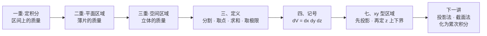

# 重积分大观

> [!info] 整理说明与阅读约定
> - **适用范围**：本专题覆盖**多元函数积分学**中的重积分。当前已完成**三重积分**部分，主体据浙江大学苏德矿《微积分（三）》**第 134 讲《三重积分的概念与 xy 型区域》**（54 分 32 秒）整理，并按考研大纲补齐了原讲未展开的性质、对称性与物理应用。索引与速查见 [[重积分 MOC]]。
> - **来源说明**：第 134 讲的完整语音／字幕暂未获取，**本笔记不是逐字听课记录**，而是依据已核实的授课主题（立体的体密度、三重积分概念的引入与定义、xy 型区域）重写的结构化笔记。**例题、性质、对称性、物理应用均为补充内容**，不代表视频使用了完全相同的例子。
> - **提示框约定**：
>   - `[!important]` **核心公式 / 定理**：考前必背结论，汇总见 [[#目录]] 下的《核心公式速查》
>   - `[!summary]` **口诀 / 一句话结论**
>   - `[!info]` **定义与补充说明**（原讲未给、后来补上的标准内容）
>   - `[!tip]` **做题动作**：考场实操步骤与几何直观
>   - `[!warning]` **易错雷区**：前提条件与高频失分点
>   - `[!failure]` **反例**：推翻直觉的样本
>   - `[!example]` **例题**：题干在外，解析折叠
>   - `[!question]` **默写自测**：题面在外、答案折叠（见 [[#十、公式默写自测（12 题）]]）
> - **编号体系**：一级板块 `一、二、三…`（`##`）→ 二级 `X.Y`（`###`）→ 三级 `X.Y.Z`（`####`）。

---

## 目录

**章节速览**

| 板块 | 核心内容 | 小节数 |
|---|---|---:|
| [[#总览：考纲定位与知识全景]] | 知识地图、命题定位、与二重积分的对照 | 3 |
| [[#一、为什么需要三重积分]] | 定积分 → 二重积分 → 三重积分的一条线 | 3 |
| [[#二、立体的体密度]] | 平均体密度、点体密度、直径趋于零 | 3 |
| [[#三、三重积分的定义]] | 分割 → 近似求和 → 取极限 → 可积性 | 4 |
| [[#四、记号、体积元素与坐标表示]] | 记号逐项解读、$dV$ 的三种坐标形式、为何无方向 | 3 |
| [[#五、三重积分的性质（补充）]] | 六条基本性质、奇偶性、轮换对称性 | 4 |
| [[#六、几何与物理意义]] | 体积、质量、重心、转动惯量 | 3 |
| [[#七、xy 型区域]] | 定义、命名由来、竖直连续性、求投影流程、反例 | 5 |
| [[#八、例题：识别与改写 xy 型区域]] | 5 道由易到难的区域描述题（含体积验算） | 5 |
| [[#九、速查与易错]] | 三步识别流程、易混对照、裸背清单 | 3 |
| [[#十、公式默写自测（12 题）]] | 闭卷检核，答案折叠 | 0 |
| [[#附录 A、来源与讲次对应]] | 本讲主题与本笔记章节的映射 | 0 |
| [[#附录 B、下一讲预告]] | 投影法与平面截割法要解决的问题 | 0 |

> [!abstract]- 点开查看全章详细目录（点击跳转）
> - [[#总览：考纲定位与知识全景]]
>   - [[#0.1 全章知识地图]]
>   - [[#0.2 考研命题定位]]
>   - [[#0.3 三重积分与二重积分的对照]]
> - [[#一、为什么需要三重积分]]
>   - [[#1.1 三种积分一览]]
>   - [[#1.2 统一的四步思想]]
>   - [[#1.3 本讲要解决的两个问题]]
> - [[#二、立体的体密度]]
>   - [[#2.1 平均体密度]]
>   - [[#2.2 点体密度：直径趋于零]]
>   - [[#2.3 体密度是三元函数]]
> - [[#三、三重积分的定义]]
>   - [[#3.1 第一步：分割立体]]
>   - [[#3.2 第二步：近似求和]]
>   - [[#3.3 第三步：取极限]]
>   - [[#3.4 定义与可积性]]
> - [[#四、记号、体积元素与坐标表示]]
>   - [[#4.1 记号逐项解读]]
>   - [[#4.2 体积元素 dV]]
>   - [[#4.3 为什么 dV 没有方向]]
> - [[#五、三重积分的性质（补充）]]
>   - [[#5.1 六条基本性质]]
>   - [[#5.2 对称性化简]]
>     - [[#5.2.1 关于坐标面的奇偶性]]
>     - [[#5.2.2 轮换对称性]]
> - [[#六、几何与物理意义]]
>   - [[#6.1 求体积]]
>   - [[#6.2 求质量]]
>   - [[#6.3 重心与转动惯量（补充）]]
> - [[#七、xy 型区域]]
>   - [[#7.1 xy 型区域的定义]]
>   - [[#7.2 为什么叫 xy 型]]
>   - [[#7.3 竖直方向的连续性要求]]
>   - [[#7.4 求投影区域的流程]]
>   - [[#7.5 不是 xy 型的立体]]
> - [[#八、例题：识别与改写 xy 型区域]]
>   - [[#8.1 例 1：旋转抛物面与坐标面]]
>   - [[#8.2 例 2：两个抛物面所围]]
>   - [[#8.3 例 3：球面与球体]]
>   - [[#8.4 例 4：三角柱（非旋转体）]]
>   - [[#8.5 例 5：球壳不是 xy 型]]
> - [[#九、速查与易错]]
>   - [[#9.1 三步识别流程]]
>   - [[#9.2 易混对照表]]
>   - [[#9.3 考前裸背清单]]
> - [[#十、公式默写自测（12 题）]]

> [!important]- 核心公式速查（8 张考前必看卡片）
> | # | 核心考点 | 关键公式 / 结论 | 跳转 |
> |:--:|---|---|---|
> | ① | 点体密度 | $\rho(x,y,z)=\lim\limits_{d\to0}\dfrac{\Delta m}{\Delta V}$（$d$ 为小立体的**直径**，不是体积） | [[#2.2 点体密度：直径趋于零\|2.2]] |
> | ② | 三重积分定义 | $\displaystyle\iiint_\Omega f\,\mathrm dV=\lim_{\lambda\to0}\sum_{i=1}^{n}f(\xi_i,\eta_i,\zeta_i)\Delta V_i$，$\lambda=\max$ 直径 | [[#3.4 定义与可积性\|3.4]] |
> | ③ | 直角坐标体积元素 | $\mathrm dV=\mathrm dx\,\mathrm dy\,\mathrm dz$；柱坐标 $r\,\mathrm dr\,\mathrm d\theta\,\mathrm dz$；球坐标 $\rho^2\sin\varphi\,\mathrm d\rho\,\mathrm d\varphi\,\mathrm d\theta$ | [[#4.2 体积元素 dV\|4.2]] |
> | ④ | 求体积 / 求质量 | $V=\iiint_\Omega 1\,\mathrm dV$；$m=\iiint_\Omega \rho\,\mathrm dV$ | [[#6.1 求体积\|6.1]] |
> | ⑤ | 估值与中值定理 | $mV\le\iiint_\Omega f\,\mathrm dV\le MV$；连续时 $\iiint_\Omega f\,\mathrm dV=f(\xi,\eta,\zeta)\,V$ | [[#5.1 六条基本性质\|5.1]] |
> | ⑥ | 奇偶性 | $\Omega$ 关于 $xOy$ 面对称：$f$ 关于 $z$ 奇 $\Rightarrow\iiint_\Omega f\,\mathrm dV=0$；偶 $\Rightarrow 2\iiint_{\Omega_{z\ge0}}$ | [[#5.2.1 关于坐标面的奇偶性\|5.2.1]] |
> | ⑦ | **xy 型区域定义** | $\Omega=\{(x,y,z)\mid (x,y)\in D_{xy},\ z_1(x,y)\le z\le z_2(x,y)\}$ | [[#7.1 xy 型区域的定义\|7.1]] |
> | ⑧ | 投影求法 | 消去 $z$：把上下曲面方程联立（或令 $z$ 有实解），得 $D_{xy}$ 的不等式 | [[#7.4 求投影区域的流程\|7.4]] |

---

## 总览：考纲定位与知识全景

### 0.1 全章知识地图

三重积分这一讲只做两件事：**把定义立起来**（是什么），**把积分区域描述清楚**（在哪积）。真正"算"的部分——把三重积分化成三次定积分——是下一讲的内容。

### 0.2 考研命题定位

| 题型 | 常考模块 | 典型考法 |
|---|---|---|
| **选择题** | 概念辨析 | 三重积分与二重积分记号、$\mathrm dV$ 的符号、区域的对称性 |
| **填空题** | 区域描述 | 写出立体在 $xOy$ 面上的投影 $D_{xy}$、写出 $z$ 的上下界 |
| **解答题** | 计算（下一讲起） | 投影法 / 截面法化累次积分，再配合柱坐标、球坐标 |

> [!info] 考纲对本章的要求
> 1. **理解**三重积分的概念，**了解**三重积分的性质。
> 2. **会**用重积分表达一些几何量与物理量（体积、质量、重心、转动惯量）。
> 3. **会**把三重积分化为累次积分（下一讲展开）。

本章是"概念 + 描述"，考纲用词是"理解"和"会表达"，因此**不要求在这里做复杂计算**，但要求能准确写出区域表达式——这正是后面所有计算的入口。

### 0.3 三重积分与二重积分的对照

二重积分是三重积分的直接前身，两者只有"维数"之差，把下表逐行对照读一遍，概念就通了大半。

| 对照项 | 二重积分 | 三重积分 |
|---|---|---|
| 积分区域 | 平面区域 $D$ | 空间区域 $\Omega$ |
| 面积／体积元素 | $\mathrm d\sigma=\mathrm dx\,\mathrm dy$（正） | $\mathrm dV=\mathrm dx\,\mathrm dy\,\mathrm dz$（正） |
| 被积函数 | $f(x,y)$ 二元 | $f(x,y,z)$ 三元 |
| 几何意义（$f\equiv1$） | 面积 | 体积 |
| 物理意义（$f=\rho$） | 薄片质量 | 立体质量 |
| 与区域边界的关系 | 由平面曲线围成 | 由空间曲面围成 |

> [!summary] 一句话
> **定积分积一段、二重积分积一片、三重积分积一块**；三者的定义结构、性质、乃至"先一后二"的化法，全都是同一套模板换维数。

---

## 一、为什么需要三重积分

### 1.1 三种积分一览

| 积分 | 积分区域 | 典型应用 | 元素 |
|---|---|---|---|
| 定积分 $\int_a^b f(x)\,\mathrm dx$ | 一维区间 | 细杆的质量 | 长度 $\mathrm dx$ |
| 二重积分 $\iint_D f(x,y)\,\mathrm d\sigma$ | 二维平面区域 | 薄片的质量 | 面积 $\mathrm d\sigma$ |
| 三重积分 $\iiint_\Omega f(x,y,z)\,\mathrm dV$ | 三维空间区域 | 立体的质量 | 体积 $\mathrm dV$ |

### 1.2 统一的四步思想

三者的构造完全一致：

$$
\boxed{\text{分割区域}\ \longrightarrow\ \text{取代表点}\ \longrightarrow\ \text{求近似和}\ \longrightarrow\ \text{取极限}}
$$

> [!tip] 为什么一定要走这四步
> 因为当密度不均匀时，"密度 $\times$ 总量"这种乘法失效了——乘法只对**常数密度**成立。四步法的本质是：**先把区域切到足够小，小到密度近似为常数，用乘法；再把无穷多个乘法的结果加起来，用极限。**

设空间立体占据区域 $\Omega$，各点密度可能不同，目标是求整个立体的质量 $m$。

### 1.3 本讲要解决的两个问题

1. **是什么**：如何用极限定义 $\iiint_\Omega f\,\mathrm dV$（第二、三、四章）。
2. **在哪积**：如何用不等式把三维区域 $\Omega$ 写清楚，尤其是 xy 型区域（第七章）。

> [!warning] 别急着算
> 这一讲不出现任何一次真正的三重积分计算。若在这里就急着套累次积分，会在"区域写错 → 上下界写反 → 结果符号错"这条链上反复翻车。**先把区域描述练成肌肉记忆，下一讲的计算才有意义。**

---

## 二、立体的体密度

### 2.1 平均体密度

设某个立体质量为 $m$、体积为 $V$，则其**平均体密度**为

$$
\bar\rho=\frac{m}{V}.
$$

若立体**各处密度相同**（均匀立体），则

$$
m=\rho V .
$$

> [!warning] 平均密度不能当密度用
> $\bar\rho$ 只是"总质量除以总体积"的一个数，它抹掉了内部差异。密度不均匀时，**不能**用 $\bar\rho V$ 以外的任何形式把它当成常数提到积分号外面——除非题目明确说均匀。

### 2.2 点体密度：直径趋于零

在点 $P(x,y,z)$ 附近取一个很小的立体 $\Delta\Omega$，其体积为 $\Delta V$、质量为 $\Delta m$。让 $\Delta\Omega$ 不断向 $P$ 收缩：

$$
\boxed{\ \rho(x,y,z)=\lim_{\Delta V\to0}\frac{\Delta m}{\Delta V}\ }
$$

> [!warning] 关键前提：要求**直径**趋于零，而不只是体积趋于零
> 小立体的**直径**定义为其中任意两点距离的上确界。只让 $\Delta V\to0$ 是不够的：一个又薄又长的"针状"区域体积可以趋于零，但它并不是在向一个点收缩，$\frac{\Delta m}{\Delta V}$ 可能根本不收敛。**必须让整个小区域"缩成一点"（直径 $\to0$），密度极限才有意义。**
> 这一点在第三章定义三重积分时还会出现一次——那里的 $\lambda$ 就是所有小区域直径的最大值。

### 2.3 体密度是三元函数

体密度描述的是**空间某一点附近单位体积所对应的质量**，它随点的位置而变：

$$
\rho=\rho(x,y,z).
$$

> [!info] 补充：密度的三种常见形态
> - **均匀**：$\rho\equiv$ 常数 → 三重积分退化为"密度乘体积"。
> - **只与到轴的距离有关**：如 $\rho=\rho\!\left(\sqrt{x^2+y^2}\right)$ → 提示用柱坐标。
> - **只与到原点的距离有关**：如 $\rho=\rho\!\left(\sqrt{x^2+y^2+z^2}\right)$ → 提示用球坐标。
>
> 看到密度的"长相"，就该预判该用哪种坐标系——这是后面几讲选坐标系的第一个信号。

---

## 三、三重积分的定义

### 3.1 第一步：分割立体

把立体区域 $\Omega$ 任意分成 $n$ 个互不重叠的小空间区域：

$$
\Delta V_1,\ \Delta V_2,\ \ldots,\ \Delta V_n ,
$$

同时用 $\Delta V_i$ 兼记第 $i$ 个小区域的**体积**（记号与二重积分里的 $\Delta\sigma_i$ 完全平行）。

### 3.2 第二步：近似求和

在第 $i$ 个小立体内**任选**一点

$$
P_i=(\xi_i,\eta_i,\zeta_i)\in\Delta\Omega_i ,
$$

由于小立体足够小，可近似认为其中密度不变，于是

$$
\Delta m_i\approx \rho(\xi_i,\eta_i,\zeta_i)\,\Delta V_i ,
$$

整个立体的质量近似为

$$
m\approx\sum_{i=1}^{n}\rho(\xi_i,\eta_i,\zeta_i)\,\Delta V_i .
$$

### 3.3 第三步：取极限

记各小区域直径的最大值为

$$
\lambda=\max_{1\le i\le n}\{\operatorname{diam}\Delta\Omega_i\},
$$

令 $\lambda\to0$（这同时迫使 $n\to\infty$）：

$$
m=\lim_{\lambda\to0}\sum_{i=1}^{n}\rho(\xi_i,\eta_i,\zeta_i)\,\Delta V_i .
$$

这就引出了三重积分

$$
\boxed{\ m=\iiint_\Omega \rho(x,y,z)\,\mathrm dV\ }.
$$

### 3.4 定义与可积性

> [!important] 三重积分的定义
> 设 $f(x,y,z)$ 是定义在**有界闭区域** $\Omega$ 上的有界函数。把 $\Omega$ 任意分成 $n$ 个小区域 $\Delta\Omega_i$（体积记 $\Delta V_i$），在第 $i$ 个小区域上任取点 $(\xi_i,\eta_i,\zeta_i)$，作和
> $$\sum_{i=1}^{n} f(\xi_i,\eta_i,\zeta_i)\,\Delta V_i ,$$
> 记 $\lambda$ 为所有小区域直径的最大值。若当 $\lambda\to0$ 时该和的极限**存在**，且**与分割方式无关、与代表点的取法无关**，则称此极限为 $f$ 在 $\Omega$ 上的**三重积分**，记作
> $$\iiint_\Omega f(x,y,z)\,\mathrm dV=\lim_{\lambda\to0}\sum_{i=1}^{n} f(\xi_i,\eta_i,\zeta_i)\,\Delta V_i ,$$
> 此时称 $f$ 在 $\Omega$ 上**可积**。

> [!info] 可积的充分条件（考研够用版）
> 1. $f$ 在 $\Omega$ 上**连续** $\Longrightarrow$ 可积；
> 2. $f$ 在 $\Omega$ 上**分片连续且有界**（如有有限个间断面）$\Longrightarrow$ 可积。
>
> 本课程遇到的被积函数基本都满足，**不必在可积性上纠缠**，但要知道"极限与分割、取点无关"这句话是定义的一部分。

> [!warning] 三个"不必"与一个"必须"
> - 不必：把 $\Omega$ 切成规则的小长方体（可任意分割）；
> - 不必：代表点取在小区域的中心或顶点（可任取）；
> - 不必：让所有小区域体积趋于零（要的是**直径**趋于零）。
> - **必须**：极限与分割方式、代表点选取**都无关**，否则极限不存在，三重积分不存在。

---

## 四、记号、体积元素与坐标表示

### 4.1 记号逐项解读

$$
\iiint_\Omega f(x,y,z)\,\mathrm dV
$$

| 记号 | 名称 | 说明 |
|---|---|---|
| $\iiint$ | 三重积分号 | 三个积分号对应三个积分变量，也对应区域的维数 |
| $\Omega$ | 积分区域 | 空间中的**有界闭区域**（可求体积） |
| $f(x,y,z)$ | 被积函数 | 二元时是"面密度"，三元时通常是"体密度" |
| $\mathrm dV$ | 体积元素 | 微小的体积，**恒取正值** |

### 4.2 体积元素 dV

在直角坐标系中

$$
\boxed{\ \mathrm dV=\mathrm dx\,\mathrm dy\,\mathrm dz\ }
$$

其本质是**小长方体的体积**：三条棱长分别为 $\mathrm dx,\mathrm dy,\mathrm dz$。

> [!info] 补充：另两种坐标系下的体积元素（后续讲次展开）
> | 坐标系 | 变换 | 体积元素 | 什么时候用 |
> |---|---|---|---|
> | 直角坐标 | — | $\mathrm dV=\mathrm dx\,\mathrm dy\,\mathrm dz$ | 立体由平面／柱面围成 |
> | 柱坐标 | $x=r\cos\theta,\ y=r\sin\theta,\ z=z$ | $\mathrm dV=r\,\mathrm dr\,\mathrm d\theta\,\mathrm dz$ | 立体绕 $z$ 轴旋转对称 |
> | 球坐标 | $x=\rho\sin\varphi\cos\theta,\ y=\rho\sin\varphi\sin\theta,\ z=\rho\cos\varphi$ | $\mathrm dV=\rho^2\sin\varphi\,\mathrm d\rho\,\mathrm d\varphi\,\mathrm d\theta$ | 立体是球或球的一部分 |
>
> 那个 $r$ 和 $\rho^2\sin\varphi$ 就是**雅可比因子**，不是"凭空多出来的系数"：坐标变换把小块"拉伸"了，体积要按拉伸比例补偿。

### 4.3 为什么 dV 没有方向

> [!important] 体积元素取正
> $\mathrm dV>0$ 恒成立。三重积分**没有方向性**，不需要像第二类曲线积分、第二类曲面积分那样讨论"正向/负向""上侧/下侧"。

为什么？因为 $\mathrm dV$ 就是**体积**——体积本身是非负的量。方向性出现在"用有向元素去点乘向量场"的场合（第二类曲面积分 $\iint_\Sigma \vec F\cdot\mathrm d\vec S$，其中 $\mathrm d\vec S=\vec n\,\mathrm dS$ 带了法向），而三重积分是对区域内部所有点做**标量累加**，不存在"从哪一侧穿过去"的问题。

> [!warning] 常见混淆
> - 三重积分：$\mathrm dV$ 恒正，**换元后仍取绝对值**（雅可比行列式要加绝对值）。
> - 第二类曲面积分：$\mathrm d\vec S$ 带方向，换面（换侧）要变号。
> - 定积分：$\int_a^b$ 与 $\int_b^a$ 差一个负号，那是**积分限**的方向，不是元素的方向。

---

## 五、三重积分的性质（补充）

> [!info] 本节为按考研大纲补齐的标准内容
> 第 134 讲只到定义为止。以下性质与二重积分逐条平行，考试中常用于"不算而判"的选填题。

### 5.1 六条基本性质

> [!important] 三重积分的六条性质（设所涉积分均存在）
> 1. **线性**：$\displaystyle\iiint_\Omega \big(\alpha f+\beta g\big)\,\mathrm dV=\alpha\iiint_\Omega f\,\mathrm dV+\beta\iiint_\Omega g\,\mathrm dV$。
> 2. **区域可加**：若 $\Omega=\Omega_1\cup\Omega_2$ 且两者内部不交，则 $\displaystyle\iiint_\Omega f\,\mathrm dV=\iiint_{\Omega_1}f\,\mathrm dV+\iiint_{\Omega_2}f\,\mathrm dV$。
> 3. **体积公式**：$\displaystyle\iiint_\Omega 1\,\mathrm dV=V(\Omega)$。
> 4. **保号与比较**：若 $f\le g$，则 $\displaystyle\iiint_\Omega f\,\mathrm dV\le\iiint_\Omega g\,\mathrm dV$；特别地 $\left|\iiint_\Omega f\,\mathrm dV\right|\le\iiint_\Omega |f|\,\mathrm dV$。
> 5. **估值定理**：若 $m\le f\le M$，则 $\displaystyle mV(\Omega)\le\iiint_\Omega f\,\mathrm dV\le MV(\Omega)$。
> 6. **中值定理**：若 $f$ 在 $\Omega$ 上连续，则存在 $(\xi,\eta,\zeta)\in\Omega$，使 $\displaystyle\iiint_\Omega f\,\mathrm dV=f(\xi,\eta,\zeta)\,V(\Omega)$。

> [!tip] 性质 5、6 的考场用法
> 题目只问"这个三重积分的取值范围"或"与某个数比大小"时，**不要算**：先求被积函数在 $\Omega$ 上的最小／最大值，再乘体积。若区域体积恰好是 $4\pi/3$、$8\pi$ 这类"好看"的数，多半就是在考估值定理。

### 5.2 对称性化简

#### 5.2.1 关于坐标面的奇偶性

> [!important] 奇偶性三行结论
> 以 $xOy$ 面为例，设 $\Omega$ 关于 $xOy$ 面**对称**（即 $(x,y,z)\in\Omega\iff(x,y,-z)\in\Omega$）：
> - 若 $f$ 关于 $z$ 是**奇函数**（$f(x,y,-z)=-f(x,y,z)$），则 $\displaystyle\iiint_\Omega f\,\mathrm dV=0$；
> - 若 $f$ 关于 $z$ 是**偶函数**（$f(x,y,-z)=f(x,y,z)$），则 $\displaystyle\iiint_\Omega f\,\mathrm dV=2\iiint_{\Omega_{z\ge0}}f\,\mathrm dV$。
>
> 关于 $yOz$ 面（看 $x$ 的奇偶）、$zOx$ 面（看 $y$ 的奇偶）完全同理。

> [!tip] 操作顺序（必背）
> **一看区域对称，二看函数奇偶，两个条件同时满足才能用。** 只满足一个就用，是最常见的失分点——例如区域关于 $xOy$ 面对称，但 $f=x$（关于 $z$ 既非奇也非偶），此时**不能**得出积分为 $0$。

#### 5.2.2 轮换对称性

> [!important] 轮换对称性
> 若把 $\Omega$ 的表达式中的 $x,y,z$ **轮换**（$x\to y\to z\to x$）后区域不变，则
> $$\iiint_\Omega f(x,y,z)\,\mathrm dV=\iiint_\Omega f(y,z,x)\,\mathrm dV=\iiint_\Omega f(z,x,y)\,\mathrm dV .$$
> 典型区域：球 $x^2+y^2+z^2\le R^2$、立方体 $[0,1]^3$、锥体 $x^2+y^2\le z^2,\ 0\le z\le1$。

> [!tip] 最高频的一步秒杀
> 在轮换对称的区域上，$\displaystyle\iiint_\Omega x^2\,\mathrm dV=\iiint_\Omega y^2\,\mathrm dV=\iiint_\Omega z^2\,\mathrm dV=\frac13\iiint_\Omega (x^2+y^2+z^2)\,\mathrm dV$。
> 于是 $\iiint_\Omega (x^2+y^2)\,\mathrm dV=\frac23\iiint_\Omega (x^2+y^2+z^2)\,\mathrm dV$——把一个"偏心的"被积函数换成**完全对称**的，这是球体积分的关键一步。

---

## 六、几何与物理意义

### 6.1 求体积

令被积函数 $f(x,y,z)\equiv1$，则

$$
\boxed{\ V(\Omega)=\iiint_\Omega 1\,\mathrm dV\ }
$$

这说明三重积分可以直接表示空间立体的体积：每个小体积 $\Delta V_i$ 乘 $1$ 再相加，就是总体积。

> [!tip] 与二重积分求体积的分工
> - **二重积分求体积**：$\displaystyle\iint_D \big[z_2(x,y)-z_1(x,y)\big]\,\mathrm d\sigma$，被积函数是"柱子的高"。
> - **三重积分求体积**：$\displaystyle\iiint_\Omega 1\,\mathrm dV$，被积函数恒为 $1$。
>
> 两者算的是同一个数。三重积分之所以还要保留"求体积"这个用法，是因为在柱坐标、球坐标下，$\iiint 1\,\mathrm dV$ 往往比先求高再二重积分更好写（被积函数是常数，只有体积元素复杂）。

### 6.2 求质量

若体密度为 $\rho(x,y,z)$，则

$$
\boxed{\ m=\iiint_\Omega \rho(x,y,z)\,\mathrm dV\ }
$$

> [!summary] 体积与质量的唯一区别
> **求体积是每个小体积直接相加；求质量是每个小体积先乘上该处的密度，再相加。** 一个被积函数是 $1$，一个是 $\rho$——形式差别就这么点，物理含义却完全不同。

### 6.3 重心与转动惯量（补充）

> [!important] 四个必记物理量（$\rho$ 为体密度，$m=\iiint_\Omega\rho\,\mathrm dV$）
> - **重心**：
> $$\bar x=\frac{1}{m}\iiint_\Omega x\rho\,\mathrm dV,\qquad \bar y=\frac{1}{m}\iiint_\Omega y\rho\,\mathrm dV,\qquad \bar z=\frac{1}{m}\iiint_\Omega z\rho\,\mathrm dV .$$
> - **转动惯量**（到坐标轴）：
> $$I_x=\iiint_\Omega (y^2+z^2)\rho\,\mathrm dV,\quad I_y=\iiint_\Omega (x^2+z^2)\rho\,\mathrm dV,\quad I_z=\iiint_\Omega (x^2+y^2)\rho\,\mathrm dV .$$
> - **到原点的转动惯量**：$I_O=\displaystyle\iiint_\Omega (x^2+y^2+z^2)\rho\,\mathrm dV$。

> [!tip] 两个记忆抓手
> 1. **重心 = 一阶矩 ÷ 质量**：分子是"位置 $\times$ 密度"的积分，分母永远是 $m$。
> 2. **绕哪个轴转，就少算哪个变量**：绕 $z$ 轴转，$z$ 坐标不变、不贡献惯量，所以 $I_z$ 里只有 $x^2+y^2$。由此还得一个关系
> $$I_x+I_y+I_z=2I_O ,$$
> 因为三个式子相加恰好把每个变量的平方算了两遍。均匀立体若 $\rho\equiv\rho_0$，则 $\rho_0$ 可提到积分号外，重心即为**形心**。

---

## 七、xy 型区域

> [!info] 本节是本讲的核心概念
> 三重积分的定义只说了"在 $\Omega$ 上积"，但没告诉你**怎么把 $\Omega$ 用不等式写出来**。区域写得出来，积分才化得下去。xy 型区域是最常用的一种写法，也是下一讲"投影法"的直接前提。

### 7.1 xy 型区域的定义

设空间区域 $\Omega$ 在 $xOy$ 平面上的**投影**为 $D_{xy}$。如果对于 $D_{xy}$ 内的**每一点** $(x,y)$，立体在竖直方向（平行于 $z$ 轴）上的范围都可以表示为

$$
z_1(x,y)\le z\le z_2(x,y),
$$

则称 $\Omega$ 为 **xy 型区域**（也称"$z$ 型简单区域""先一后二型区域"）。

> [!important] xy 型区域的标准表达式
> $$\boxed{\ \Omega=\left\{(x,y,z)\ \middle|\ (x,y)\in D_{xy},\ z_1(x,y)\le z\le z_2(x,y)\right\}\ }$$
> 其中 $z=z_1(x,y)$ 称为**下表面**，$z=z_2(x,y)$ 称为**上表面**，$D_{xy}$ 称为**投影区域**（底面）。

![[xy型区域示意图.png]]

> 概念示意图：固定一个 $(x,y)$，沿 $z$ 轴方向从下表面走到上表面，走过的正是这个立体的"一根柱子"。

### 7.2 为什么叫 xy 型

因为**先用 $(x,y)$ 定位，再用 $(x,y)$ 定 $z$**：

1. 先确定 $(x,y)$ 落在平面区域 $D_{xy}$ 的哪里（"站在底面的哪一格"）；
2. 再由这一格算出 $z$ 的上下界（"这根柱子有多长"）。

> [!summary] 一句话记住命名
> **xy 型 = 先平面、后竖直 = 先一后二。** 那个"一"是对 $z$ 的一重积分，"二"是对 $D_{xy}$ 的二重积分。

> [!info] 补充：与之对偶的"z 型区域"
> 若反过来**先固定 $z$**，用平面 $z=$ 常数去截立体，截得截面 $D_z$，则可写成
> $$\Omega=\left\{(x,y,z)\ \middle|\ c\le z\le d,\ (x,y)\in D_z\right\},$$
> 称为 **z 型区域**（"先二后一型"）。两种写法对应下一讲的两条路：**投影法**（用 xy 型）与**平面截割法**（用 z 型）。

### 7.3 竖直方向的连续性要求

> [!warning] 定义里藏着一个条件
> 对 $D_{xy}$ 内**固定的** $(x,y)$，竖直直线与立体的交必须是一个**连续的线段**（单个闭区间）。若交出来是几段互不相连的区间，这个立体**不是** xy 型区域，或者必须把 $D_{xy}$ 分成几块分别处理。

还有第二种"不满足"的情形：**上下表面的表达式在 $D_{xy}$ 的不同部分会变**。例如某立体的顶面在左半边是平面、右半边是球面，虽然竖直方向连续，但 $z_2(x,y)$ 不是同一个函数，也要**分块**。

> [!tip] 分块的判据
> 什么时候要分块？看**边界曲面的交线在 $xOy$ 面上的投影**：投影把 $D_{xy}$ 切成几块，就分几块。下一讲的"分块投影"就是这么来的。

### 7.4 求投影区域的流程

> [!tip] 四步走（拿到立体先做这个，别急着写积分）
> 1. **列曲面**：找出围成立体的**所有**曲面（缺一个，区域就写错）。
> 2. **定投影**：$D_{xy}=\{(x,y)\mid \text{存在 } z \text{ 使 } (x,y,z)\in\Omega\}$——投影就是"底面被照亮的那块影子"。
> 3. **消 $z$**：把上下两个曲面方程**联立**（即令 $z_1=z_2$）消去 $z$，得关于 $x,y$ 的不等式，就是 $D_{xy}$ 的边界；若有柱面（如 $x^2+y^2=1$、$x=0$）直接作为边界用。
> 4. **验算**：在 $D_{xy}$ 内部任取一点 $(x_0,y_0)$，算出 $z_1,z_2$，确认 $z_1\le z_2$，且这两点确实在立体上。

> [!warning] 最常见的三个错
> - 只联立了"上下曲面"，忘了还有柱面／坐标面限制，导致 $D_{xy}$ 取大了；
> - 上下界写反（$z_1>z_2$），积分出来是负数；
> - 把 $z$ 的下界一律当成 $0$——**只有**下表面恰好是 $xOy$ 面时才是 $0$。

### 7.5 不是 xy 型的立体

> [!failure] 反例：球壳不是 xy 型区域
> 设 $\Omega=\left\{(x,y,z)\ \middle|\ 1\le x^2+y^2+z^2\le4\right\}$（内半径 $1$、外半径 $2$ 的球壳）。
> 取 $(x,y)=(0,0)$，则 $1\le z^2\le4$，即 $z\in[-2,-1]\cup[1,2]$——竖直方向被挖空了中间一段，是**两段互不相连**的区间。
> 因此球壳**不是** xy 型区域，无法用单个 $z_1\le z\le z_2$ 描述；它更适合用**球坐标**（$\rho$ 的范围恰好是 $1\le\rho\le2$，一个区间），这正是"选坐标系"的意义所在。

> [!tip] 一个更隐蔽的坑
> 即使立体"看起来"是 xy 型的，只要**上表面在不同部分换了一副面孔**（例如顶面由两个不同曲面拼成），也要按交线的投影分块。判断口诀：**先看竖直方向连不连，再看上下表面是不是同一个函数。**

---

## 八、例题：识别与改写 xy 型区域

> [!info] 说明
> 以下 5 题均为**补充例题**，非第 134 讲原题。每题都要求写出 $D_{xy}$ 与 $z$ 的上下界；体积只作验算用（真正的计算在下一讲）。

### 8.1 例 1：旋转抛物面与坐标面

> [!example] 例 1
> 设立体 $\Omega$ 由曲面 $z=0$ 与 $z=4-x^2-y^2$ 围成。写出 $\Omega$ 的 xy 型表达式，并求其体积。
> > [!success]- 点开看解析
> > **① 列曲面**：下表面 $z=0$，上表面 $z=4-x^2-y^2$。
> > **② 消 $z$ 定投影**：要求 $0\le z\le 4-x^2-y^2$ 有解，必须 $4-x^2-y^2\ge0$，故
> > $$D_{xy}=\left\{(x,y)\ \middle|\ x^2+y^2\le4\right\},$$
> > 即半径为 $2$ 的圆盘。
> > **③ 写出区域**：
> > $$\Omega=\left\{(x,y,z)\ \middle|\ x^2+y^2\le4,\ 0\le z\le 4-x^2-y^2\right\}.$$
> > **④ 验算体积**（极坐标）：
> > $$V=\iint_{D_{xy}}(4-x^2-y^2)\,\mathrm d\sigma=\int_0^{2\pi}\!\!\mathrm d\theta\int_0^2 (4-r^2)r\,\mathrm dr=2\pi\left[2r^2-\frac{r^4}{4}\right]_0^2=2\pi(8-4)=8\pi .$$
> > 若写成三重积分，就是 $\displaystyle V=\iint_{D_{xy}}\left[\int_0^{4-x^2-y^2}1\,\mathrm dz\right]\mathrm dx\,\mathrm dy$——这正是下一讲"投影法"的形状。

### 8.2 例 2：两个抛物面所围

> [!example] 例 2
> 设立体 $\Omega$ 由 $z=x^2+y^2$（开口向上的抛物面）与 $z=2-x^2-y^2$（开口向下的抛物面）围成。写出 $\Omega$ 的 xy 型表达式。
> > [!success]- 点开看解析
> > **① 求交线**：令 $x^2+y^2=2-x^2-y^2$，得 $x^2+y^2=1$。
> > **② 定投影**：交线在 $xOy$ 面上的投影是单位圆，故 $D_{xy}=\{(x,y)\mid x^2+y^2\le1\}$。
> > **③ 定上下界**：在 $D_{xy}$ 内取 $(0,0)$，下表面 $z=0$、上表面 $z=2$，确实 $0\le2$，且下方曲面是 $z=x^2+y^2$、上方是 $z=2-x^2-y^2$。于是
> > $$\Omega=\left\{(x,y,z)\ \middle|\ x^2+y^2\le1,\ x^2+y^2\le z\le 2-x^2-y^2\right\}.$$
> > **④ 验算体积**：
> > $$V=\iint_{D_{xy}}\big[(2-r^2)-r^2\big]\mathrm d\sigma=\int_0^{2\pi}\!\!\mathrm d\theta\int_0^1 (2-2r^2)r\,\mathrm dr=4\pi\left[\frac{r^2}{2}-\frac{r^4}{4}\right]_0^1=4\pi\cdot\frac14=\pi .$$
> > **注意**：这题的下表面**不是** $z=0$，而是曲面 $z=x^2+y^2$——这是最容易写错的地方。

### 8.3 例 3：球面与球体

> [!example] 例 3
> （1）立体 $\Omega_1$ 由上半球面 $z=\sqrt{4-x^2-y^2}$ 与平面 $z=0$ 围成；
> （2）立体 $\Omega_2$ 为球体 $x^2+y^2+z^2\le1$。
> 分别写出两者的 xy 型表达式。
> > [!success]- 点开看解析
> > **（1）上半球（半径 2）**
> > 由 $0\le z\le\sqrt{4-x^2-y^2}$ 要求 $4-x^2-y^2\ge0$，故 $D_{xy}:x^2+y^2\le4$，
> > $$\Omega_1=\left\{(x,y,z)\ \middle|\ x^2+y^2\le4,\ 0\le z\le\sqrt{4-x^2-y^2}\right\}.$$
> > 体积 $V_1=\displaystyle\int_0^{2\pi}\!\!\mathrm d\theta\int_0^2\sqrt{4-r^2}\,r\,\mathrm dr=2\pi\cdot\frac83=\frac{16\pi}{3}$，恰为半径 $2$ 球体体积的一半，验算通过。
> >
> > **（2）整个球体（半径 1）**
> > 球体是**上下两片曲面**夹成的：$z$ 从 $-\sqrt{1-x^2-y^2}$ 到 $\sqrt{1-x^2-y^2}$，
> > $$\Omega_2=\left\{(x,y,z)\ \middle|\ x^2+y^2\le1,\ -\sqrt{1-x^2-y^2}\le z\le\sqrt{1-x^2-y^2}\right\}.$$
> > 体积 $V_2=\displaystyle\iint_{x^2+y^2\le1}2\sqrt{1-r^2}\,\mathrm d\sigma=2\pi\cdot\frac43=\frac{4\pi}{3}$，验算通过。
> >
> > **对比记忆**：球体本身**是** xy 型区域（竖直方向连续），只是下表面是下半球面而非常数 $0$；而 7.5 的球壳**不是**——差别就在"竖直方向中间有没有被挖空"。

### 8.4 例 4：三角柱（非旋转体）

> [!example] 例 4
> 设立体 $\Omega$ 由平面 $z=0$、$z=1-x-y$ 以及坐标面 $x=0$、$y=0$ 围成（第一卦限内的三棱柱）。写出 xy 型表达式并求体积。
> > [!success]- 点开看解析
> > **① 列曲面**：下表面 $z=0$，上表面 $z=1-x-y$，侧面 $x=0$、$y=0$（还有隐含的 $z\ge0$ 与 $1-x-y\ge0$）。
> > **② 定投影**：$0\le z\le 1-x-y$ 有解 $\iff 1-x-y\ge0$；再加上侧面限制 $x\ge0,\ y\ge0$，得
> > $$D_{xy}=\left\{(x,y)\ \middle|\ x\ge0,\ y\ge0,\ x+y\le1\right\},$$
> > 即顶点为 $(0,0),(1,0),(0,1)$ 的三角形。
> > **③ 写出区域**：
> > $$\Omega=\left\{(x,y,z)\ \middle|\ x\ge0,\ y\ge0,\ x+y\le1,\ 0\le z\le1-x-y\right\}.$$
> > **④ 验算体积**：
> > $$V=\iint_{D_{xy}}(1-x-y)\,\mathrm d\sigma=\int_0^1\!\mathrm dx\int_0^{1-x}(1-x-y)\,\mathrm dy=\int_0^1\frac{(1-x)^2}{2}\,\mathrm dx=\frac16 .$$
> > 与"底面积 $\frac12$ × 平均高 $\frac13$"的棱锥体积公式一致（$\frac12\cdot\frac13=\frac16$），验算通过。
> >
> > **这题的意义**：投影**不是圆**，说明 xy 型区域跟"旋转体"没有关系——只要竖直方向连续，任何平面围成的立体都能写成 xy 型。

### 8.5 例 5：球壳不是 xy 型

> [!example] 例 5
> 判断 $\Omega=\left\{(x,y,z)\ \middle|\ 1\le x^2+y^2+z^2\le4\right\}$ 是否为 xy 型区域。若不是，说明理由并给出合适的处理方向。
> > [!success]- 点开看解析
> > **不是。** 取 $D_{xy}$ 内一点 $(0,0)$（它在 $x^2+y^2\le4$ 内），竖直方向需满足
> > $$1\le z^2\le4\ \Longrightarrow\ z\in[-2,-1]\cup[1,2],$$
> > 是两段互不相连的区间，违反 7.3 的连续性要求。
> > **处理方向**：这类"空心"立体适合用**球坐标**，$\Omega:\ 1\le\rho\le2,\ 0\le\varphi\le\pi,\ 0\le\theta\le2\pi$，$\rho$ 只用一个区间就描述完了。若坚持用直角坐标，只能把 $D_{xy}$ 分成 $x^2+y^2\le1$（两段）与 $1<x^2+y^2\le4$（一段）两部分，非常麻烦。

---

## 九、速查与易错

### 9.1 三步识别流程

> [!tip] 拿到一个立体，按这个顺序走
> 1. **数曲面**：列出全部边界曲面（含坐标面）。
> 2. **找投影**：联立上下曲面消 $z$，加上柱面／坐标面限制 → $D_{xy}$。
> 3. **定上下界**：在 $D_{xy}$ 内取一点试算，写下表面 $z_1(x,y)$、上表面 $z_2(x,y)$，并检查 $z_1\le z_2$。
>
> 若第 3 步发现"试算点的竖直方向不连续"，说明**不是** xy 型 → 改用 z 型（截面法）或换坐标系。

### 9.2 易混对照表

| 易混点 | 正确说法 | 常见错误 |
|---|---|---|
| $\mathrm dV$ 的正负 | 恒正，换元时雅可比取绝对值 | 以为要按"穿入穿出"定向 |
| 定义中的 $\lambda$ | 小区域**直径**的最大值 | 写成"体积趋于零" |
| 求体积 vs 求质量 | 被积函数 $1$ vs $\rho$ | 求体积时也乘密度 |
| $z$ 的下界 | 下表面 $z_1(x,y)$ | 一律写成 $0$ |
| 上下表面 | 可以是曲面（如 $z=\sqrt{4-x^2-y^2}$） | 以为必须是常数 |
| 投影 $D_{xy}$ | 立体在 $xOy$ 面上的**影子** | 只取交线内部，漏掉柱面限制 |
| 对称性的使用 | 区域对称 **且** 函数奇偶，两个都要 | 只看其中一个就判 $0$ |
| 球体 vs 球壳 | 球体是 xy 型；球壳不是 | 混为一谈 |

### 9.3 考前裸背清单

> [!abstract] 闭卷默写这 8 条
> 1. $\displaystyle m=\iiint_\Omega \rho(x,y,z)\,\mathrm dV$；
> 2. $\displaystyle V(\Omega)=\iiint_\Omega 1\,\mathrm dV$；
> 3. $\displaystyle\iiint_\Omega f\,\mathrm dV=\lim_{\lambda\to0}\sum_{i=1}^n f(\xi_i,\eta_i,\zeta_i)\Delta V_i$，$\lambda$ 是**直径**的最大值；
> 4. $\mathrm dV=\mathrm dx\,\mathrm dy\,\mathrm dz$，**恒正无方向**；
> 5. $\Omega=\{(x,y,z)\mid (x,y)\in D_{xy},\ z_1(x,y)\le z\le z_2(x,y)\}$；
> 6. 投影 $D_{xy}$ = 上下曲面联立消 $z$ ＋ 柱面／坐标面限制；
> 7. 对称性：区域对称 **且** 函数关于对应变量奇 $\Rightarrow 0$；偶 $\Rightarrow$ 折半的两倍；
> 8. 轮换对称：$\iiint x^2=\iiint y^2=\iiint z^2=\frac13\iiint(x^2+y^2+z^2)$。

---

## 十、公式默写自测（12 题）

> [!question] 1. 三重积分的定义式
> 请写出 $\iiint_\Omega f(x,y,z)\,\mathrm dV$ 的极限定义，并说明 $\lambda$ 的含义。
> > [!success]- 点开看答案
> > $\displaystyle\iiint_\Omega f\,\mathrm dV=\lim_{\lambda\to0}\sum_{i=1}^{n}f(\xi_i,\eta_i,\zeta_i)\Delta V_i$，其中 $\lambda=\max\limits_{1\le i\le n}\{\operatorname{diam}\Delta\Omega_i\}$ 是各小区域**直径**的最大值。见 [[#3.4 定义与可积性]]

> [!question] 2. 为什么定义中要求直径趋于零
> 只说"小区域体积 $\Delta V\to0$"为什么不够？
> > [!success]- 点开看答案
> > 因为可以构造又薄又长的针状区域，其体积趋于零但并不向一点收缩，$\Delta m/\Delta V$ 可能不收敛。只有**直径**趋于零才能保证小区域真正"缩成一点"。见 [[#2.2 点体密度：直径趋于零]]

> [!question] 3. 点体密度的定义
> 写出 $\rho(x,y,z)$ 的极限定义。
> > [!success]- 点开看答案
> > $\displaystyle\rho(x,y,z)=\lim_{\Delta V\to0}\frac{\Delta m}{\Delta V}$（要求小区域**直径**趋于零）。见 [[#2.2 点体密度：直径趋于零]]

> [!question] 4. 体积元素的三种坐标形式
> 写出 $\mathrm dV$ 在直角坐标、柱坐标、球坐标下的表达式。
> > [!success]- 点开看答案
> > 直角：$\mathrm dV=\mathrm dx\,\mathrm dy\,\mathrm dz$；柱坐标：$\mathrm dV=r\,\mathrm dr\,\mathrm d\theta\,\mathrm dz$；球坐标：$\mathrm dV=\rho^2\sin\varphi\,\mathrm d\rho\,\mathrm d\varphi\,\mathrm d\theta$。见 [[#4.2 体积元素 dV]]

> [!question] 5. 为什么 dV 不考虑正负方向
> 三重积分的体积元素为什么不像第二类曲面积分那样讨论方向？
> > [!success]- 点开看答案
> > 因为 $\mathrm dV$ 就是**体积**，本身非负；三重积分是对区域内各点做标量累加，不存在"从哪一侧穿过"的问题。方向性属于定向积分（第二类曲线／曲面积分）。见 [[#4.3 为什么 dV 没有方向]]

> [!question] 6. 求体积与求质量的两个公式
> 写出用三重积分求体积、求质量的表达式，并说明两者的区别。
> > [!success]- 点开看答案
> > $V=\displaystyle\iiint_\Omega 1\,\mathrm dV$，$m=\displaystyle\iiint_\Omega\rho\,\mathrm dV$。区别只在被积函数：求体积是每个小体积直接相加，求质量是每个小体积先乘该处密度再相加。见 [[#6.1 求体积]]、[[#6.2 求质量]]

> [!question] 7. 估值定理与中值定理
> 设 $m\le f\le M$，写出三重积分的估值不等式；再写出连续情形下的中值公式。
> > [!success]- 点开看答案
> > $mV(\Omega)\le\displaystyle\iiint_\Omega f\,\mathrm dV\le MV(\Omega)$；$f$ 连续时存在 $(\xi,\eta,\zeta)\in\Omega$ 使 $\displaystyle\iiint_\Omega f\,\mathrm dV=f(\xi,\eta,\zeta)V(\Omega)$。见 [[#5.1 六条基本性质]]

> [!question] 8. 奇偶性化简
> 设 $\Omega$ 关于 $xOy$ 面对称，$f$ 关于 $z$ 为奇函数，$\iiint_\Omega f\,\mathrm dV$ 等于多少？若为偶函数呢？
> > [!success]- 点开看答案
> > 奇函数：$\iiint_\Omega f\,\mathrm dV=0$；偶函数：$\iiint_\Omega f\,\mathrm dV=2\displaystyle\iiint_{\Omega_{z\ge0}}f\,\mathrm dV$。**前提是区域对称与函数奇偶同时满足**。见 [[#5.2.1 关于坐标面的奇偶性]]

> [!question] 9. xy 型区域的定义式
> 请默写 xy 型区域 $\Omega$ 的集合表达式，并指出 $z_1,z_2,D_{xy}$ 各叫什么。
> > [!success]- 点开看答案
> > $\Omega=\{(x,y,z)\mid (x,y)\in D_{xy},\ z_1(x,y)\le z\le z_2(x,y)\}$；$z=z_1(x,y)$ 为**下表面**，$z=z_2(x,y)$ 为**上表面**，$D_{xy}$ 为立体在 $xOy$ 面上的**投影区域**。见 [[#7.1 xy 型区域的定义]]

> [!question] 10. xy 型区域中的 xy 指什么
> 为什么叫"xy 型"？它与"z 型区域"的区别是什么？
> > [!success]- 点开看答案
> > 因为先用 $(x,y)$ 定位（落在 $D_{xy}$ 的哪一格），再用 $(x,y)$ 定 $z$ 的上下界——**先平面、后竖直、先一后二**。z 型区域则反过来：先固定 $z$ 得截面 $D_z$，写成 $\{(x,y,z)\mid c\le z\le d,\ (x,y)\in D_z\}$，对应"先二后一"。见 [[#7.2 为什么叫 xy 型]]

> [!question] 11. 判断一个立体不是 xy 型
> 举一个不是 xy 型区域的立体，并说明理由。
> > [!success]- 点开看答案
> > 球壳 $1\le x^2+y^2+z^2\le4$。取 $(x,y)=(0,0)$，则 $z\in[-2,-1]\cup[1,2]$，竖直方向是两段互不相连的区间，违反连续性要求。宜改用球坐标。见 [[#7.5 不是 xy 型的立体]]

> [!question] 12. 求投影区域的方法
> 已知立体由 $z=x^2+y^2$ 与 $z=2-x^2-y^2$ 围成，求 $D_{xy}$ 与 $z$ 的上下界。
> > [!success]- 点开看答案
> > 联立两曲面：$x^2+y^2=2-x^2-y^2\Rightarrow x^2+y^2=1$，故 $D_{xy}:x^2+y^2\le1$；在 $D_{xy}$ 内 $x^2+y^2\le z\le 2-x^2-y^2$。体积 $V=\pi$。见 [[#8.2 例 2：两个抛物面所围]]

---

## 附录 A、来源与讲次对应

| 本讲官方主题 | 本笔记对应章节 |
|---|---|
| 立体的体密度 | [[#二、立体的体密度]] |
| 三重积分概念的引入 | [[#一、为什么需要三重积分]]、[[#三、三重积分的定义]] |
| 三重积分的定义 | [[#3.4 定义与可积性]]、[[#四、记号、体积元素与坐标表示]] |
| xy 型区域 | [[#七、xy 型区域]]、[[#八、例题：识别与改写 xy 型区域]] |

> [!info] 来源与可信度
> - **课程**：浙江大学 · 苏德矿《微积分（三）》第 134 讲，时长 54 分 32 秒（B 站）。
> - **本笔记的性质**：已核对视频目录与浙大课程大纲，但**未能获取本集完整语音／字幕**，故为依授课主题整理的学习笔记，**不是逐字听课记录**。
> - **补充内容**：第五章（性质与对称性）、6.3（重心与转动惯量）、全部例题、第十章默写题，均为按考研大纲补齐，**不代表老师在视频中使用了相同表述或例子**。

## 附录 B、下一讲预告

第 135 讲《直角坐标系下的投影法、平面截割法》要解决的是"**怎么算**"：

| 方法 | 依据的区域类型 | 化成的形式 |
|---|---|---|
| **投影法**（先一后二） | xy 型区域 | $\displaystyle\iint_{D_{xy}}\left[\int_{z_1(x,y)}^{z_2(x,y)}f\,\mathrm dz\right]\mathrm d\sigma$ |
| **平面截割法**（先二后一） | z 型区域 | $\displaystyle\int_c^d\left[\iint_{D_z}f\,\mathrm d\sigma\right]\mathrm dz$ |

> [!summary] 一句话衔接
> 本讲把 $\Omega$ **描述**清楚了，下一讲只需把"描述"翻译成"两次／三次定积分"。**区域写对，下一讲就是纯体力活；区域写错，后面全是白算。**

---

## 相关链接

- [[重积分 MOC]]（专题索引与考前速查面板）
- [[多元微分 MOC]]（前置：多元函数、偏导与全微分）
- [[一元积分 MOC]]（定积分与二重积分的基础）
- [[无穷级数 MOC]]、[[微分方程 MOC]]、[[函数极限 MOC]]（同库高数大观系列）

