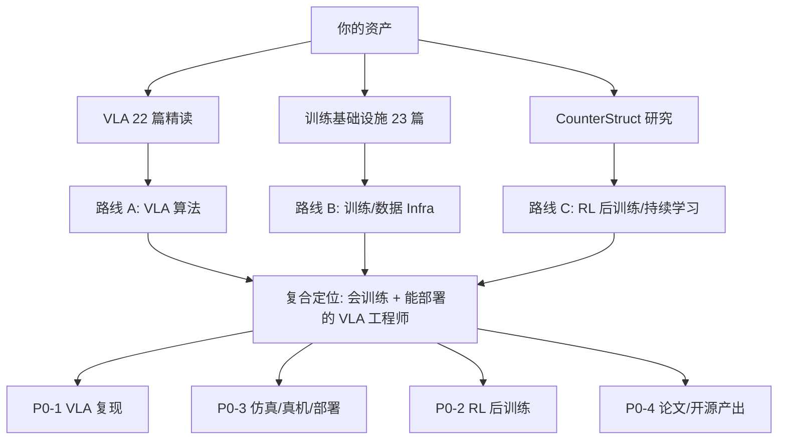

# 学习优先级报告

> [!abstract] 先给结论
> **主攻：VLA / 具身大模型（P0-1）+ RL 后训练（P0-2）+ 仿真/真机部署闭环（P0-3）+ 研究论文产出（P0-4）。**
> **差异化：训练 / 数据 Infra（B 线）**——这是你已有资产（[[03_训练基础设施论文精讲|训练基础设施 23 篇]]、[[02_CounterStruct_v2.1_纯实验方案_正式版|CounterStruct]]）最有杠杆的地方。
> **只到「能对话」：C++/ROS 工程、运动学/MPC/WBC。** **不学：传统步态/WBC 深水区、标定、嵌入式、算子。**
>
> 一句话定位：**「会训练、能部署、有研究产出的 VLA 工程师」**，而不是「什么都补一点的算法应届生」。

## 一、这份优先级是怎么排的（方法论）

优先级 = **需求强度 × 杠杆率 ÷ 学习成本**，三个因子都来自数据与你的笔记盘点：

| 因子 | 定义 | 数据来源 |
|---|---|---|
| **需求强度** | 该技能在 JD 中的覆盖率，**校招/实习子集权重 0.65，全量 0.35**（因为你走校招通道） | [[01_JD数据总览#三、技能覆盖率（这张表是学习优先级的原始依据）\|技能覆盖率表]] |
| **杠杆率** | 该技能能否放大你**已有资产**（研究、笔记、代码），以及多久能变成可展示产出 | 第二节资产盘点 |
| **学习成本** | 从当前水平到「能写进简历、能讲 5 分钟」所需周数 | 第三节逐项估计 |

> [!note] 为什么不按「覆盖率」直接排序
> 覆盖率最高的是 Python 59%、C++ 56%、部署 54%——但 Python/PyTorch 你已具备（杠杆率低，学它没有边际收益），C++ 是长期工程（成本高）。**排在最前面的是「需求高 × 你有基础 × 12 周能出成果」的交集**，也就是 VLA、RL 后训练、部署/仿真闭环、论文。

## 二、你的资产盘点（决定了杠杆率）

### 2.1 已具备（可直接复用，别再从头学）

| 资产 | 位置 | 对求职的用法 |
|---|---|---|
| **VLA 22 篇精读**（含每篇的 `model.py` 代码笔记） | [[01_具身智能论文精讲]]、[[01_OpenVLA]]、[[02_π0]]、[[01_GR00T N1]]、[[01_RT-2]]、[[01_ACT]]、[[01_Diffusion Policy]]、[[01_Octo]]、[[01_SimpleVLA-RL]]、[[01_World Models Survey]] 等 | 直接支撑 P0-1：你比 90% 候选人更懂 VLA 家族。**缺的只是「复现 + 数字」** |
| **训练基础设施 23 篇** | [[03_训练基础设施论文精讲]]、[[01_Mixed Precision Training]]、[[01_Megatron-LM]]、[[01_ZeRO]]、[[01_FSDP]]、[[01_FlashAttention]]、[[01_LoRA]]、[[01_nano-vllm 源码剖析]] | 直接支撑 B 线：智元「预训练 Infra / 训练效率」实习、光轮、字节数据平台岗 |
| **研究与实验能力** | [[00_CounterStruct_v2.1_方案导读_逐章讲解]]、[[02_CounterStruct_v2.1_纯实验方案_正式版]]、[[01_In-Place_TTT_X光]] | 直接支撑 P0-4：一篇可讲的研究工作 + 转具身叙事 |
| **面试基础 32 题** | [[00_Sharpa面试学习导航]]（矩阵乘/TopK/图搜索/坐标系/世界模型/Attention/PPO-GRPO/流匹配） | 直接支撑面试；其中 [[09_流匹配与动作生成]] 正好是 π0 的核心 |
| **数学 / 408 底座** | `01_数学/01_高等数学` 等、`03_计算机系统/01_数据结构`、`03_计算机系统/03_操作系统` | 八股与手撕代码兜底，不用再系统刷 |
| **深度学习面试题** | [[01_深度学习面试题]] | 面试前 3 天过一遍 |

### 2.2 明确缺口（按紧急度）

| 缺口 | 证据 | 严重度 |
|---|---|---|
| **没有跑通过任何一个机器人策略**（仿真或真机） | 部署 64%（校招）、仿真 55%、真机 48% | 🔴 致命：简历上无法证明「动手能力」 |
| **没有数据集/采集/评测经验** | 数据采集 19%、评测 23%（校招 33%） | 🔴 高：VLA 岗必问「数据怎么来」 |
| **C++ / ROS 工程弱** | C++ 56%、ROS 46%（社招更看重） | 🟡 中：可以边做项目边补，不必单独刷 |
| **没有具身方向的论文/开源产出** | 论文 64%（校招）、开源 25%（校招 39%） | 🟡 中：CounterStruct 可改造，但缺「具身」标签 |
| **运控/动力学理论** | 运控 33%、MPC/WBC 16% | 🟢 低：只到能对话 |
| **无真机硬件** | 真机 48%（校招） | 🟢 低：可用仿真 + 廉价桌面臂替代 |

## 三、P0 清单（12 周内必须交付，占 70% 精力）

### P0-1 · VLA 架构与动作表示：从「读懂」到「跑通」

| 项 | 内容 |
|---|---|
| **JD 证据** | VLA 全量 32%、**校招 67%**；VLM/多模态 41%/55%；具身大模型是 152 条里最大独家方向（63 条，41%）。代表岗：智元「具身大模型/VLA」、Sharpa「具身智能研究员（基座模型）」、它石「具身大模型算法工程师」、字节「多模态世界模型研究员」 |
| **目标水平** | ① 白板画出 π0 / OpenVLA / ACT / Diffusion Policy 的数据流与损失；② 讲清 action chunking、flow matching vs diffusion、离散 token vs 连续回归、co-fine-tuning、推理延迟与显存；③ 能跑 openpi / LeRobot 的预训练模型推理并做一次评测 |
| **你的起点** | 已读 22 篇 + 有 model.py 笔记（**领先**）；缺「跑起来 + 有数字」 |
| **要补的具体内容** | LeRobot 数据格式（`lerobot` dataset v3）、openpi 推理栈、LIBERO/SimplerEnv 评测协议、动作空间定义（joint / EE / delta）、真机部署链路（相机标定 → 推理 → 控制频率） |
| **产出** | `vla-repro` 仓库：4 个模型（π0 / OpenVLA / ACT / Diffusion Policy）在 LIBERO 或 SimplerEnv 上的成功率 + 推理延迟对比表 + 一篇 2000 字技术报告 |
| **验收** | 能在 3 分钟内讲清「π0 和 OpenVLA 的本质区别」，并现场跑一个 demo；报告里有真实数字（不是抄的） |
| **投入** | 2 周（第 1–2 周） |
| **资源** | [[07_学习资源库#二、论文清单（与你已有笔记的映射）|论文清单]]、openpi / LeRobot 官方仓库 |

### P0-2 · RL 后训练：PPO/GRPO → VLA 微调

| 项 | 内容 |
|---|---|
| **JD 证据** | 强化学习全量 49%、**校招 64%**；大模型微调 17%；代表：非夕「全身控制-强化学习」实习、字节 Seed、Sharpa RL 岗、上海 AI Lab |
| **目标水平** | ① 手推 PPO clip 目标与 GRPO 组内归一化；② 解释 on/off-policy、advantage、KL 约束、reward 设计（verifiable vs learned）；③ 能在小任务上跑一次 RL 微调（LeRobot + reward 或 Isaac Lab） |
| **你的起点** | [[08_PPO_GRPO与交叉熵]] 已覆盖理论；[[01_SimpleVLA-RL]] 已读；缺代码实操 |
| **要补** | 训练循环与 reward 工程、rollout 并行、KL/熵监控、benchmark 评测（成功率 vs 步数） |
| **产出** | 在某一环境（LIBERO 或 Isaac Lab 小任务）做「SFT → RL 微调」对照实验，报告提升幅度与失败案例 |
| **验收** | 能解释「为什么 RL 微调会退化」「reward hack 怎么发现」，并能复现一次曲线 |
| **投入** | 1.5 周（第 3–4 周） |

### P0-3 · 工程闭环：仿真 → 真机 → 部署（**最大缺口，也是最大加分项**）

| 项 | 内容 |
|---|---|
| **JD 证据** | 部署/推理优化 54%（**校招 64%**）、仿真/sim2real 54%（55%）、真机 41%（48%）、ROS 46%、Isaac Sim/Lab 28%、MuJoCo 22%。几乎每条 VLA JD 都有一句「有真机部署经验者优先」 |
| **目标水平** | ① Linux/Docker/Git 日常；② Isaac Lab 或 MuJoCo 跑通一个 manipulation/locomotion 任务；③ ROS2 基础（node/topic/service/action、tf2、ros2_control 概念）；④ ONNX 导出 + TensorRT 或量化，测一版延迟；⑤ 遥操作采集 50–100 条 demo 并训练 |
| **你的起点** | 零（这是主要差距） |
| **要补** | 仿真环境搭建、相机/手眼标定概念、数据采集流程、部署链路、延迟/吞吐优化 |
| **产出** | **项目 1（主线）：桌面抓取/开抽屉端到端**——自采或开源数据 → 训练 π0/ACT → 仿真评测 → （可选）廉价桌面臂真机演示视频 |
| **验收** | 有视频 + 成功率数字 + 失败分析；能回答「sim2real gap 怎么处理」 |
| **投入** | 3 周（第 5–7 周） |
| **资源** | [[07_学习资源库#三、代码库与工具（照抄能跑）|代码库清单]]（LeRobot / IsaacLab / ManiSkill / MuJoCo Playground） |

### P0-4 · 研究与论文产出：把 CounterStruct 变成具身资产

| 项 | 内容 |
|---|---|
| **JD 证据** | 论文/顶会 48%（**校招 64%**）；硕士要求 84/152 条；代表：字节 Seed、上海 AI Lab、千寻「预训练算法工程师」、之江「博士后」 |
| **目标水平** | ① 讲清自己的研究工作（动机 / 方法 / 实验 / 局限）5 分钟版 + 15 分钟版；② 有 1 个公开产出（arXiv / workshop / 开源仓库）；③ 了解 CoRL / ICRA / IROS / CVPR / NeurIPS 的投稿节奏与口味 |
| **你的起点** | 有完整方案与实验设计（v2.1），**缺投稿与具身标签** |
| **要补** | 把 CounterStruct 的「持续学习 + 固定容量 + 结构动作价值」迁移到具身场景：① 机器人策略的持续学习（多任务顺序学习、灾难遗忘）；② VLA 的参数高效后训练（LoRA / 结构稀疏）。**这两个叙事都能直接对上「具身基础模型」岗** |
| **产出** | ① CounterStruct → 具身迁移的小实验（哪怕只在 LIBERO 多任务上）；② arXiv 预印本或 workshop 摘要；③ 开源仓库 + README |
| **验收** | 面试官问「你的研究和机器人有什么关系」时，能在 2 分钟内给出有数据支撑的答案 |
| **投入** | 持续（第 8 周集中写，之后每周 4h） |

## 四、P1 清单（能对话、能改代码，占 20% 精力）

| # | 技能 | JD 证据 | 学到什么程度 | 投入 | 何时学 |
|---|---|---|---|---|---|
| P1-1 | **C++ 工程** | 全量 56%、社招 60%、校招 45% | 能读懂并修改开源 C++ 代码；手写 200 行无 bug；掌握内存/多线程/模板基础；不强求算法竞赛水平 | 2 周（穿插） | 第 5–8 周 |
| P1-2 | **ROS2** | 全量 46%、上海 48% | 能写 node、理解 topic/service/action、launch、tf2、ros2_control 概念；能在真机/仿真跑通一条链路 | 1 周 | 第 6 周 |
| P1-3 | **运动学 / 动力学 / MPC / WBC** | 运控 33%、MPC/WBC 16%、社招 35% | 理解而非精通：正逆运动学、雅可比、PD/阻抗/导纳控制、MPC 基本思想、WBC 是什么。能读懂运控 JD、能和非运控岗面试官对话即可 | 1.5 周 | 第 9 周 |
| P1-4 | **数据引擎 / 数据闭环** | 数据采集 19%、评测 23%（校招 33%） | 会设计采集流程（遥操作）、清洗与格式转换、训练/评测切分、指标定义；懂 LeRobot / OXE / DROID 数据格式 | 1 周 | 第 6–7 周（并入项目 1） |

> [!tip] C++ 不要从「刷题」入手
> JD 里的 C++ 是「能维护机器人系统」，不是「会做算法题」。最省力路径：**用 C++ 改一个开源项目**（如 LeRobot C++ 推理、ROS2 节点），比刷 300 道题有用。面试手撕代码用 Python 即可，除非岗位明确 C++ 机考。

## 五、P2 清单（知道概念，占 10% 精力）

| 技能 | JD 证据 | 学到什么程度 | 说明 |
|---|---|---|---|
| 世界模型 / WAM | 18%（校招 33%） | 读 [[01_World Models Survey]] + 2 篇（Cosmos、FastWAM）；懂「用视频预测做规划」与「latent action」 | 上升期方向，面试加分但不作为主线 |
| 感知 / 3D 视觉 | 8 条（5%）、SLAM 11% | 点云/相机模型/标定概念；不改行 | 除非投摩尔线程/地平线类岗 |
| 灵巧手 / 触觉 | 16%（灵巧手/抓取）、13% 触觉 | 知道 Sharpa/因时/戴盟在做什么，能聊 | 目标公司含 Sharpa 时可加深 |
| 自动驾驶端到端 | 8 条（5%） | BEV/端到端规划/闭环评测概念；VLA 自驾可迁移 | 备选赛道 |
| CUDA / 算子 | 11% | 能读 kernel、会用 `torch.compile`/TensorRT 即可 | 路线 B 的加分项，不必写 kernel |

## 六、反面清单（明确不做的方向）

| 不做 | 理由（数据） |
|---|---|
| 传统步态控制 / WBC 深水区 | 运控独家 18 条（12%），且校招仅 2 条、社招要求 3 年以上实机；投入产出比最低 |
| 多传感器标定 / 手眼标定专精 | 13%，且多在社招硬件岗；项目里「会做」即可 |
| 嵌入式 / RTOS / MCU | 13%，偏硬件岗，与算法岗面试无关 |
| 芯片算子 / CUDA kernel 开发 | CUDA 11%，仅芯片公司；你的 infra 优势在「用」不在「写 kernel」 |
| 纯强化学习理论（样本复杂度等） | 面试只问 PPO/GRPO 直觉与工程细节 |
| 从零学一门新语言（如 Rust） | 无 JD 证据 |
| 盲目刷 LeetCode 500 题 | 只有部分公司机考；手撕代码高频在矩阵/排序/图搜索/DP，[[00_Sharpa面试学习导航\|Sharpa 32 题]] 已覆盖大半 |

## 七、三条路线对比与决策

| 维度 | **A · VLA 算法** | **B · 训练/数据 Infra** | **C · RL 后训练/仿真** |
|---|---|---|---|
| 岗位量 | 独家 63 条（41%），校招 22/33 | 直接岗少（智元 Infra/训练效率、光轮、字节数据平台、寒武纪），但**每条 VLA 岗都隐含需要** | RL 独家 21 条 + 75 条提及（49%）；校招 64% |
| 薪资 | 30–60K（专家上限 200K） | 30–60K；实习 500–800/天（光轮最高） | 30–60K |
| 你的距离 | 近（读了 22 篇，缺复现） | **最近**（infra 笔记最全） | 中（理论有，工程缺） |
| 竞争 | 激烈（985 硕 + 论文扎堆） | **低**（会训练又懂具身的少） | 中 |
| 12 周可行性 | 中高 | 高 | 中 |
| 决策 | **主线**（简历定位） | **差异化**（面试杀手锏 + 实习敲门砖） | 备选（并入 P0-2） |

> [!success] 推荐定位（一句话简历主线）
> **「具身基础模型的训练与后训练工程师」**：能复现/训练 VLA，能做 RL 后训练，能把模型部署到仿真与真机，有持续学习方向的研究产出。
> 投 A 类岗时突出「懂模型 + 能落地」；投 B 类岗时突出「训练框架 + 数据闭环 + 推理优化」。两边都不虚。

## 八、能力自测表（30 项，0–3 分）

> 评分标准：0 = 没接触；1 = 看得懂但写不出；2 = 能改开源代码跑通；3 = 能从零实现并讲清权衡。
> 目标：**P0 项 ≥ 2.5，P1 ≥ 2，P2 ≥ 1**。低于目标的项直接对应到 [[04_12周学习路径]] 的周次。

| # | 能力 | 现状（自评） | 目标 | 对应 P |
|---|---|---|---|---|
| 1 | 讲清 π0 的 flow matching 动作生成 | 2 | 3 | P0-1 |
| 2 | 讲清 OpenVLA 的离散 action token 与训练 | 2 | 3 | P0-1 |
| 3 | ACT 的 chunking + CVAE 结构 | 2 | 3 | P0-1 |
| 4 | Diffusion Policy 与 flow 的区别与取舍 | 2 | 3 | P0-1 |
| 5 | 跑通 openpi / LeRobot 推理 | 0 | 3 | P0-1 |
| 6 | 用 LIBERO / SimplerEnv 评测并报成功率 | 0 | 3 | P0-1 |
| 7 | LeRobot dataset v3 格式与加载 | 0 | 3 | P0-3 |
| 8 | 遥操作采集 50+ 条 demo | 0 | 2 | P0-3 |
| 9 | Isaac Lab 跑通一个任务 | 0 | 2 | P0-3 |
| 10 | MuJoCo 建模/仿真 | 1 | 2 | P0-3 |
| 11 | ROS2 node/topic/action 开发 | 0 | 2 | P1-2 |
| 12 | ONNX 导出 + TensorRT/量化加速 | 0 | 2 | P0-3 |
| 13 | 相机模型/手眼标定概念 | 1 | 2 | P1-3 |
| 14 | PPO clip 推导 + 实现 | 2 | 3 | P0-2 |
| 15 | GRPO 组内归一推导 + 实现 | 2 | 3 | P0-2 |
| 16 | RL 微调 VLA（SFT→RL）跑一次 | 0 | 2 | P0-2 |
| 17 | reward 设计与 reward hack 识别 | 1 | 2 | P0-2 |
| 18 | sim2real gap 与 domain randomization | 1 | 3 | P0-3 |
| 19 | 多卡训练（FSDP/DeepSpeed） | 2 | 2 | P1（已有） |
| 20 | 混合精度/梯度检查点调参 | 2 | 2 | P1（已有） |
| 21 | VLA 推理延迟优化（量化/蒸馏） | 1 | 2 | P0-3 |
| 22 | 数据清洗/切分/指标设计 | 1 | 2 | P1-4 |
| 23 | C++ 读改开源代码 | 0 | 2 | P1-1 |
| 24 | 多线程/内存模型 | 1 | 2 | P1-1 |
| 25 | 正逆运动学 + 雅可比 | 1 | 2 | P1-3 |
| 26 | PD/阻抗控制 | 1 | 2 | P1-3 |
| 27 | MPC 基本思想 | 1 | 1 | P1-3 |
| 28 | 世界模型/视频预测规划 | 1 | 1 | P2 |
| 29 | 简历 3 个项目各讲 5 分钟 | 1 | 3 | P0-4 |
| 30 | 英文技术表达（海外/大厂面试） | 2 | 2 | — |

## 九、风险与纠偏

| 风险 | 信号 | 纠偏动作 |
|---|---|---|
| **只读不写**（最大风险） | 第 4 周仍没有可运行仓库 | 每周必须交一个 demo（哪怕 30 秒视频）；「读论文」时间上限 1.5h/天 |
| 追求「完美论文」而不敢投 | 第 8 周还没 arXiv | 先发 workshop / arXiv 预印本，再冲正式会议 |
| 项目太散 | 同时开 3 个项目都没结果 | 主线只保留 1 个（P0-3 项目 1），其余降级为「实验」 |
| 过度补 C++/八股 | 花 3 周刷题，项目停工 | C++ 只在项目里学；八股放在面试前 2 周 |
| 等「准备好」再投 | 12 月还没投过一份简历 | 第 4 周起每 2 周至少投 3 家；面试倒逼学习 |
| 只投上海 | offer 面窄 | 北京/深圳/杭州各留 3 家（字节、千寻、星尘、自变量、之江） |

---
相关：[[00_求职总览]] · [[04_12周学习路径]] · [[05_分方向专项路线]] · [[01_JD数据总览]] · [[06_简历与面试策略]]
