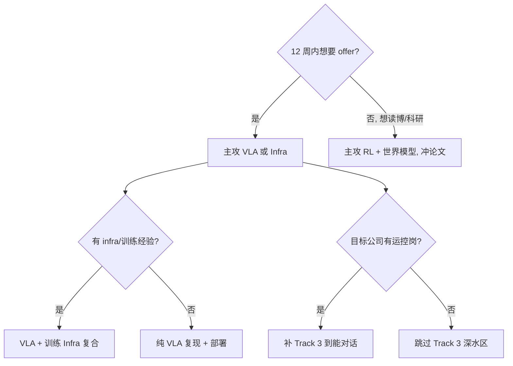

# 分方向专项路线

> [!info] 怎么用
> 先按 [[03_学习优先级报告#七、三条路线对比与决策|三条路线对比]] 选 **1 条主攻**（默认 VLA），再把本页对应 Track 当「知识树 + 项目 + 面试题」清单。
> 每条 Track 都标了 **JD 证据**——决定投入前先看它在 152 条里的真实占比，别被「听起来很前沿」带跑。

## 总览

| Track | 方向 | 独家条数 | 提及率 | 你的距离 | 建议 |
|---|---|---|---|---|---|
| **1** | VLA / 具身大模型 | **63（41%）** | VLA 32%、VLM 41% | 近（读得多、跑得少） | **主攻** |
| **2** | 具身 RL / 后训练 | 21（14%） | RL 49% | 中（理论有、工程缺） | **主攻（并入 P0-2）** |
| **3** | 运动控制 / 全身控制 | 18（12%） | 运控 33%、MPC/WBC 16% | 远 | 只到「能对话」 |
| **4** | 规划 / 导航 | 15（10%） | 规划 25%、SLAM 11% | 远 | 不主攻，概念级 |
| **5** | 仿真 / 数据 / 世界模型 | 7（5%） | 仿真 54%、数据 19%、世界模型 18% | 中 | **项目必用，方向次选** |
| **6** | 灵巧操作 / 触觉 / 感知 | 7 + 8 | 灵巧/抓取 16%、触觉 13% | 远 | 目标含 Sharpa 时加深 |

---

## Track 1 · VLA / 具身大模型（主攻）

### JD 证据

- **63/152 条独家方向（41%）**，校招 33 条里 22 条。
- 公司：智元 6、字节 5、Sharpa 3、它石 2、穹彻 2、光轮 2、人形机器人（上海）2、非夕 2、千寻、自变量、跨维、原力灵机、星尘、无界、行元、具身慧智、大晓、数字华夏、视比特、阿里、美团、拼多多、百度、华为、上海 AI Lab、之江、鹏城、北人形。
- 薪资：30–60K 为主，专家岗上限 100–200K。

### 知识树（从下往上）

```
第 5 层 部署与评测：真机延迟、成功率协议、泛化测试、sim2real
第 4 层 后训练：SFT 数据配比、RL 微调（PPO/GRPO）、持续学习、LoRA/结构稀疏
第 3 层 训练配方：预训练/co-fine-tune、数据规模与 scaling、多卡并行、混合精度
第 2 层 动作生成：flow matching / diffusion / 离散 token / action chunking / 动作表示
第 1 层 基座：VLM（PaliGemma / Qwen-VL / SigLIP）、语言指令、视觉编码器、多视角
第 0 层 数据：OXE / DROID / AgiBotWorld / 自采；语言标注、动作对齐、质量筛选
```

### 必读（你已有笔记 ✓）

| 主题 | 笔记 | 读完要能回答 |
|---|---|---|
| 领域全景 | [[01_具身智能论文精讲]] | VLA 三代演进（RT-2 → OpenVLA → π0/GR00T） |
| 奠基 | [[01_PaLM-E]]、[[01_RT-2]]、[[01_Open X-Embodiment & RT-X]] | 为什么需要 OXE？co-fine-tuning 怎么做的 |
| 动作生成 | [[01_Diffusion Policy]]、[[01_ACT]]、[[01_Octo]] | diffusion vs flow vs chunking 的取舍 |
| 开源 VLA | [[01_OpenVLA]]、[[02_π0]]、[[01_GR00T N1]] | 离散 token 与连续流的实现差异 |
| 后训练 | [[01_SimpleVLA-RL]]、[[01_FLOWER]] | RL 微调会退化吗？怎么缓解 |
| 轻量/加速 | [[01_X-VLA]]、[[01_VLA-Adapter]]、[[01_Motus]]、[[01_HybridVLA]] | 哪些设计能降推理成本 |
| 世界模型 | [[01_Cosmos Policy]]、[[01_FastWAM]]、[[01_World Models Survey]] | 世界模型和策略的关系 |
| 流匹配数学 | [[09_流匹配与动作生成]] | 从 diffusion 到 flow 的推导 |

### 最小项目（P0-1 / 项目 1）

1. **复现对比**（W1–W2）：π0 / OpenVLA / ACT / Diffusion Policy 在 LIBERO（或 SimplerEnv）上的成功率、推理延迟、显存。
2. **自采微调**（W5–W7）：50–100 条遥操作/开源数据 → 微调 π0 或 ACT → 评测 → 失败分析。
3. **加分**：把 π0 的推理加速一版（量化 / TensorRT），画「延迟-成功率」曲线。

### 面试考点（高频 12 题）

1. π0 的 flow matching 目标函数怎么写的？推理几步采样？
2. OpenVLA 为什么把动作离散化成 token？有什么缺点？
3. ACT 的 CVAE 与 action chunking 解决什么问题？
4. Diffusion Policy 与 flow matching 的异同？哪个更适合高频控制？
5. action chunk 大小怎么选？太大/太小分别会怎样？
6. 训练数据要多少条？如何配比预训练/微调数据？
7. co-fine-tuning 与 LoRA 的取舍？
8. 如何评测一个 VLA？（成功率口径、随机性、泛化集）
9. 真机部署延迟预算怎么拆？（视觉编码 / 推理 / 通信 / 控制）
10. VLA 的失败模式有哪些？（长尾、指令歧义、遮挡、动力学误差）
11. 世界模型在策略里的三种用法？
12. 持续学习在具身里为什么难？（分布漂移 + 灾难遗忘 + 硬件本体差异）

---

## Track 2 · 具身 RL / 后训练（主攻，并入 P0-2）

### JD 证据

- **RL 提及 49%**（校招 64%，全方向第二高）。
- 独家 21 条：宇树、优必选、逐际动力、腾讯、小米、商汤、帕西尼、上海 AI Lab、中科院自动化所、Figure、1X、Skild。
- 非夕「全身控制-强化学习」实习、字节 Seed、Sharpa RL 岗。

### 知识树

```
应用层：VLA RL 微调（RLHF/GRPO/reward model）、sim2real、domain randomization
算法层：PPO / GRPO / SAC / DDPG；off-policy vs on-policy；advantage 估计
环境层：Isaac Lab / MuJoCo / ManiSkill；奖励塑形；课程学习
理论层：MDP、策略梯度、方差缩减、KL 约束、探索
```

### 必读

| 笔记/材料 | 用途 |
|---|---|
| [[08_PPO_GRPO与交叉熵]]、[[01_In-Place_TTT_X光]] | 理论 + 后训练范式 |
| [[01_SimpleVLA-RL]]、[[01_FLOWER]] | VLA 上做 RL 的具体做法 |
| CS285（Berkeley） | 系统补齐 RL 理论 |
| CleanRL / Isaac Lab 示例 | 代码实现 |

### 最小项目（P0-2）

- 从零实现 PPO → MuJoCo 小任务出学习曲线。
- SFT 模型 + RL 微调对照实验（LIBERO 或 MuJoCo 操作任务）。
- 加分：domain randomization 对照（光照/摩擦/质量扰动下的成功率）。

### 面试考点（10 题）

1. PPO 的 clip 为什么能稳定训练？GAE 怎么算？
2. GRPO 与 PPO 的区别？为什么省 value model？
3. on-policy 数据效率低，工业界怎么缓解？（并行环境/off-policy 修正）
4. reward 怎么设计？稀疏奖励怎么办？（塑形/课程/HER）
5. sim2real gap 的来源与三种对策？
6. RL 微调 VLA 为什么会遗忘/退化？怎么防？
7. 如何判断训练不收敛是 reward 问题还是优化问题？
8. 多任务 RL 的梯度冲突怎么处理？
9. RL 与模仿学习在机器人上的分工？
10. 如何设计一个「真机也能跑」的 RL 实验？

---

## Track 3 · 运动控制 / 全身控制（只到能对话）

### JD 证据

- 独家 18 条（12%），**校招仅 2 条**；社招 35% 提运控。
- 公司：智元 2、Sharpa 2、开普勒 2、傅利叶、星动纪元、银河通用、星海图、灵巧智能、章鱼动力、瑆爝、字节 1。
- 岗位要求高频词：C++ 71%、ROS 63%、动力学/阻抗、MPC/WBC。

### 知识树（★ = 必会，☆ = 知道即可）

```
★ 正/逆运动学（DH、雅可比、奇异点）
★ PD / 阻抗 / 导纳控制；力矩控制概念
★ 轨迹生成（多项式、样条、时间最优）
☆ MPC（预测模型、约束、二次规划）
☆ WBC（分层任务、QP、零空间）
☆ 步态与平衡（ZMP、LIPM、接触力分配）
☆ 状态估计（IMU、编码器、滤波器）
```

### 最小项目（W9）

- MuJoCo 下实现：关节空间 PD 跟踪 → 阻抗控制 → 简单 MPC 轨迹跟踪（用 `mujoco` + `scipy` 即可）。
- 读一遍 [[05_分方向专项路线#Track 3 · 运动控制 / 全身控制（只到能对话）|运控 JD]] 的任职要求，把不懂的词查一遍。

### 面试考点（只求不露怯）

1. 阻抗控制与 PD 控制的区别？什么时候用阻抗？
2. 雅可比矩阵奇异怎么处理？
3. MPC 与 PID 的本质区别？实时性怎么保证？
4. WBC 的分层结构与 QP 形式？
5. 人形机器人为什么难控制？（欠驱动、接触、平衡）

> [!warning] 不要陷进去
> 运控是 5 年工程积累的方向。你只需要「能听懂、能问出好问题」，不需要手推 WBC 的 QP。把时间留给 P0。

---

## Track 4 · 规划 / 导航（概念级）

### JD 证据

- 独家 15 条（10%）：众擎、加速进化、钛虎、具身慧智、库卡、节卡、思岚、摩尔线程、穹彻、非夕、智元、Sharpa。
- 规划 25%、SLAM 11%、导航 25%（上海 31%）。

### 知识树

```
★ 采样规划（RRT / RRT*）、图搜索（A* / Dijkstra）
★ 轨迹优化（CHOMP / TrajOpt 思想）、时间参数化
☆ 移动导航栈（costmap、全局/局部规划）、SLAM 概念（视觉/激光）
☆ 抓取规划（GraspNet 类）、任务与运动规划（TAMP）
```

### 最小项目

- 用 MoveIt/pybullet 做一个「桌面物体抓取」的规划 demo（2–3 天即可，不必深）。
- 知道 `nav2` 的模块划分。

### 面试考点

1. RRT* 为什么渐进最优？与 PRM 的区别？
2. 轨迹优化怎么处理碰撞约束？
3. 具身智能里「端到端 VLA」和「传统规划」怎么结合？（高频开放题）

---

## Track 5 · 仿真 / 数据 / 世界模型（项目必用）

### JD 证据

- 独家 7 条，但**仿真提及 54%（校招 55%）、Isaac 28%、MuJoCo 22%**；数据 19%（校招 33%）；世界模型 18%（校招 33%）。
- 公司：智元 2、大疆、群核、百度、发那科、宁波星际动力；光轮智能（仿真数据）、字节（数据平台）值得单独关注。

### 知识树

```
仿真：Isaac Lab（GPU 并行）/ MuJoCo / ManiSkill / Gazebo / pybullet
数据：采集协议、遥操作、格式（LeRobot v3 / RLDS）、清洗、标注、评测集
世界模型：视频预测、latent action、WAM、Cosmos、Dreamer 系
工程：数据版本管理、训练/评测流水线、可复现性
```

### 最小项目（并入 P0-3）

- Isaac Lab 或 MuJoCo Playground 跑通一个任务，写出「环境搭建 → 训练 → 评测」全流程文档。
- 数据卡片：50–100 条数据的采集/清洗/切分/局限。
- 加分：合成数据（域随机化/纹理随机）对真实场景成功率的 ablation。

### 面试考点

1. Isaac Lab 与 MuJoCo 的取舍？（并行度、物理精度、生态）
2. 仿真到真机的 gap 怎么量化、怎么缓解？
3. 数据采集 1000 条和 100 条差在哪？怎么判断「够了」？
4. 世界模型训练目标是什么？如何用于规划？
5. 数据闭环怎么设计？（采集→训练→评测→badcase→再采集）

---

## Track 6 · 灵巧操作 / 触觉 / 感知（目标含 Sharpa 时加深）

### JD 证据

- 灵巧操作/触觉独家 7 条：Sharpa 4、因时、戴盟、智元；灵巧/抓取提及 16%、触觉 13%。
- 感知独家 8 条（5%）、SLAM 11%。

### 知识树

```
灵巧：多指手运动学、抓取分类（力闭合/形闭合）、dexterous manipulation
触觉：触觉传感原理（视触觉/压阻/电容）、触觉表征学习、力控闭环
感知：相机模型、点云、6D 位姿估计、手眼标定
```

### 最小项目

- 读 Sharpa 的产品与技术（SharpaWave），把 [[00_Sharpa面试学习导航|Sharpa 面经]] 的 Q07–Q11（坐标系/外参/预处理）复习一遍。
- 仿真里做一个简单抓取（平行夹爪）即可，不必碰灵巧手硬件。

### 面试考点

1. 6D 位姿估计的主流方法？
2. 手眼标定的原理（AX=XB）？
3. 触觉数据怎么表征、怎么和视觉融合？
4. 灵巧手为什么难？（高维动作空间、接触丰富、仿真不准）

---

## 选择决策树



---
相关：[[00_求职总览]] · [[03_学习优先级报告]] · [[04_12周学习路径]] · [[07_学习资源库]]
